## Introdução I {.nostretch}

Várias aplicações em Visão Computacional precisam estabelecer correspondências entre pontos de diferentes imagens

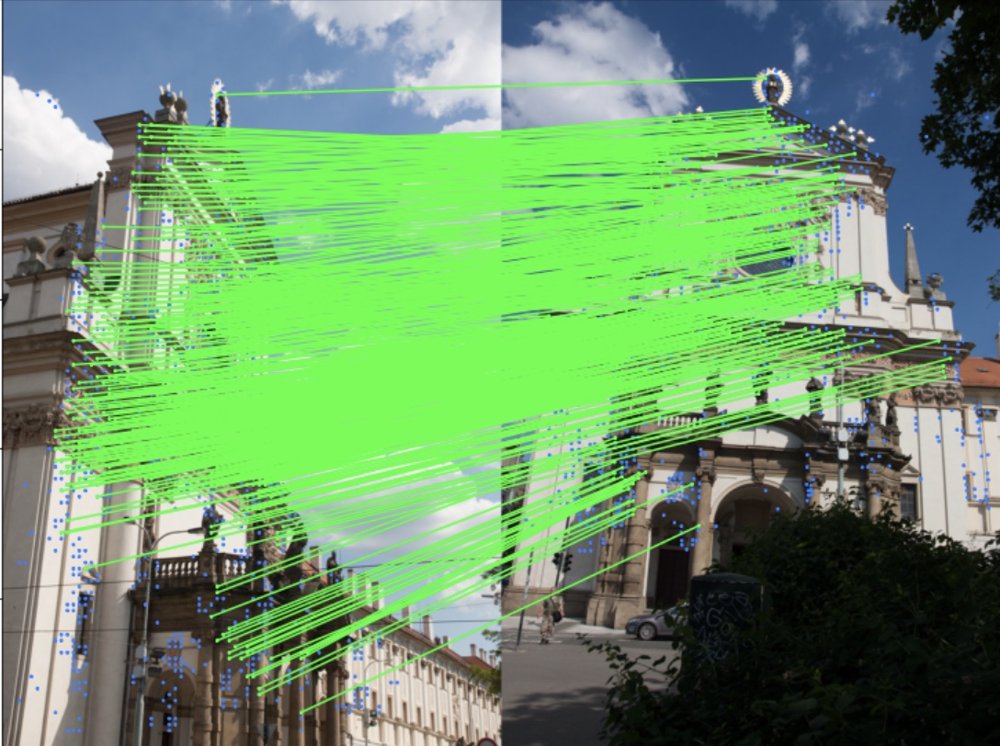{height=420 fig-align="center"}

Fonte da imagem: [Kornia](https://kornia.readthedocs.io/en/latest/applications/image_matching.html) [@korniaMatching]

---

## Introdução II

Possibilidades:

- *Template matching*: buscar uma janela em torno de cada ponto
- Fluxo óptico: calcular o deslocamento de cada ponto
- Casamento de descritores: estabelecer correspondências entre vetores

Como proceder?

---

## Casamento de Descritores I

Cada vetor descritor está em um espaço vetorial $n$-dimensional

- SIFT: $\mathbb{R}^{128}$
- SURF: $\mathbb{R}^{64}$
- FREAK: $\mathbb{R}^{512}$
- Etc

---

## Casamento de Descritores II {.smaller}

Para cada ponto/descritor $p_i$ da imagem $\mathbf{I}^{1}$, achar o descritor mais próximo:

- Calcular a distância Euclidiana entre $p_i$ e todos os pontos/descritores $p_j$ de $\mathbf{I}^{2}$
- A menor distância $d_k$ indicará o ponto $p_k$ que é a correspondência de $p_i$

$$
d_k = \operatorname*{argmin}_{k}\operatorname{dist}(p_i,p_j),
\qquad \forall p_i \in \mathbf{I}^{1},\ \forall p_j \in \mathbf{I}^{2}
$$

---

## Casamento de Descritores III {.nostretch}

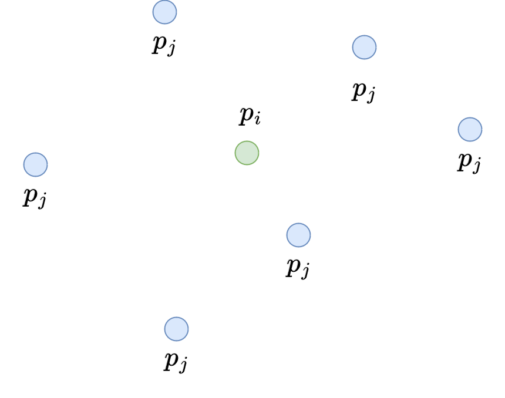{height=530 fig-align="center"}

---

## Casamento de Descritores IV {.nostretch}

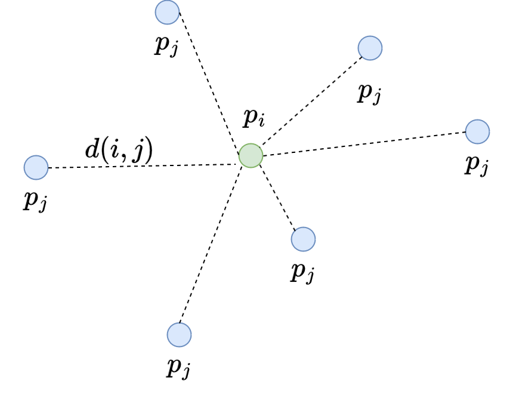{height=530 fig-align="center"}

---

## Casamento de Descritores V {.nostretch}

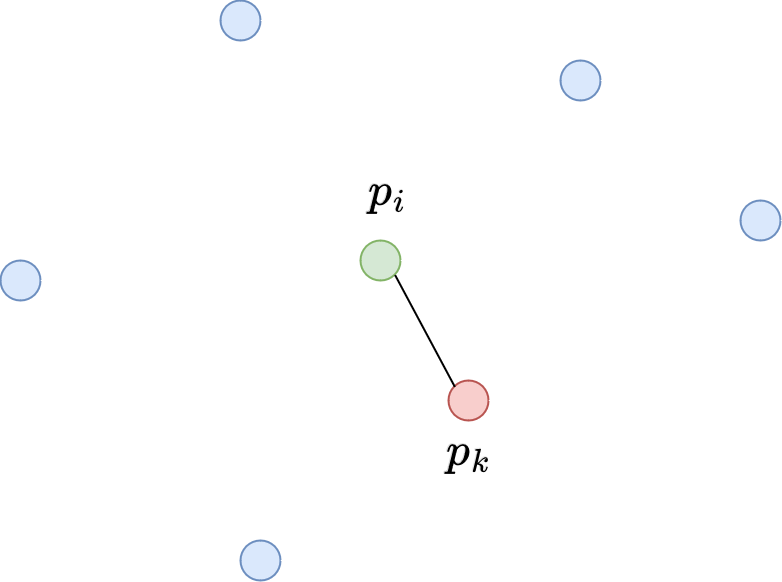{height=530 fig-align="center"}

---

## Casamento de Descritores: Problema I

Devido à natureza dos dados que originam o descritor, nem sempre o descritor mais próximo no espaço vetorial é uma correspondência correta

- Ruído, projeção perspectiva e iluminação alteram o descritor
- Resultado: vários casamentos incorretos

---

## Casamento de Descritores: Problema I – Solução I {.smaller}

Uma heurística aceita $p_k$ como correspondência de $p_i$ somente se a distância entre eles não exceder um limiar, ou seja:

$$
d_k < \tau
$$

Desvantagem: $\tau$ precisa ser ajustado para cada situação

---

## Casamento de Descritores: Problema I – Solução II {.smaller}

Uma segunda heurística aceita $p_k$ como correspondência de $p_i$ somente se a menor distância $d_k$ for menor que $k$ vezes a segunda menor distância $d_l$:

$$
d_k < k d_l
$$

Oferece bons resultados sem precisar de ajuste caso a caso; geralmente, $k=0.8$

---

## Casamento de Descritores: Problema II

O algoritmo de força bruta compara todos os descritores $p_i$ da imagem $\mathbf{I}^{1}$ com todos os descritores $p_j$ da imagem $\mathbf{I}^{2}$

O custo computacional é alto:

- Os descritores têm dimensão grande, como o SIFT, com 128 dimensões
- As imagens podem possuir muitos descritores

---

## Casamento de Descritores: Problema II – Solução I {.smaller}

Para reduzir o custo computacional da busca por correspondências, utiliza-se uma estrutura de dados:

- **K-D trees** (árvores K-D)
  - Particionam o espaço de $K$ dimensões dos descritores
  - SIFT: espaço de dimensão 128
- Nós da árvore:
  - Intermediários: conjunto de descritores
  - Folha: um único descritor

---

## K-D Tree {.nostretch}

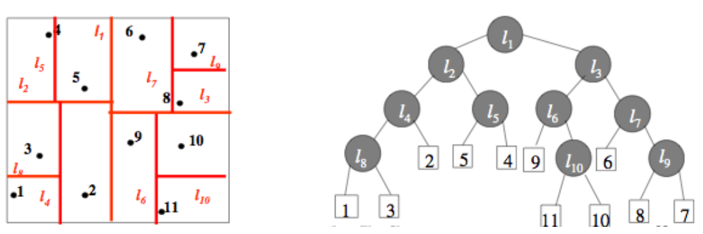{width=90% fig-align="center"}

Exemplo de árvore 2-D:

- Pontos no espaço estão em preto
- Nós da árvore estão em vermelho

Fonte: *Feature Matching*, Del Bimbo, Università degli Studi di Firenze [@delbimboFeatureMatching]

---

## K-D Tree: Ideia da Construção {.smaller}

- A raiz da árvore contém todos os descritores
- Uma dimensão é selecionada por nó para particionar o espaço em duas partes:
  - Metade dos pontos, com valor $< x$, forma um nó filho
  - A outra metade, com valor $\geq x$, forma outro nó filho
- O processo se repete até que o nó contenha um número de pontos menor que o máximo definido por nó
- Os descritores em uma dada partição serão nós folha na árvore

---

## K-D Tree: Construção I {.nostretch}

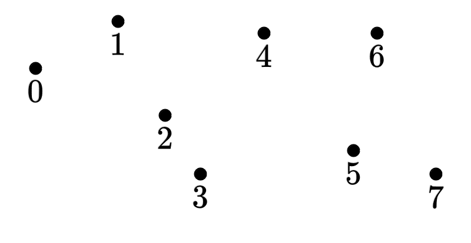{height=530 fig-align="center"}

---

## K-D Tree: Construção II {.nostretch}

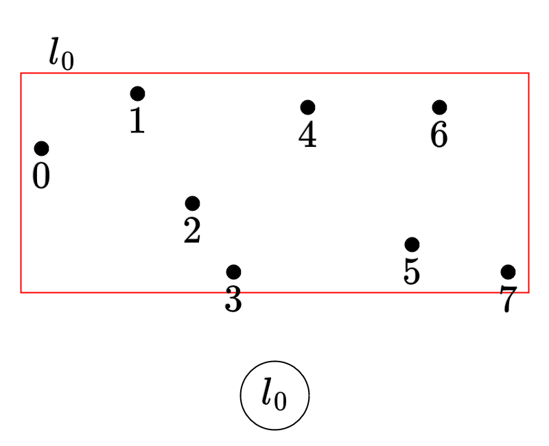{height=530 fig-align="center"}

---

## K-D Tree: Construção III {.nostretch}

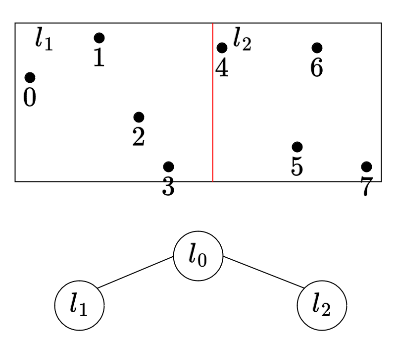{height=530 fig-align="center"}

---

## K-D Tree: Construção IV {.nostretch}

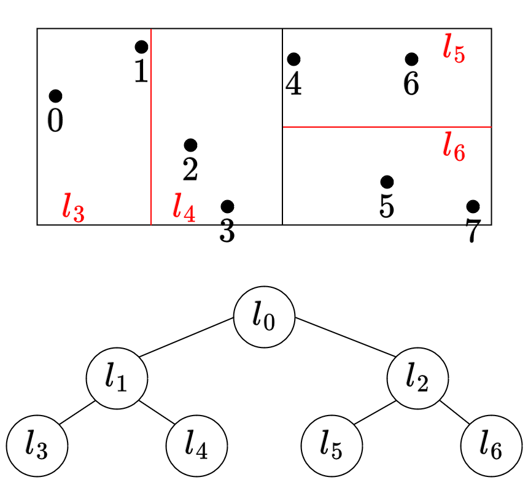{height=530 fig-align="center"}

---

## K-D Tree: Construção V {.nostretch}

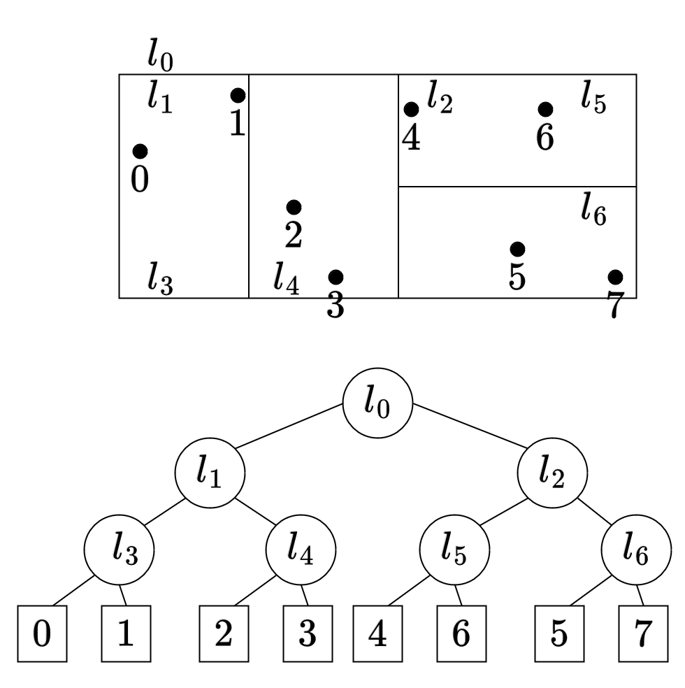{height=530 fig-align="center"}

---

## K-D Tree: Busca {.smaller}

Após a construção, a árvore K-D permite buscar o ponto/descritor $p_k$ mais próximo de $p_i$:

- A árvore é percorrida a partir da raíz, seguindo as
  dimensões que foram utilizadas para particionar o espaço
- O nó folha contendo o ponto mais próximo a $p_i$ deve ser
  encontrado. Este é o ponto mais próximo $p_k^{\prime}$ até então
- Novas buscas acontecem nas subárvores intersectadass pela 
  hipersfera firnada por $p_i$ e o raio $r$ que liga
  $p_i$ a $p_k^{\prime}$

---

## K-D Tree: Busca I {.nostretch}

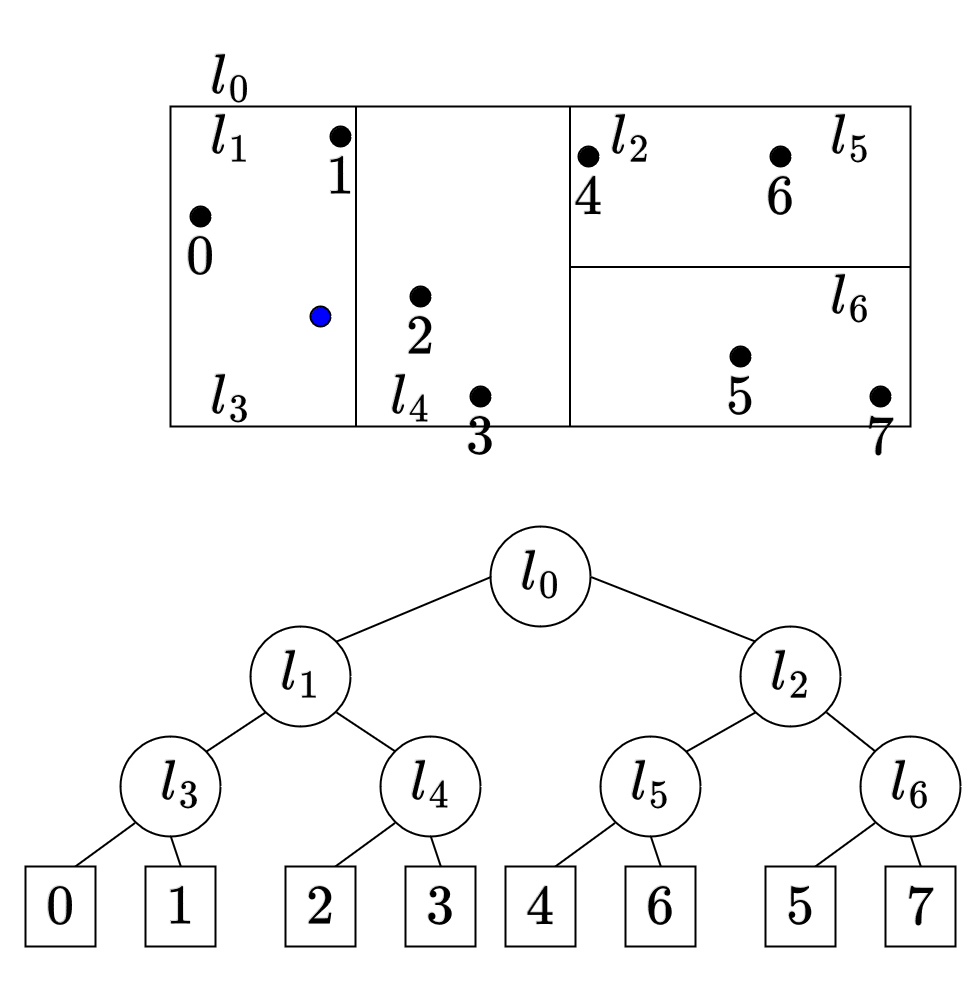{height=530 fig-align="center"}

---

## K-D Tree: Busca II {.nostretch}

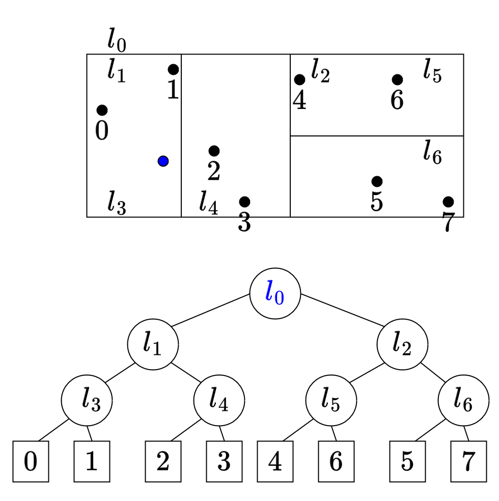{height=530 fig-align="center"}

---

## K-D Tree: Busca III {.nostretch}

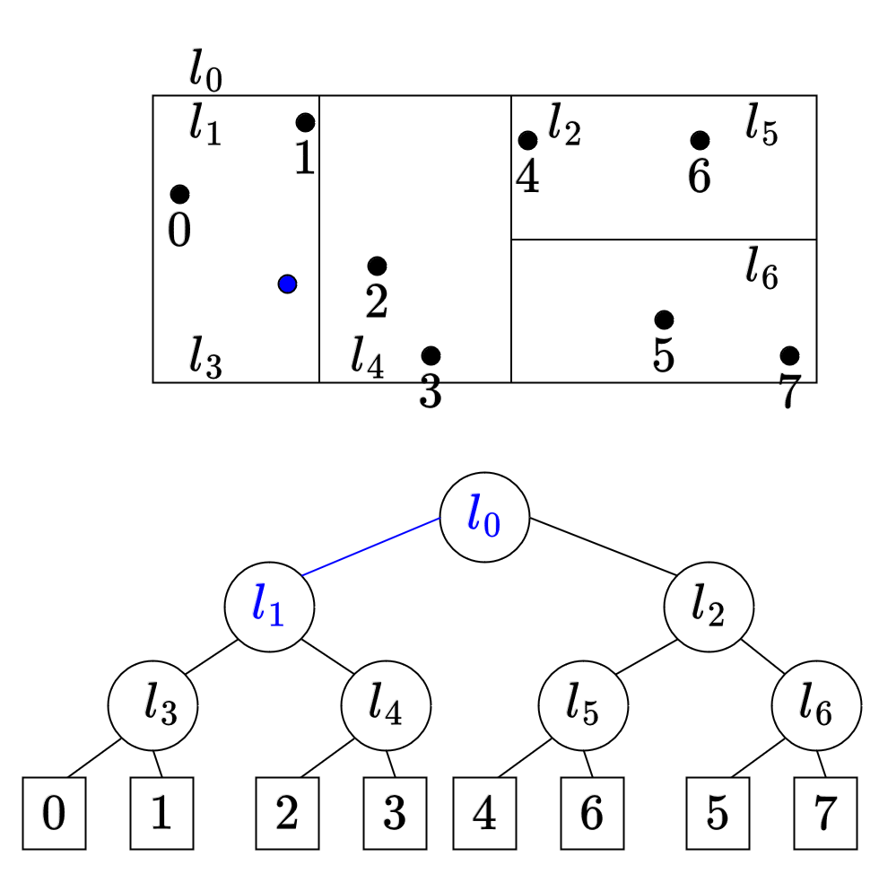{height=530 fig-align="center"}

---

## K-D Tree: Busca IV {.nostretch}

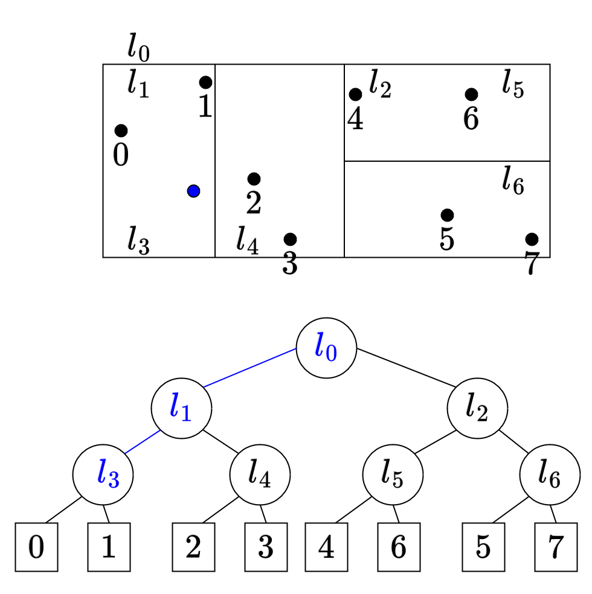{height=530 fig-align="center"}

---

## K-D Tree: Busca V {.nostretch}

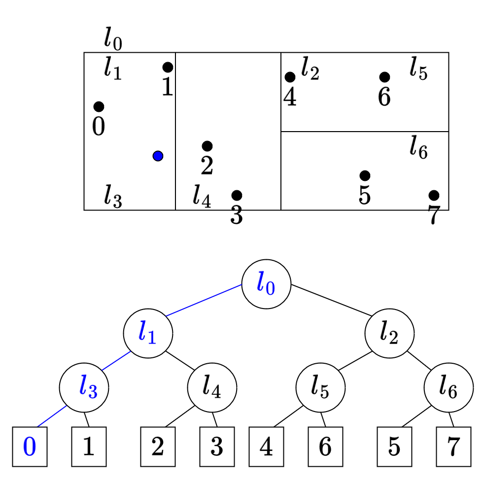{height=530 fig-align="center"}

---

## K-D Tree: Busca VI {.nostretch}

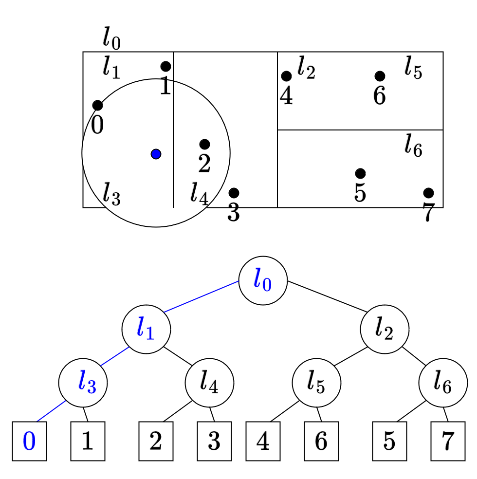{height=530 fig-align="center"}

---

## K-D Tree: Busca VII {.nostretch}

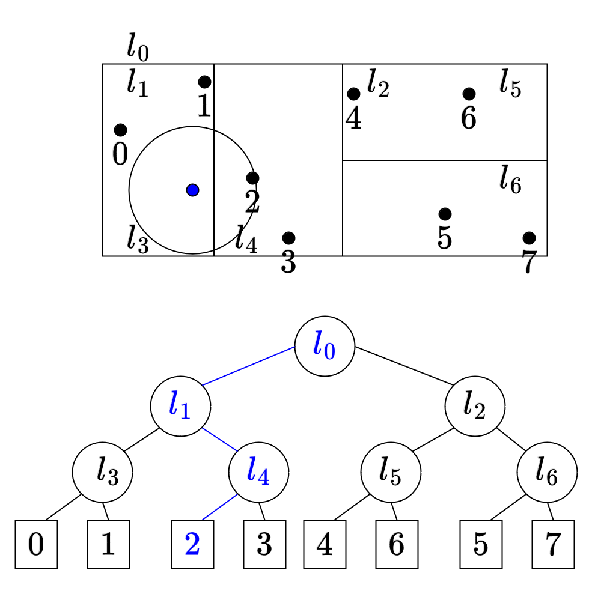{height=530 fig-align="center"}

---

## K-D Tree: Busca Aproximada {.smaller}

Para descritores de features em espaços de muitas dimensões, a busca exata com uma árvore K-D ainda não reduz suficientemente o custo computacional da busca por correspondências

- Solução: algoritmos aproximados [@silpaanan2008; @muja2014]
- Várias imagens podem ser inseridas na árvore K-D para buscar correspondências entre uma imagem e $N$ imagens, com $N$ pequeno
- Para $N$ elevado: *Bag of Visual Words* [@labbe2011]

---

## Funções da OpenCV

Funcionalidades da OpenCV relacionadas ao tópico da aula:

- `cv2.BFMatcher()`: busca exaustiva (força bruta)
- `cv2.FlannBasedMatcher()`: busca aproximada
- `match()`: encontra a melhor correspondência para cada descritor
- `knnMatch()`: encontra as $k$ melhores correspondências
   para cada descritor
- `radiusMatch()`: encontra correspondências dentro de um
   limite de distância

## Guia de leitura

- *Distinctive Image Features from Scale-Invariant Keypoints* [@lowe2004]
- *Optimised KD-trees for fast image descriptor matching* [@silpaanan2008]
- *Scalable Nearest Neighbor Algorithms for High Dimensional Data* [@muja2014]
- *Memory management for real-time appearance-based loop closure detection* [@labbe2011]

## Sumário

Nesta aula: casamento de descritores de features

- Casamento por força bruta e heurísticas
- Casamento por árvores K-D

---

## Referências {.smaller .scrollable}

::: {#refs}
:::
