## Introdução

Uma tarefa comum em aplicações de Visão Computacional é identificar algo específico em uma cena:

- Um objeto
- Uma classe de objetos, como carros

Em ambos os casos, podemos buscar diretamente por um padrão
específico de intensidades na imagem

---

## Introdução

Nesta aula, será estudada a técnica de **casamento por blocos**, conhecida na literatura como *template matching* ou *block matching*.

- A técnica busca um padrão específico de intensidade (pixels) em uma imagem
- O casamento é realizado entre uma imagem e um *template*
- Pode ser usada para localizar objetos específicos

---

## Template Matching {.nostretch}

::: {.columns}

::: {.column width="65%"}
Imagem:

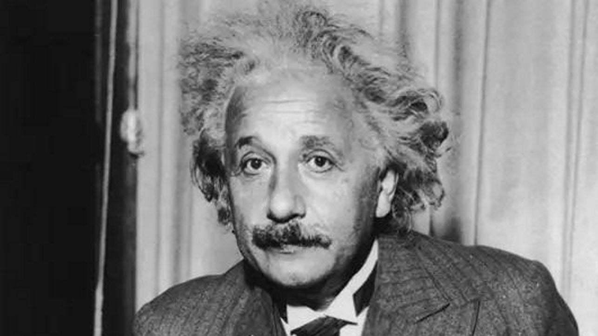{width=80%}
:::

::: {.column width="35%"}
Template:

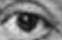{width=70%}
:::

:::

Dada uma imagem, achar um determinado padrão (template)

---

## Template Matching

Como proceder?

---

## Template Matching: ideia

1. Deslizar o padrão sobre a imagem e compará-lo com cada região
2. Contar quantos pixels são iguais
3. A posição com mais pixels iguais indica a região do padrão

---

## Template Matching: exemplo {.nostretch}

::: {.columns}

::: {.column width="65%"}
Cena:

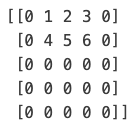{width=60%}
:::

::: {.column width="35%"}
Padrão:

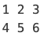{width=40%}
:::

:::

Dada uma imagem, achar um determinado padrão (template)

---

## Template Matching: exemplo {.nostretch}

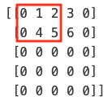{width=25%}
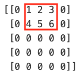{width=25%}
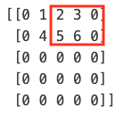{width=25%}

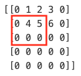{width=25%}
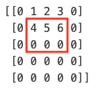{width=25%}
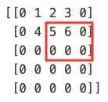{width=25%}

---

## Template Matching: exemplo {.nostretch}

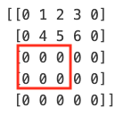{width=25%}
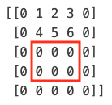{width=25%}
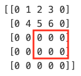{width=25%}

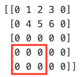{width=25%}
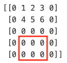{width=25%}
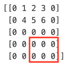{width=25%}

---

## Template Matching: resultado {.nostretch}

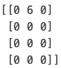{width=20% fig-align="center"}

Há algum problema com esta abordagem? Se sim, quais?

---

## Template Matching: resultado {.nostretch}

{width=20% fig-align="center"}

O template precisa ser exatamente igual à sua contraparte na imagem.
Isso torna o algoritmo pouco prático.

Como podemos melhorá-lo?

---

## Template Matching: métricas

É preciso uma métrica de comparação:

- Medida de similaridade entre blocos *patches* de imagens
- *Patches* são porções da imagem, também chamadas de blocos ou subimagens
- A métrica deve ser robusta a mudanças de intensidade causadas por ruído

---

## Template Matching: correlação {.nostretch}

Primeira métrica: **correlação normalizada** entre a janela da imagem $I_w$ e o *template* $T$

$$
corr'(x,y) = \frac{\sum I_w(x+k, y+l)T(k,l)}{\| I_w(x+k,y+l) \|\| T(k,l) \|},
$$

calculada para todas as posições $(k,l) \in w$ da janela da imagem centrada em $(x,y)$.

<!-- aqui é interessante colocar a imagem de uma janela na imagem -->

---

## Template Matching: correlação

Para mostrar que esta métrica fornece uma medida de similaridade:

- Considere as imagens como vetores
- O produto interno entre dois vetores indica o grau de similaridade
- Quanto maior o produto interno, maior a similaridade

---

## Imagens como vetores {.nostretch}

A região da imagem $I_w$ contida na janela forma o vetor

$$
\mathbf{v_1} = [I(x,y), I(x,y+1), ..., I(x,y+l), ..., I(x+k,y+l)],
$$

assim como o *template* $T$ forma o vetor

$$
\mathbf{v_2} = [T(0,0), T(0,1), ..., T(0,l-1), ..., T(k-1,l-1)].
$$

Os dois vetores fazem parte do espaço de dimensão $k \times l$.

---

## Imagens como vetores {.nostretch}

Uma medida de similaridade entre vetores é o ângulo entre eles,

$$
cos \theta = \frac{\mathbf{v_1} . \mathbf{v_2}}{\|\mathbf{v1}\| \| \mathbf{v2}\|}
$$

que equivale a

$$
corr'(x,y) = \frac{\sum I_w(x+k, y+l)T(k,l)}{\| I_w(x+k,y+l) \|\| T(k,l) \|}
$$

calculado em uma janela $w$ centrada no pixel $(x,y)$

---

## Imagens como vetores {.nostretch}

::: {.columns}

::: {.column width="65%"}

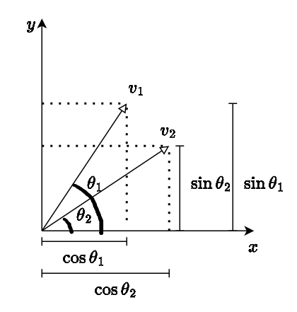{width=75%}

:::

::: {.column width="35%"}

Para ilustrar o conceito, considere os vetores unitários
$\mathbf{v_1}$ e $\mathbf{v_2}$ em $\mathbb{R}^2$

:::

:::

---

## Imagens como vetores {.nostretch}

É possível ver que o ângulo $\theta$ entre os vetores $\mathbf{v_1}$ e $\mathbf{v_2}$ é dado por

$$
\begin{aligned}
\theta     &= \theta_1 - \theta_2 =\\
cos \theta &= cos (\theta_1 - \theta_2) =\\
cos \theta &= cos(\theta_1) cos(\theta_2) + sen(\theta_1) sen(\theta_2)
\end{aligned}
$$

Observe que $cos(\theta_i)$ e $sen(\theta_i)$ são as componentes $x_i$ e $y_i$
dos vetores unitários dos triângulos retângulos da figura anterior.

---

## Imagens como vetores {.nostretch}

Então

$$
\begin{aligned}
cos \theta &= \frac{x_1}{\|\mathbf{v_1}\|}\frac{x_2}{\|\mathbf{v_2}\|} +
             \frac{y_1}{\|\mathbf{v_1}\|}\frac{y_2}{\|\mathbf{v_2}\|}
           = \frac{\mathbf{v_1} .\mathbf{v_2}}{\|\mathbf{v_1}\| \|\mathbf{v_2}\|} \\
           &= \frac{\sum I_w(x+k, y+l)T(k,l)}{\| I_w(x+k,y+l) \|\| T(k,l) \|}
\end{aligned}
$$

---

## Template Matching: correlação {.nostretch}

Observe que o cosseno está sendo calculado entre dois vetores de norma unitária:

- O resultado estará no intervalo $[-1,1]$
- Para vetores idênticos, o resultado da correlação será 1
- Para vetores iguais, mas de "sentido oposto", o resultado será -1

---

## Template Matching: correlação {.nostretch}

- A correlação é executada para toda posição $(x,y)$ da imagem, resultando
  em uma nova imagem chamada de **mapa de similaridade**
- A posição no mapa de similaridade que resultar no maior valor
  é (possivelmente) onde encontra-se o template, ou seja,

$$
\operatorname*{arg\,max}_{(x,y)} corr'(x,y) = \frac{\sum I_w(x+k, y+l)T(k,l)}{\| I_w(x+k,y+l) \|\| T(k,l) \|}
$$

---

## Resultado: correlação normalizada {.nostretch}

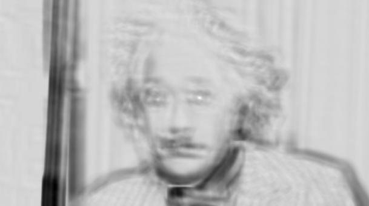{width=47%}
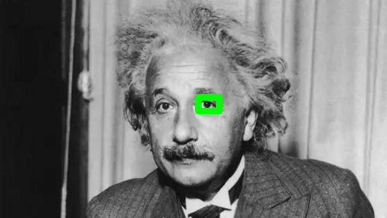{width=47%}

Mapa de similaridade (à esquerda) e retângulo centrado na posição
de maior similaridade.

---

## Template Matching: correlação {.nostretch}

Vetores não unitários também podem ser usados na correlação:

$$
corr(x,y) = \sum I_w(x+k, y+l)T(k,l)
$$

- Correlação não-normalizada
- Pode ser atraente (reduz custo computacional)

---

## Resultado: correlação sem normalização {.nostretch}

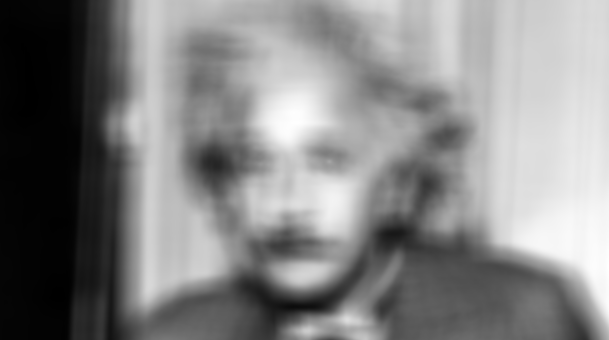{width=47%}
{width=47%}

Por que a maior resposta está em uma posição
incorreta? $\rightarrow$ a correlação não-normalizada tem o produto
interno alto em regiões mais claras da imagem

---

## Template Matching: SSD {.nostretch}

Segunda métrica: **soma das diferenças quadráticas**
(*Sum of Squared Differences*, SSD) entre a janela da imagem $I_w$ e o *template* $T$:

$$
SSD(x,y) = \sum [I_w(x+k, y+l) - T(k,l)]^2,
$$

calculada para todas as posições $(k,l) \in w$ da janela da imagem centrada em $(x,y)$.

---

## Template Matching: SSD {.nostretch}

- Pode ser mostrado que esta é a métrica ótima quando ruído Gaussiano Branco está presente
- Ao contrário da correlação entre patches, estamos calculando uma diferença entre patches, ou seja
- Quanto **menor** a diferença, mais similar é o template da imagem

---

## Template Matching: SSD {.nostretch}

Após calcular $SSD(x,y)$ para todas as posições válidas $(x,y)$ da imagem,
o *template* $T$ deverá estar na posição que contiver a menor diferença quadrática:

$$
\operatorname*{arg\,min}_{(x,y)} SSD(x,y) = \sum [I_w(x+k, y+l) - T(k,l)]^2
$$

---

## Template Matching: SSD {.nostretch}

A expansão da minimização é dada por

$$
\begin{aligned}
\operatorname*{arg\,min}_{(x,y)} SSD(x,y) &= \sum [I_w(x+k, y+l) - T(k,l)]^2\\
                                          &= \sum I^2_w(x+k, y+l)\\
                                          &- 2\sum I_w(x+k, y+l)T(k,l)\\
                                          &+ \sum T^2(k,l)
\end{aligned}
$$

---

## Template Matching: SSD {.nostretch}

- O termo $\sum I^2_w(x+k, y+l)$ depende da posição $(x,y)$
- O termo $- 2\sum I_w(x+k, y+l)T(k,l)$ é idêntico à correlação não-normalizada
- O termo $\sum T^2(k,l)$ é constante: não depende da posição $(x,y)$

---

## Template Matching: SSD {.nostretch}

Então,

$$
\begin{aligned}
\operatorname*{arg\,min}_{(x,y)} SSD(x,y) &= \sum [I_w(x+k, y+l) - T(k,l)]^2\\
                                          &= \sum I^2_w(x+k, y+l)\\
                                          &- 2\sum I_w(x+k, y+l)T(k,l)
\end{aligned}
$$

---

## Template Matching: SSD {.nostretch}

- Ou seja, a métrica $SSD(x,y)$ contém matematicamente $corr(x,y)$
- O termo $\sum I^2_w$ fornece uma medida de similaridade da imagem
  com ela mesma (autocorrelação)

---

## Template Matching: SSD {.nostretch}

A métrica $SSD$ também possui uma versão normalizada.
Após descartar o termo $\sum T^2(k,l)$, ela pode
ser dividida por $\sum I^2_w$, resultando em:

$$
\operatorname*{arg\,min}_{(x,y)} SSD(x,y) = 1 - \frac{2\sum I_w(x+k, y+l)T(k,l)}{\sum I^2_w(x+k, y+l)}
$$

---

## Template Matching: SSD {.nostretch}

Minimizar a equação anterior equivale a maximizar sua versão normalizada:

$$
\operatorname*{arg\,max}_{(x,y)} SSD'(x,y) = \frac{\sum I_w(x+k, y+l)T(k,l)}{\sum I^2_w(x+k, y+l)}
$$

---

## Template Matching: SSD {.nostretch}

**Importante** $\rightarrow$ podemos normalizar o $SSD$ de duas formas:

1. A forma mostrada anteriormente: simplifica a expressão (descarta termos) e então
   é aplicada a normalização
2. Mantém a expressão original, dividindo-a pelo produto da norma dos vetores envolvidos

---

## Template Matching: SSD {.nostretch}

Esta segunda forma é utilizada, por exemplo, pela OpenCV:

$$
\operatorname*{arg\,min}_{(x,y)} SSD(x,y) = \sum \frac{[I_w(x+k, y+l) - T(k,l)]^2}{\| [I_w(x+k, y+l) \| \|T(k,l)] \|}
$$

---

## Resultado: SSD {.nostretch}

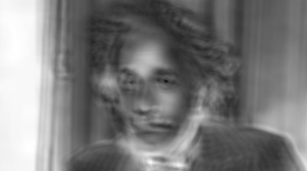{width=47%} {width=47%}

Lembre-se: para o $SSD$, o template deverá estar na posição de menor valor

---

## Resultado: SSD normalizado {.nostretch}

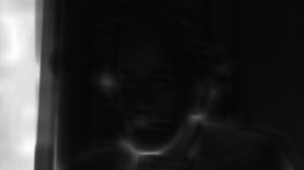{width=47%} {width=47%}

Lembre-se: para o $SSD'$, o template deverá estar na posição de menor valor

---

## Template Matching: problema {.nostretch}

Considere o template à esquerda com a correlação
calculada na região da imagem com intensidade uniforme $v$:

::: {.columns}

::: {.column width="50%"}

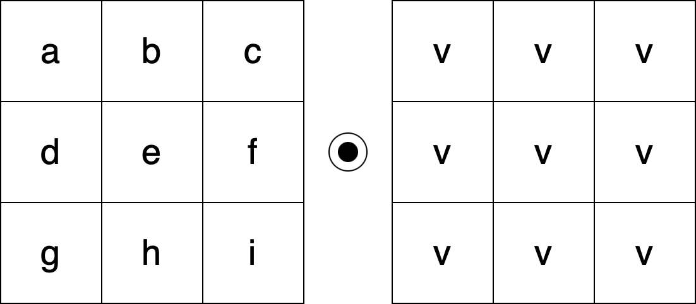{width=90%}

:::

::: {.column width="50%"}

$=(a+b+c+d+e+f+g+h+i)*v$

:::

:::

---

## Template Matching: problema {.nostretch}

Agora, a região da imagem tem intensidade $2v$:

::: {.columns}

::: {.column width="50%"}

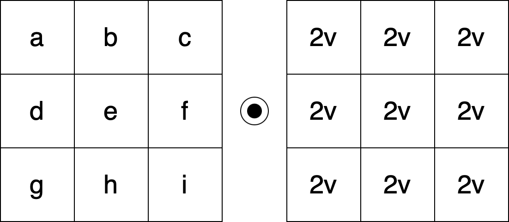{width=90%}

:::

::: {.column width="50%"}

$=(a+b+c+d+e+f+g+h+i)*2v$

:::

:::

---

## Template Matching: problema {.nostretch}

Neste último caso:

- A correlação resulta em um valor 2 vezes maior que o primeiro caso
- Entretanto, isso não se deve a uma similaridade maior
- O que acontece é que quem aumentou a correlação foi o padrão da imagem

---

## Template Matching: solução

Como solução, calcular a correlação após:

- Subtrair o valor médio dos pixels da janela sob o template
- Subtrair o valor médio do template

---

## Template Matching: solução

- Isto irá aumentar a invariância a alterações nos padrões de intensidade
- A métrica será alta quando partes escuras do template estiverem sobre
  partes escuras da imagem (e o mesmo para partes claras)
- Aumenta o custo computacional

---

## Template Matching: solução {.nostretch}

Correlação normalizada e com média subtraída:

$$
\bar{corr}(x,y) = \frac{\sum [I_w(x+k, y+l) - \bar{I}_w][T(k,l) - \bar{T}]}{\| [I_w(x+k,y+l)- \bar{I}_w] \|\| [T(k,l) - \bar{T}]\|}
$$

$\bar{I}_w$ é a média da janela sob o *template* e $\bar{T}$ é a média do *template*

---

## Template Matching: solução {.nostretch}

SSD normalizada e com média subtraída:

$$
\bar{SSD}(x,y) = \frac{\sum [I_w(x+k, y+l) - \bar{I}_w][T(k,l) - \bar{T}]}{\sum [I^2_w(x+k, y+l) - \bar{I}_w]}
$$

---

## Resultado: correlação {.nostretch}

Note que, após remover a média, a correlação (não-normalizada) é corrigida

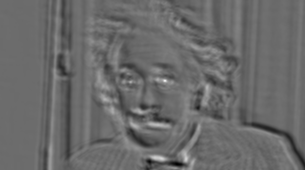{width=47%} {width=47%}

---

## Resultado: correlação normalizada {.nostretch}

Correlação normalizada após remover a média:

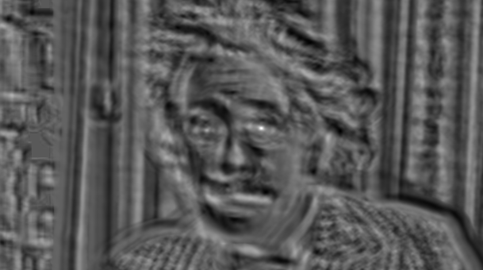{width=47%} {width=47%}

---

## Resultado: SSD {.nostretch}

SSD após remover a média:

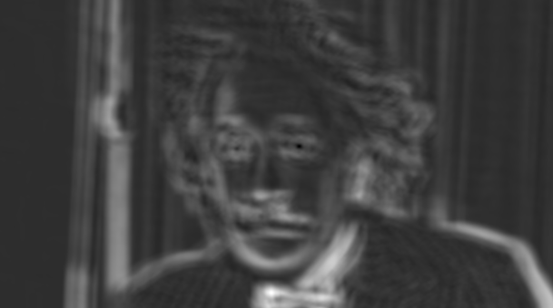{width=47%} {width=47%}

---

## Resultado: SSD normalizado {.nostretch}

SSD normalizado após remover a média:

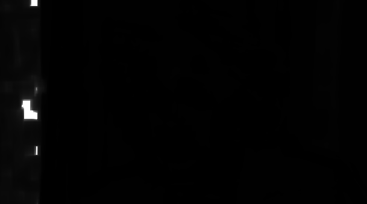{width=47%} {width=47%}

---

## Template Matching: importante

As técnicas de *template matching* apresentadas presumem que as imagens diferem apenas por:

- Translação
- Brilho
- Contraste

Caso estas premissas não sejam verdadeiras: o método não terá sucesso

---

## Template Matching: importante

Para mudanças de escala e rotação:

- Força bruta: calcular as métricas em várias escalas e rotações

Mudanças de perspectiva requerem outras técnicas, abordadas mais adiante no curso

---

## Funções da OpenCV

Função da OpenCV relacionadas ao tópico da aula:

`cv.matchTemplate`

---

## Funções da OpenCV

Constantes da função `cv.matchTemplate` (métricas):

- `TM_CCORR`: $corr(x,y)$
- `TM_CCORR_NORMED`: $corr'(x,y)$
- `TM_SQDIFF`: $SSD(x,y)$
- `TM_SQDIFF_NORMED`: $SSD'(x,y)$
- `TM_CCOEFF`: $corr(x,y)$ subtraindo as médias, sem normalizar
- `TM_CCOEFF_NORMED`: $\bar{corr}(x,y)$

---

## Guia de Leitura {.smaller}

- @nixon2019
- @kaehler2016

---

## Sumário

Nesta aula, foi apresentada a técnica de *template matching* por meio de:

- Correlação
- Soma das diferenças quadráticas (SSD)
- Correlação normalizada
- SSD normalizada

## Referências {.smaller}

::: {#refs}
:::
