## Introdução I

O que é possível fazer a partir de duas imagens obtidas com uma câmera calibrada de uma mesma cena?

## Introdução II {.nostretch}

Computar o movimento relativo de uma plataforma robótica (odometria visual) [@nister2004]

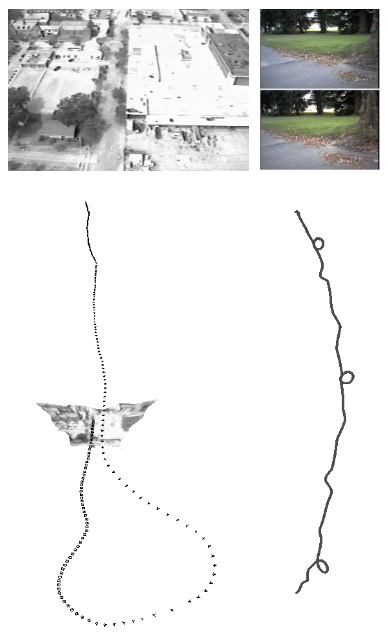{width=25% fig-align="center"}

::: {.notes}
Revisar: no original, esta chamada é [5], que na bibliografia corresponde ao artigo do algoritmo dos 5 pontos (Nistér, 2004). A figura parece vir de outro trabalho sobre odometria visual; confirmar a fonte.
:::

## Introdução III {.nostretch}

Computar o movimento realizado por uma câmera (odometria visual) [@silva2012]

::: {.columns}
::: {.column width="50%"}

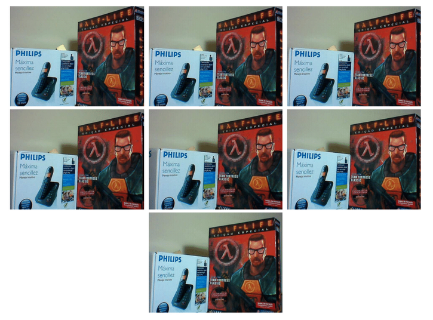{width=100% fig-align="center"}

:::
::: {.column width="50%"}

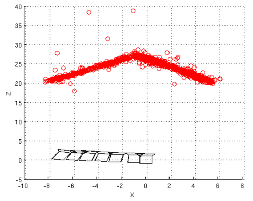{width=100% fig-align="center"}

:::
:::

## Introdução IV {.nostretch}

Obter reconstruções 3D em larga escala [@schonberger2016]

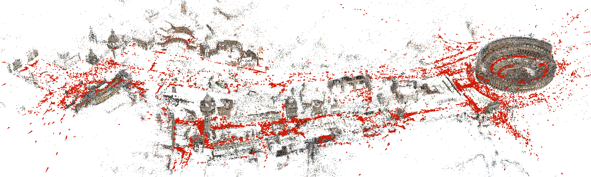{width=90% fig-align="center"}

## Introdução V

Os trabalhos listados têm como fundamentos a geometria de duas ou mais visualizações de uma cena:

- Fornece modelos matemáticos que relacionam diferentes imagens de uma mesma cena
- Permite que sejam computados:
  - O movimento da câmera realizado entre as imagens
  - A estrutura 3D (nuvem de pontos) correspondente à cena

## Introdução VI

Este tópico de pesquisa é conhecido como *Structure from Motion* - SfM (estrutura a partir do movimento) e tem algumas versões:

- Reconstrução 3D em coleções de imagens (processamento offline)
- Reconstrução 3D incremental – Odometria Visual (processamento online)

Nesta aula, são mostrados os principais fundamentos matemáticos que constituem aplicações desta classe.

## Geometria de uma Visualização I {.nostretch}

Os modelos matemáticos desta aula assumem que a câmera está calibrada.

::: {.columns}
::: {.column width="55%"}

Parâmetros:

- $f_x, f_y$: distância focal (em pixels)
- $c_x, c_y$: ponto principal (em pixels)

:::
::: {.column width="45%"}

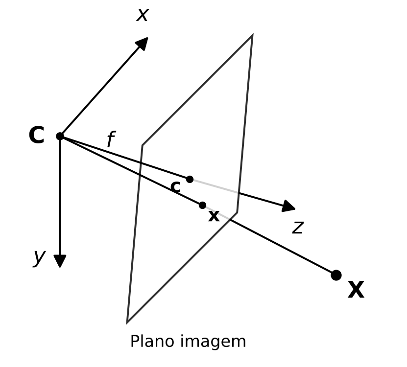{width=100% fig-align="center"}

:::
:::

## Projeção Perspectiva {.nostretch}

<iframe data-src="../../demos/projecao_perspectiva.html"
        width="100%" height="580" style="border: none;"></iframe>

## Geometria de uma Visualização II

Estes parâmetros estão na matriz de parâmetros intrínsecos $K$ que realiza a projeção perspectiva:

$$
\begin{gathered}
\hat{\mathbf{x}} = K\mathbf{X} = \\
\begin{bmatrix} \hat{x} \\ \hat{y} \\ \hat{z} \end{bmatrix} =
\begin{bmatrix} f_x & 0 & c_x \\ 0 & f_y & c_y \\ 0 & 0 & 1 \end{bmatrix}
\begin{bmatrix} X \\ Y \\ Z \end{bmatrix}
\end{gathered}
$$

As coordenadas de imagem do ponto projetado são dadas então por
$\mathbf{x} = \hat{\mathbf{x}}/\hat{z} = [u, v, 1]^t$

## Geometria de uma Visualização III {.nostretch}

::: {.columns}
::: {.column width="55%"}

Quando os pontos a serem projetados não estão no sistema de coordenadas de câmera, é necessário transformar os pontos do mundo com os parâmetros extrínsecos

- $R$: matriz de rotação
- $\mathbf{t}$: vetor de translação

:::
::: {.column width="45%"}

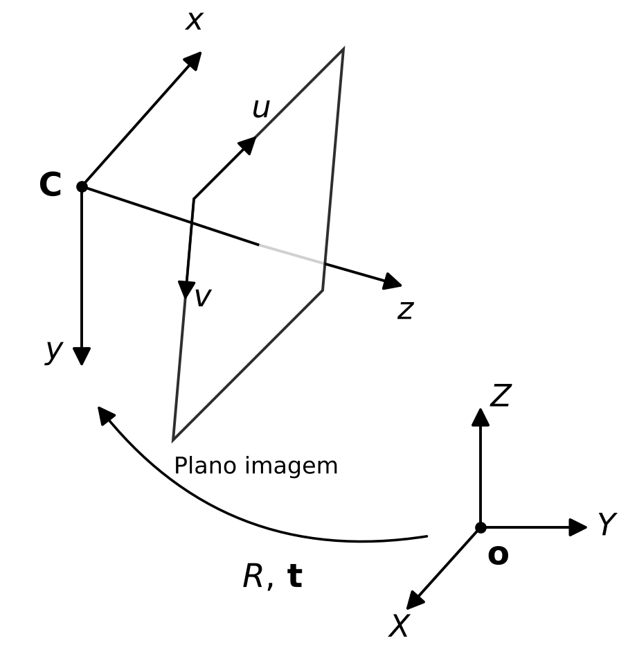{width=100% fig-align="center"}

:::
:::

## Geometria de uma Visualização IV

Com $R$ e $\mathbf{t}$, temos:

$$
\begin{gathered}
\hat{\mathbf{x}} = K[R|\mathbf{t}]\hat{\mathbf{X}} = \\
\begin{bmatrix} \hat{x} \\ \hat{y} \\ \hat{z} \end{bmatrix} =
\begin{bmatrix} f_x & 0 & c_x \\ 0 & f_y & c_y \\ 0 & 0 & 1 \end{bmatrix}
\begin{bmatrix} r_{00} & r_{01} & r_{02} & t_x \\ r_{10} & r_{11} & r_{12} & t_y \\ r_{20} & r_{21} & r_{22} & t_z \end{bmatrix}
\begin{bmatrix} X \\ Y \\ Z \\ 1 \end{bmatrix}
\end{gathered}
$$

## Geometria de duas Visualizações I

Duas imagens de uma mesma cena, com a câmera alterando a sua posição, formam o que se chama de **geometria epipolar**. Isto pode ser obtido em duas situações:

- Uma única câmera em movimento
- Câmera estéreo (duas ou mais câmeras com calibração entre elas)

## Geometria de duas Visualizações II {.nostretch}

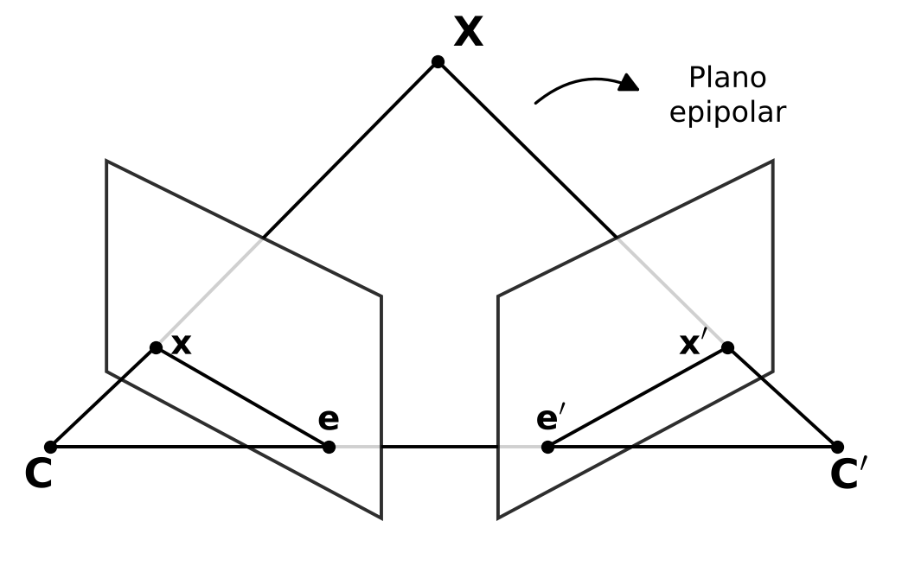{width=70% fig-align="center"}

## Geometria de duas Visualizações III {.smaller}

A geometria epipolar é formada por:

- O ponto 3D $\mathbf{X}$
- As posições 3D das duas câmeras $\mathbf{C}$ e $\mathbf{C}'$
- As projeções nas duas imagens $\mathbf{x}$ e $\mathbf{x}'$ de $\mathbf{X}$
- Os **epipolos** $\mathbf{e}$ e $\mathbf{e}'$:
  - $\mathbf{e}$ é a projeção (virtual) de $\mathbf{C}'$ na câmera $\mathbf{C}$ ($\mathbf{e}'$ é a projeção de $\mathbf{C}$ na câmera $\mathbf{C}'$)
- Linhas epipolares $\overline{\mathbf{e}\mathbf{x}}$ e $\overline{\mathbf{e}'\mathbf{x}'}$
- Todos estes elementos pertencem a um mesmo plano: o chamado **plano epipolar**

## Geometria Epipolar {.nostretch}

<iframe data-src="../../demos/geometria_epipolar.html"
        width="100%" height="580" style="border: none;"></iframe>

## Reconstrução 3D com Duas Visualizações I  {.nostretch}

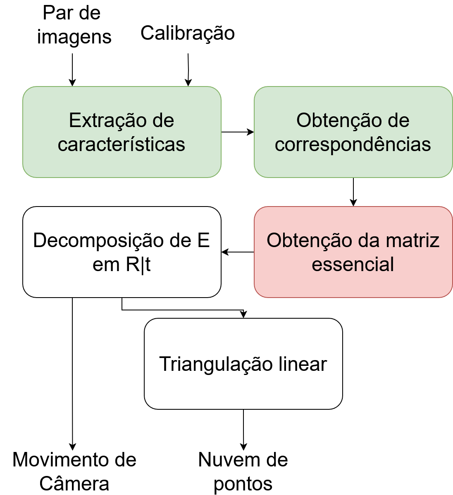{width=40% fig-align="center"}

## Geometria de duas Visualizações: Matriz Essencial I

Uma matriz $E$ relaciona um ponto $\mathbf{X}$ da câmera $\mathbf{C}$ com o seu correspondente
$\mathbf{X}'$ na câmera $\mathbf{C}'$.

Para deduzir esta matriz:

- Assumimos a relação $\mathbf{X}' = R\mathbf{X} + \mathbf{t}$
- Tomamos os vetores que formam o plano epipolar no sistema de coordenadas
  de qualquer uma das duas câmeras e construímos o produto misto entre eles
- A dedução a seguir considera os vetores em $\mathbf{C}'$

::: {.notes}
Tanto faz tomar os 3 vetores do plano epipolar do sistema de coordenadas de C
ou de C', mas os 3 vetores precisam ser da mesma referência.
Além disso, tanto faz a ordem deles no produto misto, mas algumas propriedades
são necessárias para chegar à mesma igualdade (ex.: a x b = -b x a).
:::

## Geometria de duas Visualizações Matriz Essencial II {.nostretch}

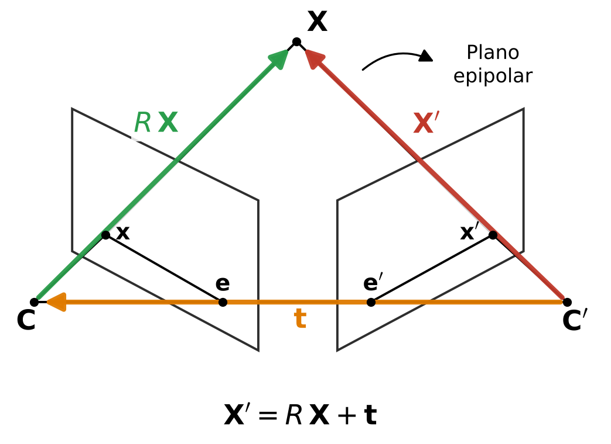{width=70% fig-align="center"}

## Geometria de duas Visualizações: Matriz Essencial III

Uma vez que $\mathbf{X}'$, $\mathbf{t}$ e $R\mathbf{X}$ são três vetores que pertencem a um mesmo plano, podemos expressar a relação de coplanaridade entre eles pelo produto misto:

- Produto vetorial entre $\mathbf{t}$ e $R\mathbf{X}$
- Produto escalar do resultado anterior por $\mathbf{X}'$ 

$$
(\mathbf{X}')^t(\mathbf{t} \times R\mathbf{X}) = 0
$$

## Geometria de duas Visualizações: Matriz Essencial IV

É possível realizar produto vetorial por meio de uma matriz antissimétrica $S$, ou seja,
$\mathbf{t} \times R\mathbf{X} = SR\mathbf{X}$, com 

$$
S = 
\begin{bmatrix} 0 & -t_z & t_y \\ t_z & 0 & -t_x \\ -t_y & t_x & 0 \end{bmatrix}
$$

## Geometria de duas Visualizações: Matriz Essencial V

Assim, a relação de coplanaridade se torna

$$
(\mathbf{X}')^t(SR\mathbf{X}) = 0
$$

## Geometria de duas Visualizações: Matriz Essencial VI

A **Matriz Essencial** $E$ é definida pelo produto 
entre a matriz antissimétrica que contém a translação $S$
e a matriz de rotação $R$, ou seja:

$$
E = SR
$$

e portanto, temos a relação entre $\mathbf{X}$ e $\mathbf{X}'$,

$$
\mathbf{X}'^t E \mathbf{X} = 0
$$

## Geometria de duas Visualizações: Matriz Essencial VII {.smaller}

A matriz essencial $E$:

- É uma matriz homogênea (definida a menos de um fator de escala)
- Relaciona pontos 3D pertencentes a diferentes câmeras na geometria epipolar
- Ela codifica a rotação $R$ e translação $\mathbf{t}$ que relaciona o par de pontos 3D
- É uma matriz $3 \times 3$ de posto 2:
  - Mapeia pontos em uma câmera para retas na outra câmera
  - Um ponto 3D é transformado na linha epipolar 3D correspondente na outra câmera

## Geometria de uma Visualização: Retroprojeção I

Observe que a partir da projeção

$$
Z\mathbf{x} = K\mathbf{X},
$$

é possível fazer a **retroprojeção** do pixel $[u,v]^t$, isto é, 
traçar o raio que sai do centro de projeção, passa por ele
e intercepta o plano $Z = 1$

## Geometria de uma Visualização: Retroprojeção II

Isolando $\mathbf{X}$, temos 

$$
\mathbf{X} = ZK^{-1}\mathbf{x},
$$

ou seja, o ponto $\mathbf{X}$ a menos da sua profundidade $Z$.
No plano $Z=1$, o ponto retroprojetado é $K^{-1}\mathbf{x}$

## Geometria de uma Visualização: Retroprojeção III

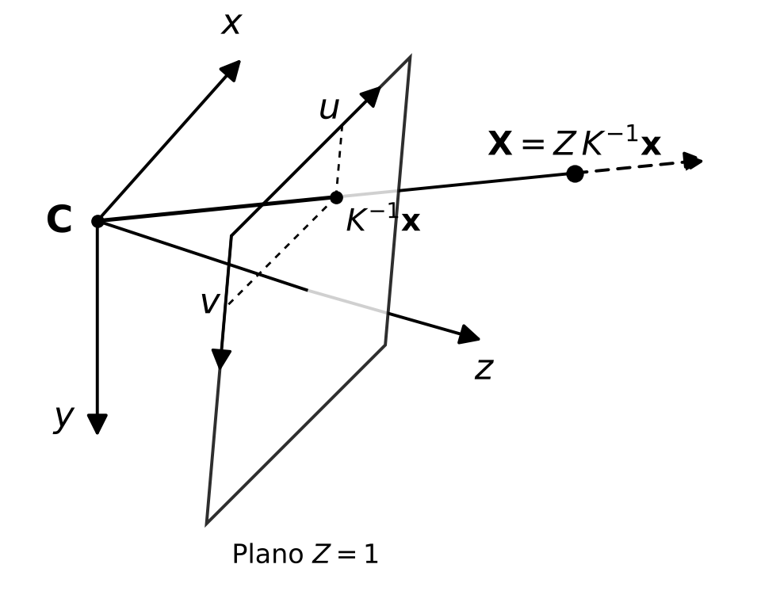{width=70% fig-align="center"}

## Geometria de uma Visualização: Retroprojeção IV

$K^{-1}\mathbf{x}$ é então dado por

$$
K^{-1}\mathbf{x} =
\begin{bmatrix} X/Z \\ Y/Z \\ 1 \end{bmatrix} =
\begin{bmatrix} \dfrac{u - c_x}{f_x} \\[2mm] \dfrac{v - c_y}{f_y} \\[2mm] 1 \end{bmatrix} =
\begin{bmatrix}
\frac{1}{f_x} & 0 & \frac{-c_x}{f_x} \\
0 & \frac{1}{f_y} & \frac{-c_y}{f_y} \\
0 & 0 & 1
\end{bmatrix}
\begin{bmatrix} u \\ v \\ 1 \end{bmatrix}
$$

## Geometria de duas Visualizações: Matriz Fundamental I

Podemos substituir o ponto retroprojetado $ZK^{-1}\mathbf{x}$
na expressão da Matriz Essencial, para assim obter relações diretas
entre os pontos na imagem $\mathbf{x}$ e $\mathbf{x}'$

$$
\begin{aligned}
\mathbf{X}'^t E \mathbf{X} & = 0\\
(Z'K^{-1}\mathbf{x}')^t E (ZK^{-1}\mathbf{x})& = 0\\
Z'Z(K^{-1}\mathbf{x}')^t E (K^{-1}\mathbf{x})& = 0\\
\mathbf{x}'^{t}K^{-t} E K^{-1}\mathbf{x} & = 0
\end{aligned}
$$

## Geometria de duas Visualizações: Matriz Fundamental II

Chamamos o produto $K^{-t} E K^{-1}$ de Matriz Fundamental:

$$
F = K^{-t} E K^{-1}
$$

e a partir dela, obtemos a relação direta entre pontos de imagem
de duas visualizações de um mesmo ponto

$$
\mathbf{x}'^t F \mathbf{x} = 0
$$

## Geometria de duas Visualizações: Matriz Fundamental III {.smaller}

A matriz fundamental $F$:

- É uma matriz homogênea (definida a menos de um fator de escala)
- Relaciona pontos 2D (de imagem) entre pares de câmera na geometria epipolar
- Ela codifica $R$, $\mathbf{t}$, e a matriz de parâmetros intrínsecos $K$
- É uma matriz $3 \times 3$ de posto 2:
  - Mapeia pontos em uma imagem para retas na outra imagem
  - Um ponto em uma imagem é transformado na linha epipolar correspondente na outra imagem

## Matriz Fundamental: Algoritmo dos 8 pontos I

Como $F$ é uma matriz homogênea $3 \times 3$, ela pode ser computada utilizando 8 correspondências com o Algoritmo dos 8 Pontos:

- Assume movimento de câmera entre duas imagens (principalmente translação suficiente)
- Assume que os pontos visualizados não são coplanares

## Matriz Fundamental: Algoritmo dos 8 pontos II

A relação entre pontos na imagem e a matriz fundamental pode ser escrita como:

$$
\mathbf{x}'^t F \mathbf{x} = 0
$$

$$
\begin{bmatrix} u' & v' & 1 \end{bmatrix}
\begin{bmatrix} f_1 & f_2 & f_3 \\ f_4 & f_5 & f_6 \\ f_7 & f_8 & f_9 \end{bmatrix}
\begin{bmatrix} u \\ v \\ 1 \end{bmatrix} = 0
$$

## Matriz Fundamental: Algoritmo dos 8 pontos III {.smaller}

$$
\begin{bmatrix} u'f_1 + v'f_4 + f_7 & u'f_2 + v'f_5 + f_8 & u'f_3 + v'f_6 + f_9 \end{bmatrix}
\begin{bmatrix} u \\ v \\ 1 \end{bmatrix} = 0
$$

$$
uu'f_1 + uv'f_4 + uf_7 + v'f_2 + vv'f_5 + vf_8 + u'f_3 + v'f_6 + f_9 = 0
$$

Ou seja:

- 1 correspondência fornece 1 equação
- São necessárias $\geq 8$ correspondências para computar $F$
  - Lembrando: para homografia $H$, 1 correspondência fornece 2 equações

::: {.notes}
Revisar: transcrito como no original. Na expansão, o quarto termo aparece como $v'f_2$; pela linha anterior, seria $vu'f_2$.
:::

## Matriz Fundamental: Algoritmo dos 8 pontos IV {.smaller}

Assim, o sistema de equações lineares fica

$$
\begin{bmatrix}
u_1 u & v_1 u_1' & u_1' & u_1 v_1' & v_1 v_1' & v_1' & u_1 & v_1 & 1 \\
\vdots & \vdots & \vdots & \vdots & \vdots & \vdots & \vdots & \vdots & \vdots \\
u_8 u_8' & v_8 u_8' & u_8' & u_8 v_8' & v_8 v_8' & v_8' & u_8 & v_8 & 1
\end{bmatrix}
\begin{bmatrix} f_1 \\ \vdots \\ f_9 \end{bmatrix} =
\begin{bmatrix} 0 \\ \vdots \\ 0 \end{bmatrix}
$$

O sistema deve ser resolvido em conjunto com RANSAC (8 correspondências sendo selecionadas aleatoriamente).

::: {.notes}
Revisar: transcrito como no original. A primeira entrada da primeira linha aparece como $u_1 u$; pela última linha, seria $u_1 u_1'$.
:::

## Matriz Fundamental: Algoritmo dos 8 pontos V {.smaller}

Para resolver o sistema - SVD:

- Decompor a matriz $A$ (tamanho $8 \times 9$) em $U\Sigma V^t$
- As entradas de $F$ são formadas pelo vetor singular à direita correspondente ao menor valor singular (última coluna de $V$)
- Forçar numericamente que a solução tenha posto 2:
  - Decompor $F = U\Sigma V^t$
  - Atribuir 0 ao menor auto valor em $\Sigma$, formando assim $\Sigma'$
  - Recomputar $F = U\Sigma' V^t$

## Matriz Essencial: Algoritmo dos 5 pontos

A matriz essencial pode ser computada a partir de 5 correspondências:

- Funciona apenas para câmeras calibradas
- Melhor para o RANSAC
- Algoritmo não é tão simples: envolve calcular as raízes de polinômio de grau 10 [@nister2004]

## Reconstrução 3D com Duas Visualizações II  {.nostretch}

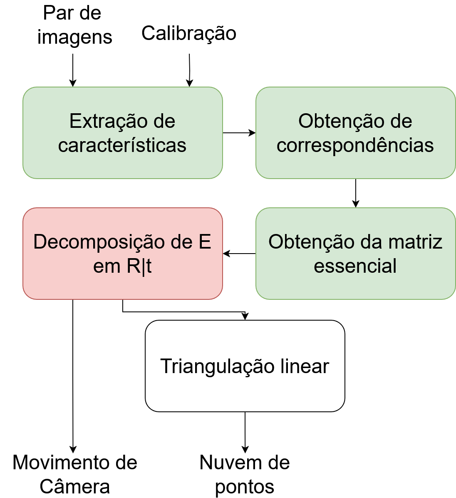{width=40% fig-align="center"}

## Matriz Essencial: Extração da Pose I

A pose relativa de câmera (rotação e translação) que relaciona o sistema de coordenadas da 1ª câmera com o sistema da 2ª pode ser recuperada a partir da matriz $E$:

- Realizada a partir de uma fatoração de $E$
- **Importante:** a translação $\mathbf{t}$ sempre terá norma unitária
- A solução é dada pela decomposição em valores singulares de $E$

## Matriz Essencial: Extração da Pose II {.smaller}

Sendo a SVD de $E = U\Sigma V^t$, existem 4 possibilidades para $R|\mathbf{t}$:

- $[R|\mathbf{t}] = [UWV^t \mid +\mathbf{u}_3]$
- $[R|\mathbf{t}] = [UWV^t \mid -\mathbf{u}_3]$
- $[R|\mathbf{t}] = [UW^tV^t \mid +\mathbf{u}_3]$
- $[R|\mathbf{t}] = [UW^tV^t \mid -\mathbf{u}_3]$

Nestas equações,

$$
W = \begin{bmatrix} 0 & -1 & 0 \\ 1 & 0 & 0 \\ 0 & 0 & 1 \end{bmatrix}
$$

e $\mathbf{u}_3$ é o 3º vetor coluna de $U$

## Matriz Essencial: Extração da Pose III

Apesar de todas as 4 possibilidades anteriores serem válidas matematicamente, em apenas 1 delas os pontos 3D estarão à frente de ambas as câmeras.

No slide seguinte, são mostradas visões superiores com os 4 pares de câmeras e um ponto 3D. Em apenas um dos pares a pose está correta (o ponto 3D está à frente das duas câmeras).

## Matriz Essencial: Extração da Pose IV {.nostretch}

::: {.columns}
::: {.column width="50%"}

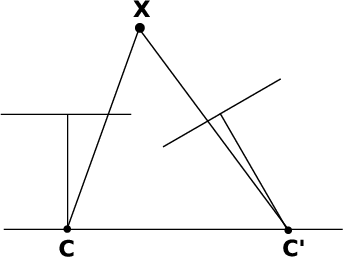{width=55% fig-align="center"}

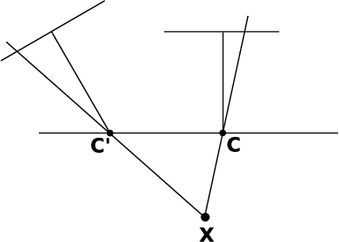{width=55% fig-align="center"}

:::
::: {.column width="50%"}

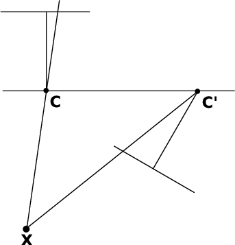{width=50% fig-align="center"}

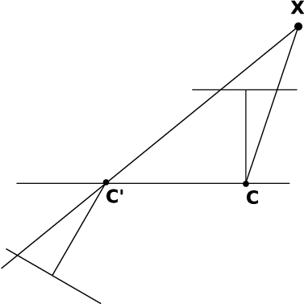{width=50% fig-align="center"}

:::
:::

## Reconstrução 3D com Duas Visualizações III  {.nostretch}

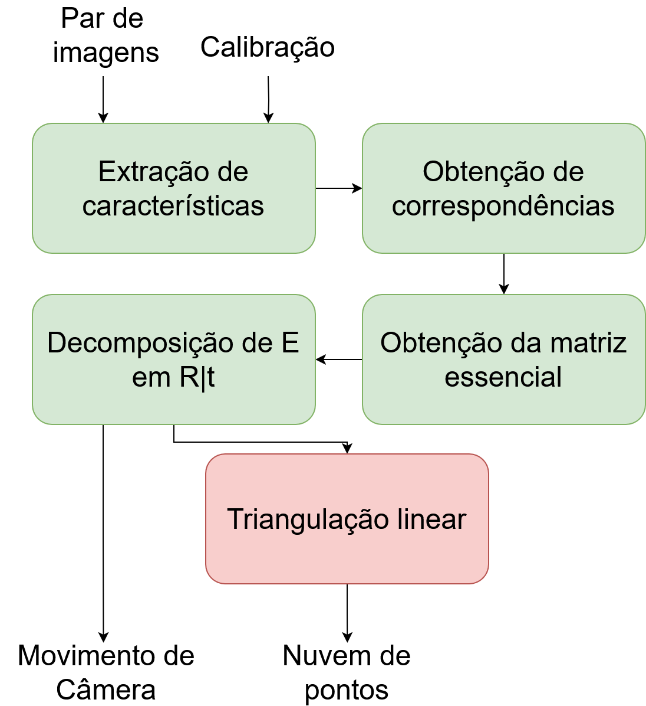{width=40% fig-align="center"}

## Geometria de uma Visualização: Matriz de Projeção

As matrizes de parâmetros intrínsecos e extrínsecos podem ser multiplicadas, resultando em uma única matriz, chamada matriz de projeção $P$:

$$
P = K[R|\mathbf{t}]
$$

## Reconstrução 3D por Triangulação Linear I

A partir disto e de posse dos parâmetros $R$ e $\mathbf{t}$ que relaciona um par de imagens, é possível obter uma reconstrução 3D das correspondências.

Isto é feito expressando as projeções para o par de câmeras:

$$
P = K[I|\mathbf{0}],
$$

sendo $I$ a matriz identidade e $\mathbf{0}$ um vetor coluna de 0s e

$$
P' = K[R|\mathbf{t}]
$$

## Reconstrução 3D por Triangulação Linear II

Um ponto 3D $\mathbf{X}$ no sistema de coordenadas da primeira câmera é projetado em ambas as câmeras por

$$
\hat{z}\mathbf{x} = P\mathbf{X}
$$

e

$$
\hat{z}'\mathbf{x}' = P'\mathbf{X}
$$

## Reconstrução 3D por Triangulação Linear III

Deixando explícitas as coordenadas de imagem e o fator de escala, assim como os vetores linha $\mathbf{p}_i$ da matriz $P$, temos que

$$
\hat{z} \begin{bmatrix} u \\ v \\ 1 \end{bmatrix} =
\begin{bmatrix} \mathbf{p}_1 \\ \mathbf{p}_2 \\ \mathbf{p}_3 \end{bmatrix} \mathbf{X}
$$

## Reconstrução 3D por Triangulação Linear IV

Trazendo o lado direito da equação para o lado esquerdo, ficamos com

$$
\begin{bmatrix}
\hat{z}u - \mathbf{p}_1\mathbf{X} \\
\hat{z}v - \mathbf{p}_2\mathbf{X} \\
\hat{z}
\end{bmatrix} =
\begin{bmatrix}
0 \\
0 \\
\mathbf{p}_3\mathbf{X}
\end{bmatrix}
$$

## Reconstrução 3D por Triangulação Linear V

Dividindo as duas primeiras equações pela escala homogênea,

$$
\begin{matrix} u\mathbf{p}_3\mathbf{X} - \mathbf{p}_1\mathbf{X} \\ v\mathbf{p}_3\mathbf{X} - \mathbf{p}_2\mathbf{X} \end{matrix} =
\begin{bmatrix} 0 \\ 0 \end{bmatrix}
$$

Temos 2 equações para 3 incógnitas, sendo estas as componentes de $\mathbf{X}$

## Reconstrução 3D por Triangulação Linear VI

Só que podemos usar a relação para a 2ª Câmera, no que resulta em 4 equações para 3 incógnitas:

$$
\begin{matrix}
u\mathbf{p}_3\mathbf{X} - \mathbf{p}_1\mathbf{X} \\
v\mathbf{p}_3\mathbf{X} - \mathbf{p}_2\mathbf{X} \\
u'\mathbf{p}_3'\mathbf{X} - \mathbf{p}_1'\mathbf{X} \\
v'\mathbf{p}_3'\mathbf{X} - \mathbf{p}_2'\mathbf{X}
\end{matrix} =
\begin{bmatrix} 0 \\ 0 \\ 0 \\ 0 \end{bmatrix}
$$

## Reconstrução 3D por Triangulação Linear VII

Assim, ficamos com um sistema linear

$$
\begin{bmatrix}
u\mathbf{p}_3 - \mathbf{p}_1 \\
v\mathbf{p}_3 - \mathbf{p}_2 \\
u'\mathbf{p}_3' - \mathbf{p}_1' \\
v'\mathbf{p}_3' - \mathbf{p}_2'
\end{bmatrix}
\begin{bmatrix} X \\ Y \\ Z \\ 1 \end{bmatrix} =
\begin{bmatrix} 0 \\ 0 \\ 0 \\ 0 \end{bmatrix},
$$

do tipo $A\mathbf{x} = \mathbf{0}$, com a matriz $A$ de tamanho $4 \times 4$.

A solução é novamente computada com SVD.

## Reconstrução 3D por Triangulação Linear VIII {.smaller}

**Importante -** a escala da reconstrução é arbitrária:

- É impossível recuperar a profundidade real dos pontos visualizados usando apenas imagens.
  Para isto, alguma outra informação é necessária, que pode ser:
  - A norma do vetor translação (dada por algum outro sensor)
  - Objeto 3D com dimensões conhecida
- Assim, os pontos 3D reconstruídos estarão em uma escala coerente entre si, proporcional à *linha de base* (distância) entre as câmeras

## Reconstrução 3D com Duas Visualizações {.nostretch}

<video autoplay loop muted playsinline style="display: block; margin: 0 auto; width: 80%; height: 80%; object-fit: contain;">
  <source src="img/reconstrucao_duas_imagens.mp4" type="video/mp4">
</video>

## Reconstrução 3D com Duas Visualizações: OpenCV

Funções na OpenCV:

- [`findFundamentalMat`](https://docs.opencv.org/3.4/d9/d0c/group__calib3d.html#ga59b0d57f46f8677fb5904294a23d404a) (Algoritmo dos 8 pontos)
- [`findEssentialMat`](https://docs.opencv.org/3.4/d9/d0c/group__calib3d.html#ga0b166d41926a7793ab1c351dbaa9ffd4) (Algoritmo dos 5 pontos)
- [`decomposeEssentialMat`](https://docs.opencv.org/3.4/d9/d0c/group__calib3d.html#ga54a2f5b3f8aeaf6c76d4a31dece85d5d) (para extrair a rotação e translação da Matriz Essencial)
- [`triangulatePoints`](https://docs.opencv.org/3.4/d9/d0c/group__calib3d.html#gad3fc9a0c82b08df034234979960b778c) (2 visualizações)
- [`triangulatePoints`](https://docs.opencv.org/4.x/d0/dbd/group__triangulation.html#ga211c855276b3084f3bbd8b2d9161dc74) (N visualizações)

## Reconstrução 3D com Duas Visualizações: Falhas

Principais causas de falha:

- Correspondências incorretas (RANSAC mal parametrizado)
- Pontos utilizados (correspondências *inliers*) pertencente a um plano dominante
- Linha de base (distância entre câmeras) insuficiente

## Guia de leitura

- *Computer Vision: Algorithms and Applications* [@szeliski2022]
- *Learning OpenCV* [@kaehler2016]
- *Introductory Techniques for 3-D Computer Vision* [@trucco1998]
- *Multiple View Geometry in Computer Vision* [@hartley2004]
- *An efficient solution to the five-point relative pose problem* [@nister2004]
- *On monocular visual odometry for indoor ground vehicles* [@silva2012]
- *Structure-from-Motion Revisited* [@schonberger2016]
- *OpenCV Documentation 3.4: Camera Calibration and 3D Reconstruction* [@opencv34_calib3d]
- *OpenCV Documentation 4.x: Triangulation* [@opencv_sfm_triangulation]

## Sumário

Nesta aula – Estrutura a partir do Movimento:

- Geometria epipolar
- Matriz Essencial e Matriz Fundamental
- Triangulação linear
- Estrutura básica para reconstrução 3D monocular

## Referências {.smaller .scrollable}

::: {#refs}
:::
