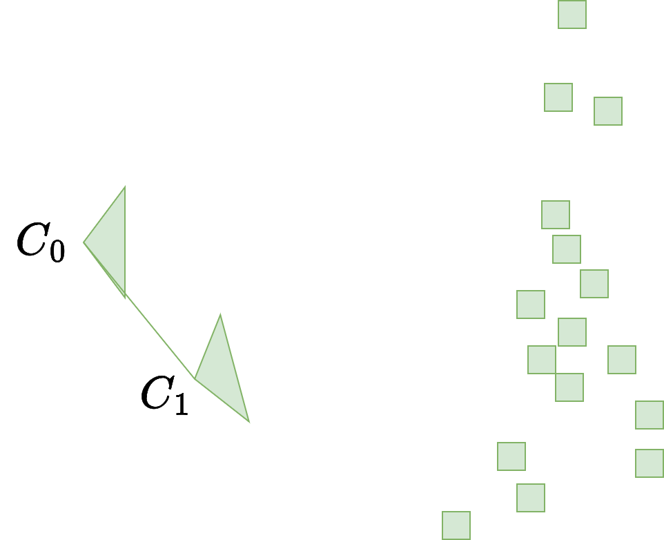
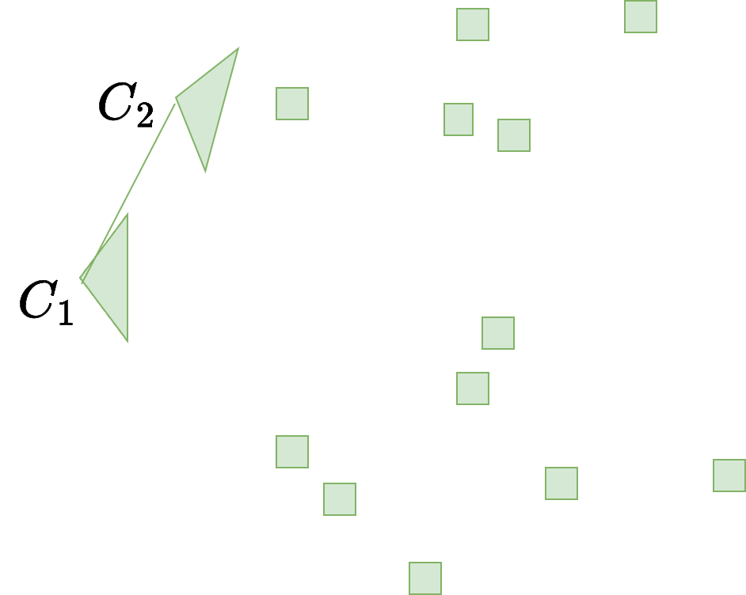

## Introdução

Na aula anterior:

- Reconstrução 3D (movimento de câmera + estrutura 3D) em pares de imagens
- Como proceder para $N > 2$ imagens?
  - Será que calcular a reconstrução par a par é suficiente?

## União de Reconstruções 3D I {.nostretch}

<video autoplay loop muted playsinline style="display: block; margin: 0 auto; width: 80%; height: 80%; object-fit: contain;">
  <source src="img/reconstrucoes_acumuladas.mp4" type="video/mp4">
</video>

## União de Reconstruções 3D II

O resultado anterior estaria incorreto:

- As reconstruções sobrepõem umas às outras
- Todas elas foram incorretamente computadas no que diz respeito às suas origens (sist. de coordenadas)

## União de Reconstruções 3D III

Caso o par envolvido seja a imagem $I_i$ e a imagem $I_j$:

- A origem do sistema de coordenadas da reconstrução será a 1ª. câmera do 
  par (digamos, a câmera $C_i$)
- O movimento relativo tem a câmera $C_i$ como origem
- A transformação relativa $T_{i,j} = [R_{i,j} \mid \mathbf{t}_{i,j}]$
  relaciona $C_i$ com $C_j$
- Os pontos 3D estão referenciados em relação à câmera $C_i$

## União de Reconstruções 3D IV

Ideia:

- Computar reconstrução 3D entre pares de imagens
- Unir reconstruções 3D de diferentes pares

## União de Reconstruções 3D V

*Como unir a reconstrução obtida com as imagens $I_i$ e $I_j$ com outra reconstrução, obtida entre as imagens $I_j$ e $I_k$?*

## União de Reconstruções 3D VI {.nostretch}

::: {.columns}
::: {.column width="45%"}

{width=100% fig-align="center"}

:::
::: {.column width="55%"}

{width=100% fig-align="center"}

:::
:::

::: {style="text-align: center;"}
Como alinhar?
:::

## União de Reconstruções 3D VII

Temos dois problemas a serem resolvidos:

- Rotação/translação para alinhamento dos sistemas de coordenadas
- Cálculo da escala relativa:
  - **Um mesmo ponto na reconstrução do primeiro par não estará na mesma escala da reconstrução do segundo par**

## União de Reconstruções 3D VIII

Uma transformação de similaridade $T_{i,k} = [s_{i,k} R_{i,k} \mid \mathbf{t}_{i,k}]$ entre os sistemas da câmera $i$ e $k$ deve ser conhecida, sendo $i$ o índice de qualquer imagem do primeiro par e $k$ o índice de qualquer imagem do segundo.

## União de Reconstruções 3D IX

Solução 1: calcular o alinhamento entre os sistemas de coordenadas utilizando os pontos 3D [@umeyama1991]

- Sendo $\{X\}_i$ uma nuvem de pontos pertencente ao primeiro par de imagens
- Sendo $\{X\}_k$ uma nuvem de pontos pertencente ao segundo par de imagens
- É possível calcular $T_{i,k}$ como sendo a escala $s_{i,k}$, rotação $R_{i,k}$ e translação $\mathbf{t}_{i,k}$ que alinha a nuvem de pontos $\{X\}_k$ com a nuvem de pontos $\{X\}_i$

## União de Reconstruções 3D X

Esta transformação é dada por

$$
T_{i,k} = \operatorname*{arg\,min}_{s, R,\,\mathbf{t}}
\sum \left\| X_i - (sR X_k + \mathbf{t}) \right\|^2
$$

Ou seja, $T_{i,k}$ é dado como a escala/rotação/translação que minimiza a soma do quadrado das distâncias entre cada ponto $X_i$ da primeira nuvem e o ponto transformado $X_k$ da segunda nuvem.

## União de Reconstruções 3D XI

<video autoplay loop muted playsinline style="display: block; margin: 0 auto; width: 80%; height: 80%; object-fit: contain;">
  <source src="img/alinhamento_nuvens.mp4" type="video/mp4">
</video>

## União de Reconstruções 3D XII

Sobre a solução 1:

- Os pontos 3D originários do SfM
  contêm ruídos que não são modelados com erro Gaussiano:
  - Erros por falsas correspondências
  - Erros por distância curta entre câmeras (quanto mais curta esta distância, maior a incerteza sobre a profundidade do ponto)
  - Mesmo com RANSAC, o resultado não é de uso prático para sistemas monoculares

## União de Reconstruções 3D XIII

Sobre a solução 1:

- Na prática, a solução funciona apenas para o caso de pontos 3D estimados por estéreo, RGB-D [@silva2014] ou por LiDAR
- Variação do algoritmo anterior: *Iterative Closest Point* (ICP) [@besl1992; @vizzo2023]
- Este problema também é conhecido como registro entre nuvens de pontos

## União de Reconstruções 3D XIV

Solução 2: calcular a **pose da câmera** correspondente a uma terceira imagem, sendo que esta terceira imagem possui correspondências entre pontos em comum com uma das duas imagens anteriores

- Problema conhecido como *Perspective-n-Point* (PnP)
- Dados $n$ pontos cujas coordenadas 3D e projeções 2D na imagem são conhecidas, calcular a pose de câmera $T_{i,k} = [R_{i,k} \mid \mathbf{t}_{i,k}]$

## União de Reconstruções 3D XV {.nostretch}

*Perspective-n-Point:* calcula a pose da câmera de uma imagem que
visualiza uma nuvem de pontos

![Fonte: [@shrestha_pnp]](img/pnp_correspondencias_3d_2d.png){width=50% fig-align="center"}

## Perspective-n-Point {.nostretch}

<iframe data-src="../../demos/perspective_n_point.html"
        width="100%" height="580" style="border: none;"></iframe>

## União de Reconstruções 3D XVI

Como usar o PnP:

- Obter $n$ correspondências entre os pontos 2D de uma das duas imagens
  da reconstrução anterior e pontos 2D de uma terceira imagem
- Utilizar as coordenadas 3D associadas a estes $n$ pontos
  - As coordenadas 3D já estão no sistema de coordenadas global
  - Então, a pose de câmera calculada também estará no sistema de coordenadas global, com a mesma escala

## União de Reconstruções 3D XVII

Como usar o PnP:

- Assim, o passo de calcular a Matriz Essencial se torna necessário apenas para obter uma reconstrução 3D inicial (ou quando a câmera "se perde")
- Novos pontos são triangulados utilizando as poses calculadas pelo algoritmo PnP
- Esta ideia é utilizada até hoje em sistemas de Odometria Visual
  [@scaramuzza2011]

## União de Reconstruções 3D: Odometria Visual {.nostretch}

<video autoplay loop muted playsinline style="display: block; margin: 0 auto; width: 80%; height: 80%; object-fit: contain;">
  <source src="img/odometria_visual.mp4" type="video/mp4">
</video>

## União de Reconstruções 3D XVIII

Função na OpenCV:

- [`solvePnP`](https://docs.opencv.org/4.x/d9/d0c/group__calib3d.html#ga549c2075fac14829ff4a58bc931c033d) (contém variações do algoritmo)

## Guia de leitura {.smaller}

- *Visual Odometry [Tutorial]* [@scaramuzza2011]
- *Least-Squares Estimation of Transformation Parameters Between Two Point Patterns* [@umeyama1991]
- *A Method for Registration of 3-D Shapes* [@besl1992]
- *KISS-ICP: In Defense of Point-to-Point ICP -- Simple, Accurate, and Robust Registration If Done the Right Way* [@vizzo2023]
- *A Fast Feature Tracking Algorithm for Visual Odometry and Mapping Based on RGB-D Sensors* [@silva2014]
- *Complete Solution Classification for the Perspective-Three-Point Problem* [@gao2003]
- *Perspective-n-Point (PnP)* [@shrestha_pnp]
- *OpenCV Documentation 4.x: Camera Calibration and 3D Reconstruction* [@opencv4_calib3d]

## Sumário

Nesta aula – união de reconstruções 3D:

- Intuição do problema
- Alinhamento entre nuvens de pontos
- Algoritmo *Perspective-n-Point* (PnP)

## Referências {.smaller .scrollable}

::: {#refs}
:::
