## Features: pontos Harris {.nostretch}

O algoritmo de Harris fornece uma resposta a regiões consideradas cantos (*corners*)

::: {.columns}
::: {.column width="50%"}

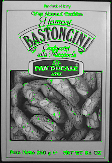{height=330px fig-align="center"}

:::
::: {.column width="50%"}

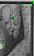{height=230px fig-align="center"}

:::
:::

## Features: pontos SIFT {.nostretch}

Nesta aula, é apresentado o algoritmo SIFT, para detectar pontos com características mais interessantes que os de Harris

::: {.columns}
::: {.column width="50%"}

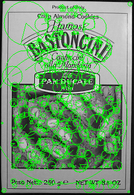{height=330px fig-align="center"}

:::
::: {.column width="50%"}

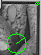{height=230px fig-align="center"}

:::
:::

## Features Multiescala – Intuição I {.nostretch}

Segundo o detector de cantos (*corners*), em quais das imagens abaixo será detectado um canto no centro do filtro (janela $3\times3$ em destaque)?

::: {.columns}
::: {.column width="33%"}

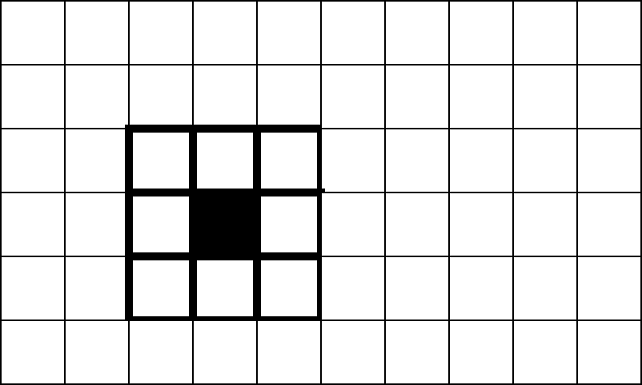{width=100%}

:::
::: {.column width="33%"}

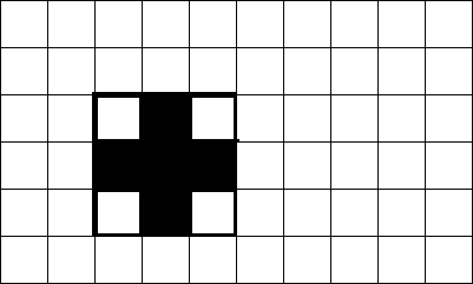{width=100%}

:::
::: {.column width="33%"}

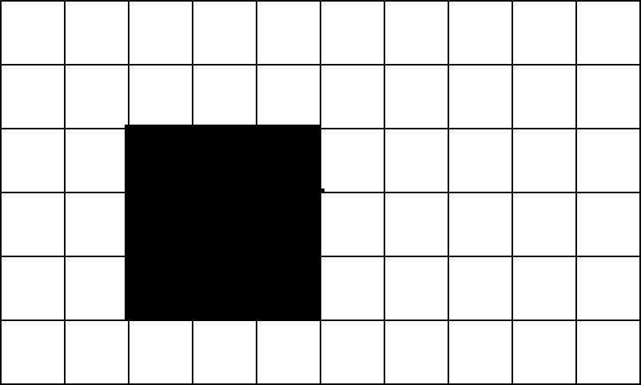{width=100%}

:::
:::

## Features Multiescala – Intuição II {.nostretch}

E no caso de uma janela $5\times5$? No que isto influencia?

::: {.columns}
::: {.column width="33%"}

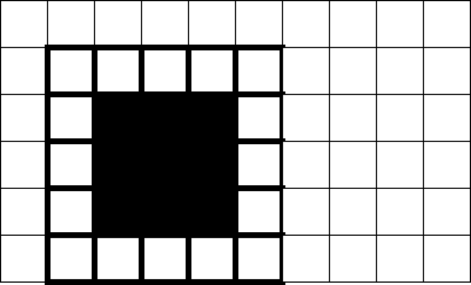{width=100%}

:::
::: {.column width="33%"}

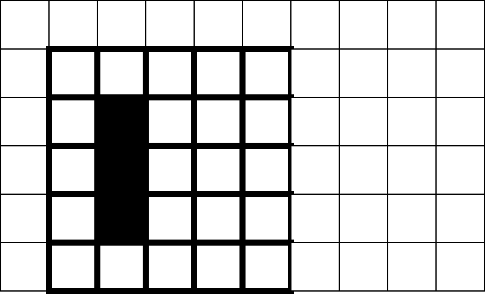{width=100%}

:::
::: {.column width="33%"}

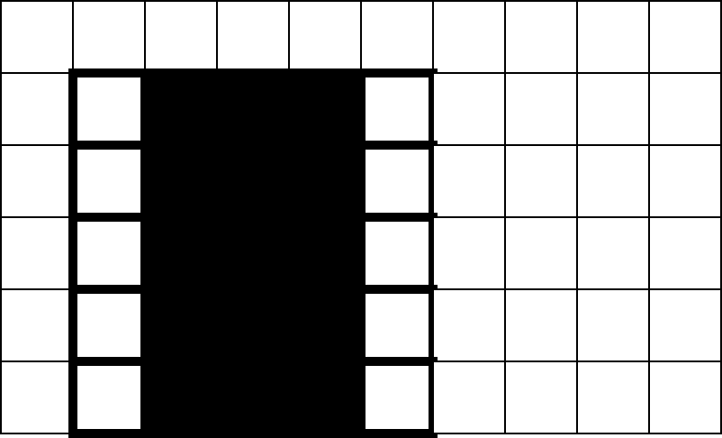{width=100%}

:::
:::

## Features Multiescala – Intuição III

- Uma região só é classificada como “ponto” de acordo com a matriz de autocorrelação dos gradientes calculada no centro do filtro
- Existem cenários em que, para uma janela pequena (ex.: $3\times3$), os autovalores da matriz são pequenos, mas com uma janela maior (ex.: $5\times5$), os autovalores são grandes
- A resposta do detector de cantos depende do tamanho relativo do filtro em relação ao padrão de intensidade da imagem

## Features Multiescala – Intuição IV

É possível que uma região que não contenha ponto se torne uma que contenha ao:

- Aumentar o tamanho do filtro
- Aumentar o tamanho da imagem, mantendo o tamanho do filtro constante

## Features Multiescala – Intuição IV

Esta intuição é explorada nos detectores de pontos multiescala.
O primeiro deles é o **SIFT** (*Scale Invariant Feature Transform*)

## Espaço de Escalas I

Formalmente, features invariantes à escala são detectadas segundo a teoria de **Espaço de Escalas**:

- Teoria formalizada nos anos 1980
- Fundamentada na área de Processamento de Sinais
- Estuda a matemática necessária para representar um sinal invariante à escala

## Espaço de Escalas II

Para gerar o espaço de escalas $L(x,y,\sigma)$ de uma imagem $I(x,y)$, várias convoluções com o filtro Gaussiano $G(x,y,\sigma)$ são realizadas:

$$
L(x,y,\sigma)=G(x,y,\sigma)*I(x,y)
$$

## Espaço de Escalas III

Os valores de $\sigma$ utilizados para gerar o espaço de escalas:

- Determinam o grau de “borramento” da imagem $I(x,y)$
- É o que se chama de escala
- São escolhidos de forma matematicamente fundamentada
  - $\sigma$ é um valor contínuo e, portanto, admite infinitos valores

## Espaço de Escalas IV

O primeiro passo para gerar o espaço de escalas de uma imagem é construir uma **pirâmide de Gaussianos** da imagem de entrada:

- Cada nível $l$ da pirâmide é construído com
  - A imagem original é o nível 0 da pirâmide
  - O descarte de linha sim/linha não, coluna sim/coluna não da imagem do nível anterior
  - A filtragem passa-baixas na imagem subamostrada utilizando um determinado valor para $\sigma$

## Espaço de Escalas V {.nostretch}

Abaixo, é mostrado um exemplo de uma pirâmide de Gaussianos

A pirâmide é construída com as funções `pyrDown` e `pyrUp` da OpenCV

{width=256px} {width=128px} {width=64px} 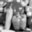{width=32px}

## Espaço de Escalas VI {.nostretch .smaller}

Uma segunda pirâmide, denominada **pirâmide de Laplacianos**, é construída em seguida, de acordo com a lógica abaixo:

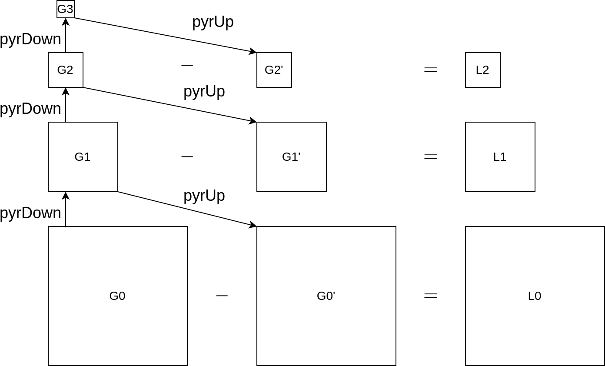{height=300px fig-align="center"}

$$
G_0-G'_0=L_0,\qquad G_1-G'_1=L_1,\qquad G_2-G'_2=L_2
$$

## Espaço de Escalas VII {.nostretch}

A pirâmide de Laplacianos do exemplo construída é mostrada abaixo

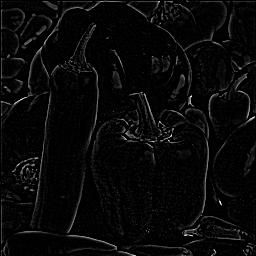{width=256px} 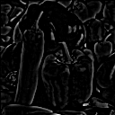{width=128px} 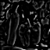{width=64px}

## Espaço de Escalas VIII

- Cada nível $l$ da pirâmide de Gaussianos é denominado de **oitava**
- Para cada oitava, é feita a convolução da imagem base do nível correspondente com filtros $G(x,y,\sigma)$ com diferentes valores de $\sigma$
- As imagens resultantes formam subníveis na pirâmide de Gaussianos
- As diferenças entre imagens de níveis adjacentes geram o espaço de escalas

## Espaço de Escalas IX {.nostretch}

A imagem a seguir exibe a pirâmide de Gaussianas e o espaço de escalas computado por **diferenças de Gaussianos (DoG)**

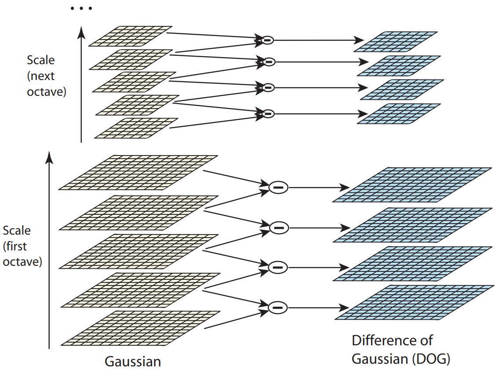{height=380px fig-align="center"}

## Espaço de Escalas X

<video autoplay loop muted playsinline style="display: block; margin: 0 auto; width: 80%; height: 80%; object-fit: contain;">
  <source src="img/construcao_laplaciana.mp4" type="video/mp4">
</video>

## Detecção de Pontos SIFT I {.nostretch .smaller}

Features SIFT são então detectadas no espaço de escalas:

- Extremos (mínimos ou máximos) devem ser detectados ao longo da sua vizinhança espacial e ao longo de escalas
- Similar a como é feito com a detecção de cantos

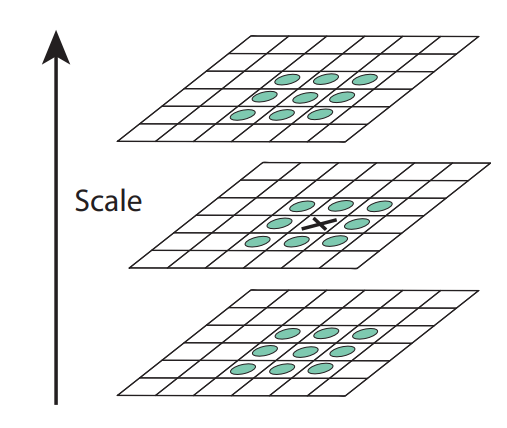{height=300px fig-align="center"}

## Detecção de Pontos SIFT II

<video autoplay loop muted playsinline style="display: block; margin: 0 auto; width: 80%; height: 80%; object-fit: contain;">
  <source src="img/deteccao_sift.mp4" type="video/mp4">
</video>

## Detecção de Pontos SIFT III

Detalhes:

- Todo ponto detectado possui a escala como atributo
  - Também chamado de "tamanho" do ponto
- A escolha dos valores/quantidade de $\sigma$ é feita por oitava

## Detecção de Pontos SIFT IV

Detalhes:

- Para cada extremo, é tratado matematicamente se este se trata de um ponto presente em uma borda
- É necessário interpolar os pontos ao longo do espaço e ao longo da escala para ter mais precisão (coordenadas de subpixel)

## Próximos Passos

A cada ponto/escala, devem ser atribuídos:

- Uma orientação (ângulo) local
- Um vetor descritor

## Orientação do Ponto I

Uma orientação local é atribuída a cada ponto. Isto faz com que:

- O descritor do ponto leve em consideração tal orientação
- O descritor seja invariante à rotação

## Orientação do Ponto II

- A escala do ponto é usada para obter a imagem $L$ do espaço de escalas que está mais próxima a ela
- Utilizando diferenças de pixel, a magnitude $m(x,y)$ e a direção do gradiente $\theta(x,y)$ são computadas em $L$ para cada pixel

## Orientação do Ponto III {.smaller}

Magnitude do gradiente:

$$
m(x,y)=\sqrt{[L(x+1,y)-L(x-1,y)]^2+[L(x,y+1)-L(x,y-1)]^2}
$$

Direção do gradiente:

$$
\theta(x,y)=\tan^{-1}\left(\frac{L(x,y+1)-L(x,y-1)}{L(x+1,y)-L(x-1,y)}\right)
$$

## Orientação do Ponto IV

Um histograma de orientação com **36 células** (*bins*) é então computado:

- O histograma cobre $360^\circ$, ou seja, cada *bin* tem $10^\circ$
- Alguns pontos ao redor do ponto SIFT são selecionados
- $m(x,y)$ e $\theta(x,y)$ são calculados para cada ponto ao redor e adicionados ao histograma
- A magnitude do gradiente contribui com um peso

## Orientação do Ponto V

- Picos no histograma de orientação determinam a orientação do ponto SIFT
- Caso existam picos menores no histograma, mas que sejam pelo menos **80%** do valor do máximo:
  - Uma cópia do ponto é criada
  - Esta cópia possui as mesmas coordenadas e escala, mas orientação igual à dada pelo pico secundário no histograma

## Orientação do Ponto VI

<video autoplay loop muted playsinline style="display: block; margin: 0 auto; width: 80%; height: 80%; object-fit: contain;">
  <source src="img/orientacao_sift.mp4" type="video/mp4">
</video>

## Descritor Local do Ponto I

Um descritor em forma de vetor é computado para cada ponto SIFT:

- Vetor de **128 números reais**
- Atribui uma assinatura a um ponto
- Idealmente, sempre que tal ponto for detectado em uma imagem, terá um descritor similar
- Permite que o ponto seja rastreado ao longo de imagens

## Descritor Local do Ponto II

Torna o ponto invariante a mudanças na:

- Posição
- Orientação
- Escala
- Iluminação (parcialmente)
- Perspectiva (parcialmente)

## Construção do Descritor I {.nostretch .smaller}

A partir da posição, escala e orientação do ponto:

- A posição e a orientação do gradiente são computadas levando-se em consideração a orientação do ponto SIFT
- O descritor é formado pelo vetor contendo histogramas de gradientes computados em várias regiões de tamanho $4 \times 4$
  em torno do ponto
- O tamanho de cada região depende da escala do ponto

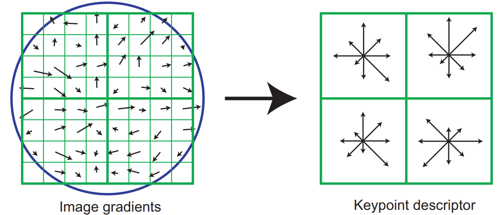{height=250px fig-align="center"}

## Construção do Descritor II

- Cada histograma possui **8 orientações**, o que resulta no descritor de tamanho 128 ($4\times4\times8$)
- Por fim, o vetor é normalizado, fazendo com que mudanças na iluminação sejam minimizadas

## Construção do Descritor III

<video autoplay loop muted playsinline style="display: block; margin: 0 auto; width: 80%; height: 80%; object-fit: contain;">
  <source src="img/descritor_sift.mp4" type="video/mp4">
</video>

## Exemplo: Features SIFT {.nostretch}

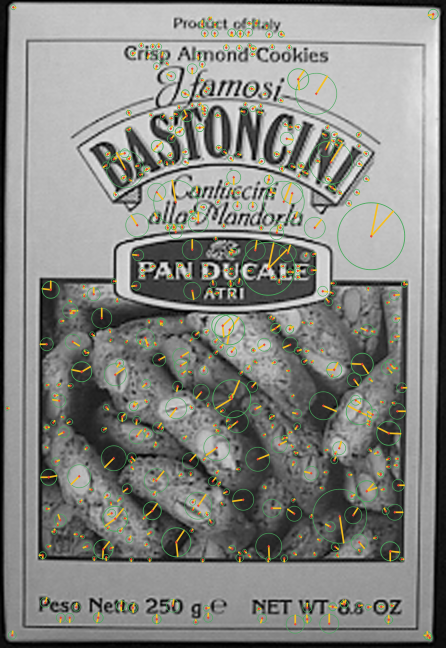{height=550px fig-align="center"} 

## Funções da OpenCV

Função da OpenCV relacionada ao tópico da aula:

- `cv2.SIFT_create()`: cria objeto SIFT
- `detect()`: detecta pontos na imagem
- `compute()`: extrai descritores para pontos previamente detectados

## Guia de Leitura

- Pirâmides de Gaussianas (OpenCV) [@opencvPyramids]
- SIFT [@lowe2004]
- Outras features multiescalas:
  - **SURF** (*Speeded-Up Robust Features*) [@bay2008]
  - **BRIEF** (*Binary Robust Independent Elementary Features*) [@calonder2010]
  - **ORB** (*Oriented BRIEF*) [@rublee2011]
  - **FREAK** (*Fast Retina Keypoint*) [@alahi2012]

## Sumário

Nesta aula, feature multiescala SIFT:

- Intuição do espaço de escalas
- Detecção do ponto
- Cálculo da orientação do ponto
- Cálculo do descritor do ponto

## Referências {.smaller .scrollable}

::: {#refs}
:::
