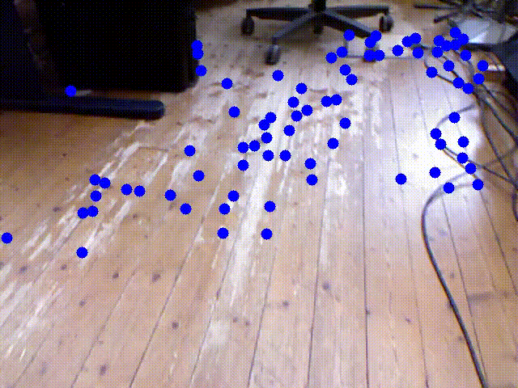
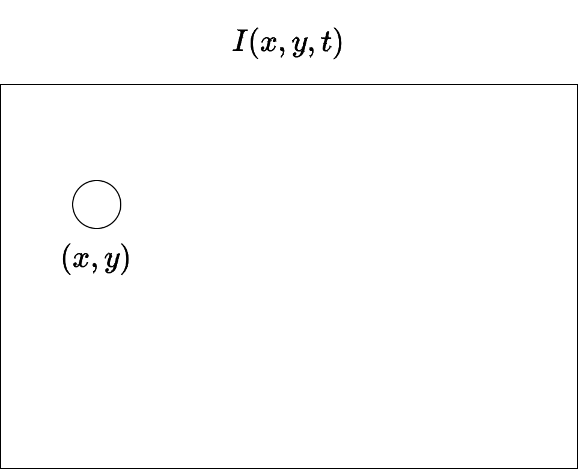
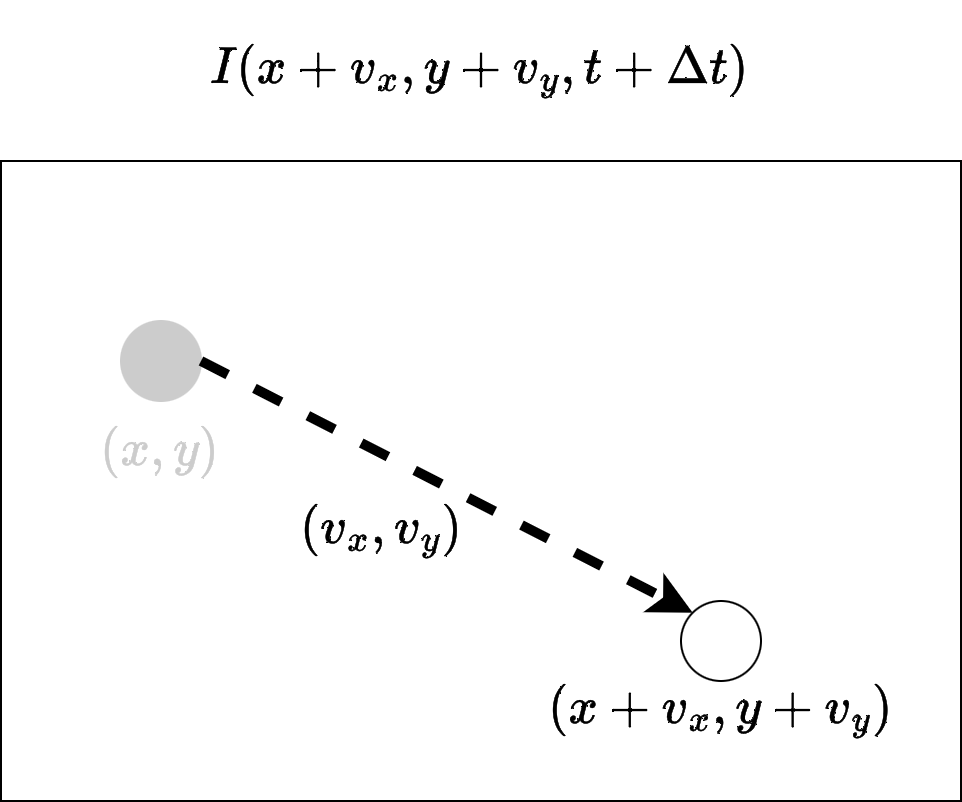
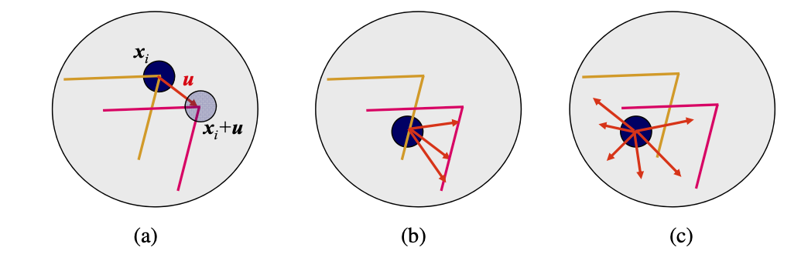
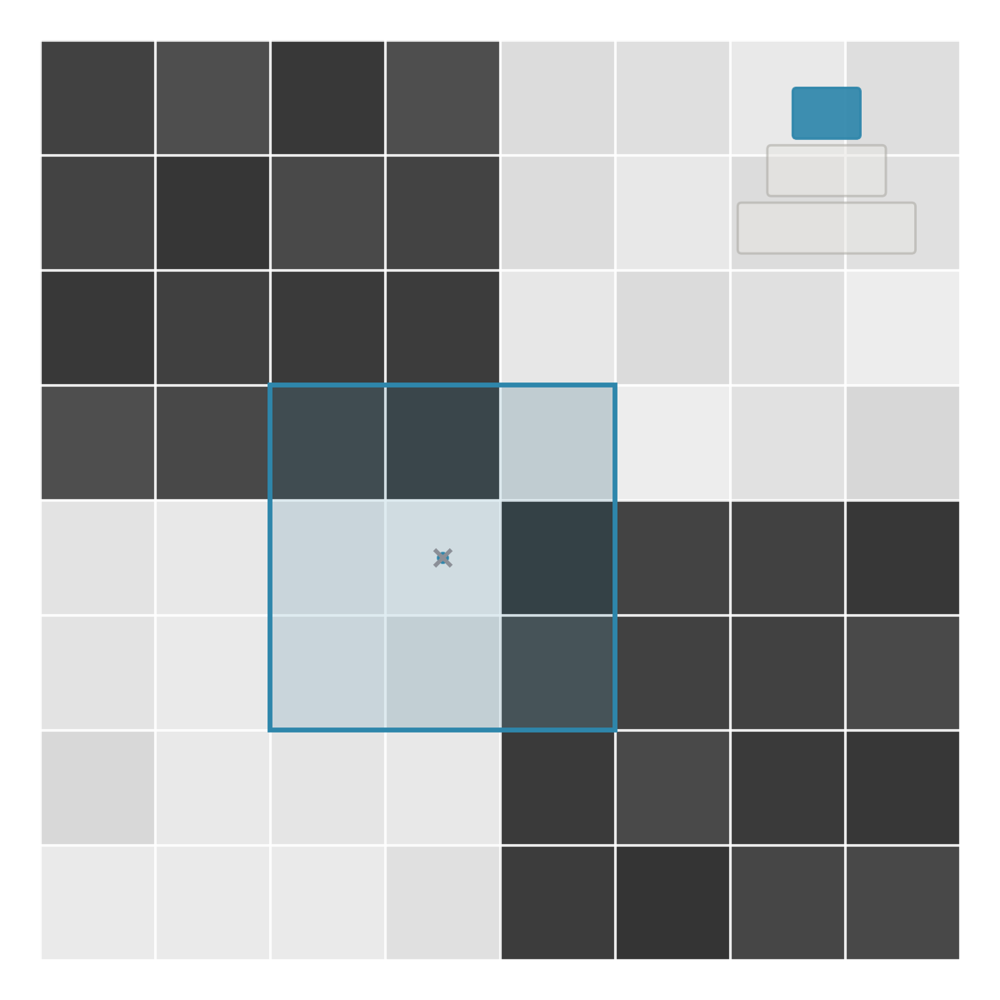
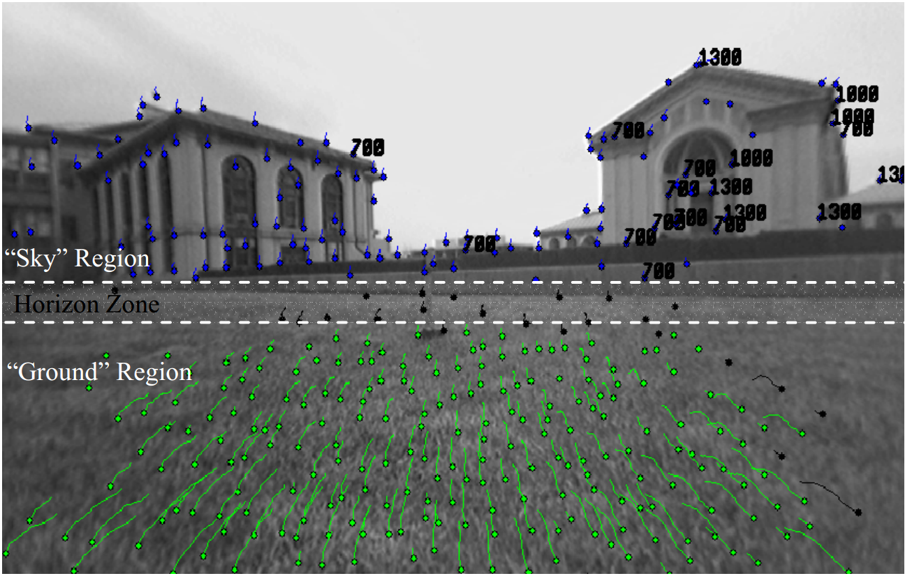
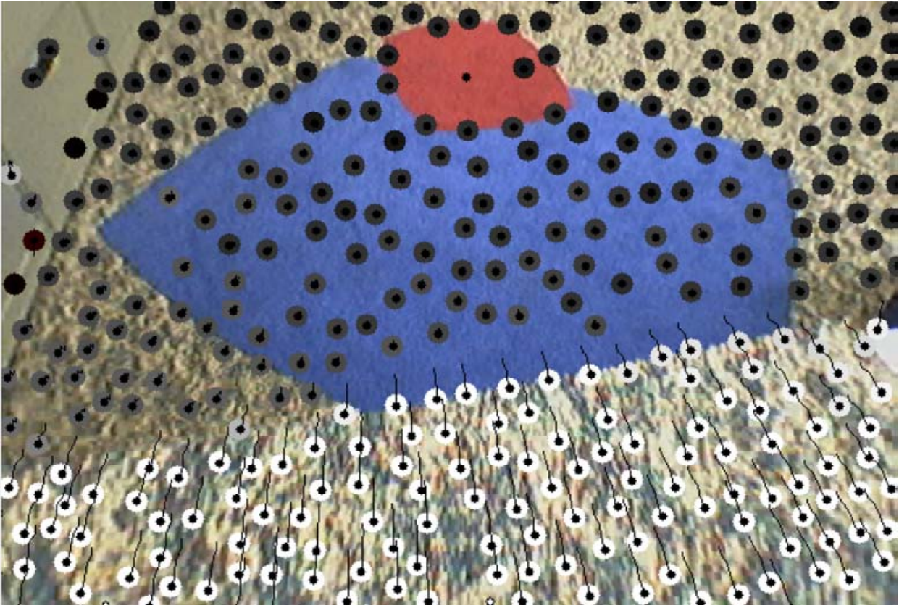
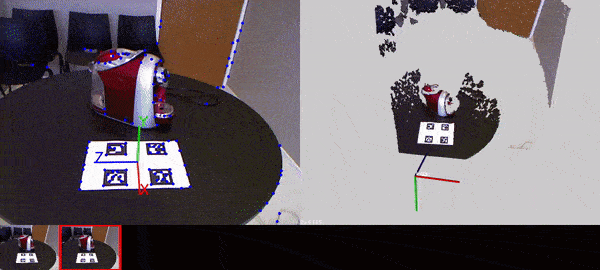

## Rastreamento de Features I

Aplicações com features do tipo ponto (*corner*) frequentemente precisam de correspondências entre diferentes imagens

Para isto:

- Detecção de pontos em todas as imagens + obtenção de correspondências (*matching*)
- Detecção em uma imagem de referência + **rastreamento** das features em imagens subsequentes

## Rastreamento de Features II

Ao rastrear features ao invés de detectá-las em cada nova imagem,
o custo computacional da obtenção de correspondências entre pontos é menor.

Uma das formulações deste problema é conhecida como **fluxo óptico**.

## Fluxo Óptico {.nostretch}

{width=40% fig-align="center"}

- Pontos azuis são detectados e rastreados
- Para funcionar, o algoritmo assume um certo grau de similaridade entre imagens subsequentes

## Fluxo Óptico I

O fluxo óptico de uma imagem:

- É o movimento aparente no padrão de intensidade da imagem
  - A câmera se move com a cena estática; ou
  - Objetos se movem com a câmera estática

## Fluxo Óptico II

- É dado por um conjunto de vetores deslocamento
  - Vetores deslocamento = vetores velocidade (em pixels/quadro)
- Para seu cálculo, são consideradas as variações espaciais e temporais nos pixels de uma imagem

## Fluxo Óptico III

Dadas duas imagens $I_1$ e $I_2$:

::: {.columns}
::: {.column width="50%"}

$I_1$ obtida no instante de tempo $t$.

{width=80% fig-align="center"}

:::
::: {.column width="50%"}

$I_2$ obtida no instante de tempo $t+\Delta t$.

{width=80% fig-align="center"}

:::
:::

O ponto $(x,y)$ se desloca por $(v_x,v_y)$ até $(x+v_x,y+v_y)$.

## Fluxo Óptico IV

Por definição:

$$
I_1(x,y,t)=I_2(x+v_x,y+v_y,t+\Delta t)
$$

Isto é, a segunda imagem deve ser igual à primeira mais os deslocamentos de cada ponto.

## Fluxo Óptico V

Para calcular o fluxo óptico entre as imagens, assumem-se as seguintes premissas:

- As superfícies dos objetos da cena são **Lambertianas** (reflectância uniforme)
  - Pixels vizinhos que correspondem a um mesmo objeto possuem o mesmo padrão de intensidade
- O brilho de objetos que se movem em relação à câmera se mantém constante ao longo do tempo
  - Um objeto que se move não tem sua intensidade alterada

## Fluxo Óptico VI

Matematicamente, a variação ao longo do tempo da intensidade/brilho $I(x,y,t)$ deve ser nula, o que dá origem à equação da constância de brilho:

$$
\frac{dI(x,y,t)}{dt}=0
$$

## Fluxo Óptico – Desenvolvimento I

A equação anterior pode ser desenvolvida como:

$$
\begin{aligned}
\frac{dI(x,y,t)}{dt}
&=\frac{\partial I}{\partial x}\frac{dx}{dt}
+\frac{\partial I}{\partial y}\frac{dy}{dt}
+\frac{\partial I}{\partial t} \\
&=0,
\end{aligned}
$$

## Fluxo Óptico – Desenvolvimento II {.smaller}

Com

$$
G_x=\frac{\partial I}{\partial x}\qquad\text{e}\qquad G_y=\frac{\partial I}{\partial y}
$$

formando o vetor gradiente da imagem $\nabla G^t=[G_x,G_y]^t$,

$$
v_x=\frac{dx}{dt}\qquad\text{e}\qquad v_y=\frac{dy}{dt},
$$

formando o vetor deslocamento $\mathbf{v}=[v_x,v_y]^t$ e

$$
\frac{\partial I}{\partial t}=I_t
$$

sendo mudança de intensidade ao longo do tempo na posição $(x,y)$,

## Fluxo Óptico – Desenvolvimento III

tem-se:

$$
G_xv_x+G_yv_y=-I_t
$$

que pode ser escrito na forma vetorial como:

$$
\nabla G^t\mathbf{v}=-I_t
$$

Desta forma, temos uma única equação para duas incógnitas (as componentes do vetor $\mathbf{v}$). Como proceder?

## Fluxo Óptico – Lucas Kanade I

Uma solução para este problema foi formulada por Lucas e Kanade, no que ficou conhecido como algoritmo de fluxo óptico de **Lucas-Kanade (LK)**

## Fluxo Óptico – Lucas Kanade II

- Calcula-se $\mathbf{v}$ para o pixel central de uma janela $W$ de tamanho $N\times N$
- Tem-se agora um sistema sobredeterminado de $N\times N$ equações, formado pela equação do slide anterior aplicada a cada pixel $\mathbf{p}_i$, $i=1,\ldots,N\times N$, da janela $W$
- Supõe que todos os pixels da janela se moveram pelo mesmo vetor de deslocamento

## Fluxo Óptico – Lucas Kanade III

Sistema linear: as incógnitas são as componentes do vetor de deslocamento $\mathbf{v}$. O sistema é sobredeterminado (possui $N\times N$ equações para 2 incógnitas):

$$
\begin{bmatrix}
G_x(\mathbf{p}_1) & G_y(\mathbf{p}_1) \\
G_x(\mathbf{p}_2) & G_y(\mathbf{p}_2) \\
\vdots & \vdots \\
G_x(\mathbf{p}_{N\times N}) & G_y(\mathbf{p}_{N\times N})
\end{bmatrix}
\begin{bmatrix}v_x\\v_y\end{bmatrix}
=-\begin{bmatrix}
I_t(\mathbf{p}_1)\\
I_t(\mathbf{p}_2)\\
\vdots\\
I_t(\mathbf{p}_{N\times N})
\end{bmatrix}
$$

## Fluxo Óptico – Lucas Kanade IV

Resolver o sistema sobredeterminado $A\mathbf{v}=\mathbf{b}$ equivale a minimizar a função erro dada por:

$$
\varepsilon(\mathbf{v})=
\sum_{\mathbf{p}_i\in W}\left(\nabla G^t\cdot\mathbf{v}+I_t\right)^2
$$

## Fluxo Óptico – Lucas Kanade V

A solução para $\mathbf{v}$ é obtida resolvendo-se:

$$
A^tA\mathbf{v}=A^t\mathbf{b}
$$

que, por sua vez, é dado por:

$$
\begin{bmatrix}
\sum G_x^2 & \sum G_xG_y \\
\sum G_xG_y & \sum G_y^2
\end{bmatrix}
\begin{bmatrix}v_x\\v_y\end{bmatrix}
=-\begin{bmatrix}\sum G_xI_t\\\sum G_yI_t\end{bmatrix}
$$

com os somatórios computados em $\mathbf{p}_i\in W$.

## Fluxo Óptico – Problema da Abertura I

Em algumas situações, a matriz $A^tA$ não possui inversa:

- Gradientes espaciais $G_x$ e $G_y$ na janela $W$ são nulos ou paralelos
- Isto é conhecido na literatura como **problema da abertura**

## Fluxo Óptico – Problema da Abertura II {.nostretch}

{width=80% fig-align="center"}

::: {style="font-size: 0.7em;"}

- **(a)** $A^tA$ possui inversa: gradientes adequados
- **(b)** $A^tA$ não possui inversa: gradiente apenas ao longo de uma direção
- **(c)** $A^tA$ não possui inversa: sem gradiente

:::

## Fluxo Óptico – Problema da Abertura III

Para o fluxo óptico não ter ambiguidade:

- Ele precisa ser calculado em posições na imagem que contenham variações de intensidade consideráveis ao longo das duas direções.

**Isto já foi visto no curso:**

- Esta condição acontece em regiões de cantos (*corners*)
- A matriz $A^tA$ precisa que o menor dos seus autovalores tenha um valor mínimo

## Fluxo Óptico – Problema da Abertura IV

O resultado do fluxo óptico pode então ser interpretado como:

- Determinação do deslocamento $\mathbf{v}$ que relaciona $I_1(x,y)$ com $I_2(x+v_x,y+v_y)$ ou
- Rastreamento do ponto $I_1(x,y)$ para $I_2(x+v_x,y+v_y)$

## Fluxo Óptico - Validação do Cálculo

  Sendo $\mathbf{p}_i$ da imagem $I_t$ e $\mathbf{p'}_i$ da imagem $I_{t+1}$, temos:

- $\mathbf{p'}_i = \mathbf{p}_i + \mathbf{v}$, assim como
- $\mathbf{p}_i = \mathbf{p'}_i - \mathbf{v}$

Ou seja, é possível calcular o fluxo óptico $-\mathbf{v}$ na direção contrária
para validar $\mathbf{v}$:

$$
\mathbf{p}_i + \mathbf{v} \approx \mathbf{p'}_i - \mathbf{v}
$$

## Fluxo Óptico – LK Piramidal I

O algoritmo de Lucas-Kanade possui uma versão piramidal:

- Possui precisão e robustez a movimentos mais rápidos (movimentos maiores)
- É computado em várias versões subamostradas da imagem (ex.: $320\times240$, $160\times120$, etc.)
- O vetor deslocamento na imagem de menor resolução é propagado como solução inicial para a imagem imediatamente maior
- Método iterativo

## Fluxo Óptico - LK Piramidal II {.nostretch}

::: {.columns}
::: {.column width="50%"}

{width=90% fig-align="center"}

:::
::: {.column width="50%"}

A estimativa do nível da pirâmide anterior (cinza) é usada
como solução inicial para resolver o sistema linear, resultando na estimativa
do nível atual (vermelha).

:::
:::

## Fluxo Óptico – Aplicações I

Aplicações do fluxo óptico: navegação e detecção de obstáculos para robôs planares [@campbell2005].

::: {.columns}
::: {.column width="50%"}

{width=100% fig-align="center"}

:::
::: {.column width="50%"}

{width=100% fig-align="center"}

:::
:::

## Fluxo Óptico – Aplicações II 

Aplicações do fluxo óptico: SLAM e reconstrução 3D [@silva2015].

{width=90% fig-align="center"}

## Fluxo Óptico – Esparso vs. Denso

- O que foi mostrado nesta aula foi apenas um algoritmo para o fluxo óptico **esparso**
- Existem vários outros algoritmos
- Existem também algoritmos **densos**: calculam o vetor deslocamento para todos os pixels na imagem

## Funções da OpenCV

Função da OpenCV relacionada ao tópico da aula:

`cv.calcOpticalFlowPyrLK`

---

## Guia de Leitura

- Teoria do fluxo óptico: @trucco1998, @szeliski2022
- Fluxo óptico na OpenCV @kaehler2016
- Versões do algoritmo esparso: @lucas1981, @shi1994, @bouguet1999
- Aplicações: @campbell2005, @silva2015

---

## Sumário

Nesta aula — cálculo do fluxo óptico:

- Suposições assumidas
- Algoritmo apresentado: Lucas-Kanade
- Problema da abertura: cálculo do deslocamento ambíguo para alguns casos
- Aplicações

---

## Referências {.smaller .scrollable}

::: {#refs}
:::
