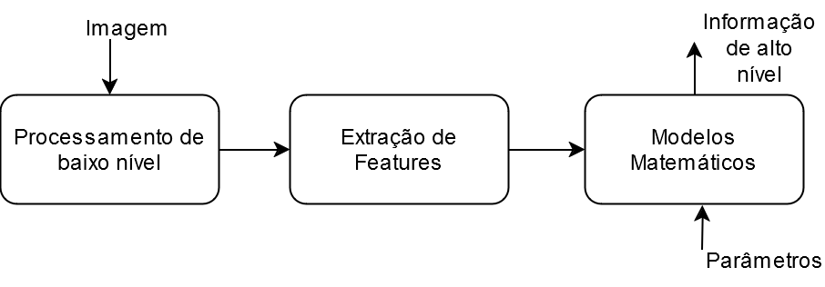
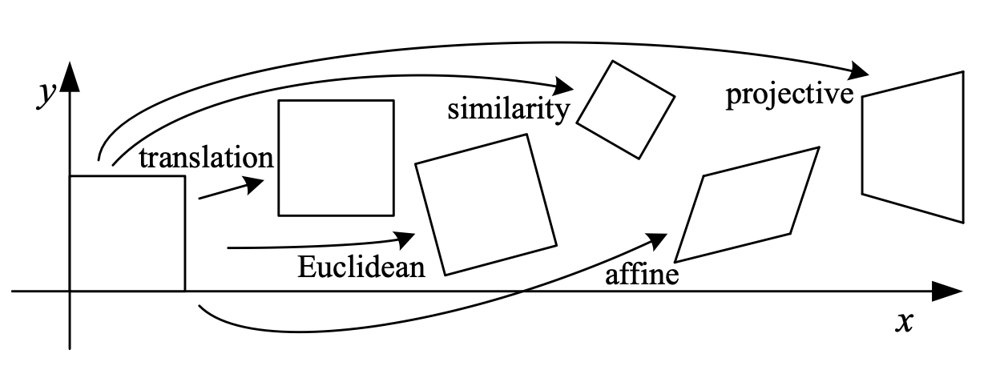
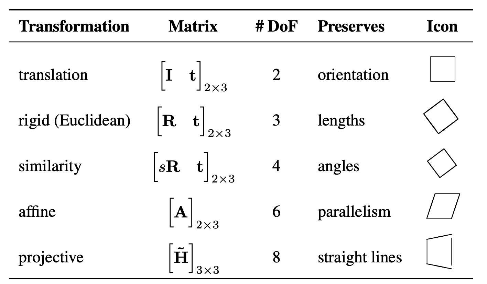
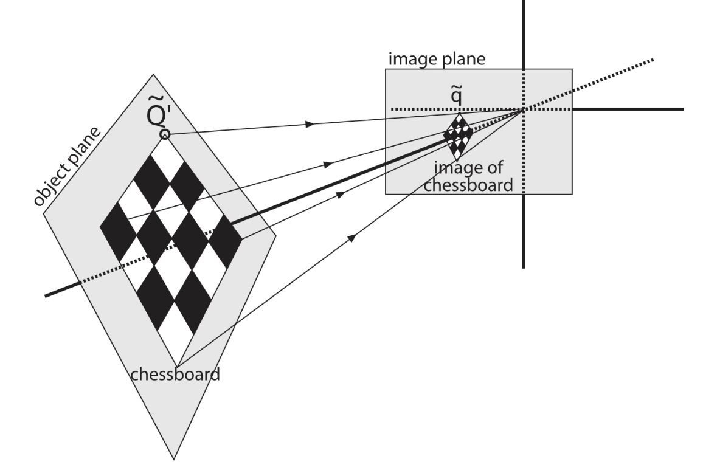
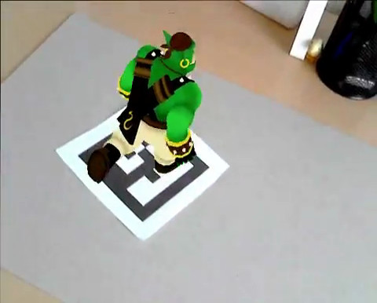
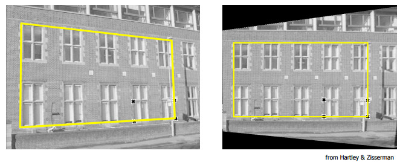
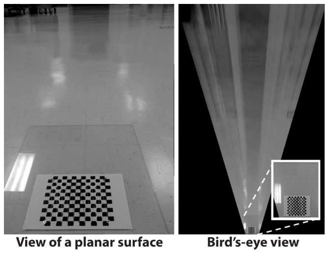
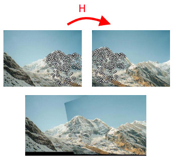
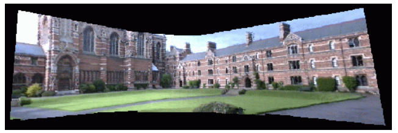
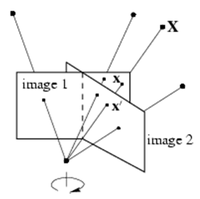

## Introdução

Várias aplicações de Visão Computacional envolvem obter informações de alto nível:

- Informações presentes na **imagem** de uma cena:
  - Pessoas, rostos, animais, objetos, etc
  - Informações 2D originárias dos pixels de uma imagem
- Informações **da própria** cena:
  - Posições de pessoas/objetos, espaço livre à frente de um carro, posição de impedimento de um jogador, etc
  - Informações 3D computadas utilizando informações 2D como entrada

## Introdução {.nostretch}

{width=80% fig-align="center"}

## Introdução

É preciso portanto conhecer, entender e aplicar modelos matemáticos que relacionem features extraídas de imagens com a cena de interesse.

Um destes modelos é chamado de **homografia**

## Homografia I

- O termo se refere a uma família de transformações matemáticas
- Em Visão Computacional: é uma transformação que relaciona pontos presentes em planos
  - Pode transformar pontos presentes em um plano no mundo para planos na imagem (transformação $3D \rightarrow 2D$)
  - Pode transformar pontos presentes em uma imagem em pontos presentes em outra imagem (transformação $2D \rightarrow 2D$)

## Homografia II {.nostretch}

{width=75% fig-align="center"}

Hierarquia de transformações:

- Homografia é uma transformação projetiva
- Transforma um quadrado em um quadrilátero qualquer
- Transformações à esquerda são mais específicas

## Homografia III {.nostretch}

{width=60% fig-align="center"}

Hierarquia de transformações:

- Transformações abaixo são mais genéricas e incluem as acima

## Homografia: Exemplos de Aplicações I {.nostretch}

::: {.columns}
::: {.column width="55%"}

Calibração de câmera:

- O padrão de calibração é um plano no espaço 3D
- A transformação entre pontos presentes no plano do xadrez e o plano de imagem é uma homografia

:::
::: {.column width="45%"}

{width=100% fig-align="center"}

:::
:::

## Homografia: Exemplos de Aplicações II {.nostretch}

::: {.columns}
::: {.column width="55%"}

Realidade aumentada:

- O marcador é um plano no espaço 3D
- Com a homografia e câmera calibrada, é possível obter a rotação e translação entre câmera e marcador para
  assim renderizar gráficos 3D sobre o marcador

:::
::: {.column width="45%"}

{width=100% fig-align="center"}

:::
:::

## Homografia: Exemplos de Aplicações IIIa {.nostretch}

::: {.columns}
::: {.column width="40%"}

Correção de perspectiva:

- Com a homografia, é possível distorcer uma imagem de forma a retificar um plano presente nela para o mesmo plano presente em outra imagem

:::
::: {.column width="60%"}

{width=100% fig-align="center"}

:::
:::

## Homografia: Exemplos de Aplicações IIIb {.nostretch}

::: {.columns}
::: {.column width="50%"}

Correção de perspectiva:

- Também é possível distorcer uma imagem de forma que este plano seja visto do topo (*bird's eye view*)

:::
::: {.column width="50%"}

{width=100% fig-align="center"}

:::
:::

## Homografia: Exemplos de Aplicações IV {.nostretch}

::: {.columns}
::: {.column width="50%"}

Mosaico (1):

- Pontos muito distantes da câmera são considerados pertencentes a um plano no infinito

:::
::: {.column width="50%"}

{width=100% fig-align="center"}

:::
:::

## Homografia: Exemplos de Aplicações V {.nostretch}

::: {.columns}
::: {.column width="45%"}

Mosaico (2):

- Mesmo com pontos próximos à câmera, a relação entre pares de imagens é dada por uma homografia caso o movimento da câmera seja apenas de rotação

:::
::: {.column width="55%"}

{width=100% fig-align="center"}

{width=35% fig-align="center"}

:::
:::

## Coordenadas Homogêneas I

Uma recurso muito utilizado para se trabalhar no espaço 3D é representar
pontos com coordenadas homogêneas.

O ponto 2D $\mathbf{p} = [x, y]^t$ é representado em coordenadas homogêneas por 

$$
\mathbf{\hat{p}} = 
\begin{bmatrix} kx \\ ky \\ k,
\end{bmatrix}
$$

onde $k \in \mathbb{R},\quad k \neq 0$ é a escala homogênea.

## Coordenadas Homogêneas II

Com elas, é possível representar uma transformação em um ponto
utilizando multiplicações matriciais:

$$
\begin{aligned}
\mathbf{\hat{p}'}                                &= T\mathbf{\hat{p}}\\
\begin{bmatrix} k'x' \\ k'y' \\ k' \end{bmatrix} &=
\begin{bmatrix}
t_1 & t_2 & t_3 \\
t_4 & t_5 & t_6 \\
t_7 & t_8 & t_9
\end{bmatrix}
\begin{bmatrix} kx \\ ky \\ k \end{bmatrix},
\end{aligned}
$$

onde o ponto $\mathbf{\hat{p}'}$ é o resultado da transformação
$H$ em $\mathbf{\hat{p}}$

## Coordenadas Homogêneas III

Em alternativa a usar as coordenadas não homogêneas $x,y$ junto com a escala $k$,
também é possível representar um ponto em termos
de suas coordenadas homogêneas $\hat{x}, \hat{y}, \hat{w}$:

$$
\mathbf{\hat{p}} = 
\begin{bmatrix} \hat{x} \\ \hat{y} \\ \hat{w} \end{bmatrix} = 
\begin{bmatrix} kx \\ ky \\ k \end{bmatrix}
$$

## Homografia IV

Dados um ponto $\mathbf{\hat{p}}_1 = [\hat{x}_1, \hat{y}_1, \hat{w}_1]^t$ presente em uma imagem $I_1$ e a sua correspondência
$\mathbf{\hat{p}}_2 = [\hat{x}_2, \hat{y}_2, \hat{w}_2]^t$ presente em uma imagem $I_2$, uma homografia $H$ relaciona o par de pontos por

$$
\mathbf{\hat{p}}_2 = H\mathbf{\hat{p}}_1
$$

## Homografia V

A homografia possui inversa, ou seja, $H$ relaciona uma correspondência entre pontos por

$$
\mathbf{\hat{p}}_2 = H\mathbf{\hat{p}}_1
$$

e

$$
\mathbf{\hat{p}}_1 = H^{-1}\mathbf{\hat{p}}_2
$$

## Homografia VI

A homografia $H$ é uma transformação homogênea, isto é, definida a menos de um fator de escala:

$$
\begin{bmatrix}
h_1 & h_2 & h_3 \\
h_4 & h_5 & h_6 \\
h_7 & h_8 & h_9
\end{bmatrix}
\overset{\text{def}}{=}
\begin{bmatrix}
wh_1 & wh_2 & wh_3 \\
wh_4 & wh_5 & wh_6 \\
wh_7 & wh_8 & wh_9
\end{bmatrix}
$$

## Homografia VII

O cálculo da homografia a partir de correspondências pode ser obtido desenvolvendo a equação $\mathbf{\hat{p}}_2 = H\mathbf{\hat{p}}_1$:

$$
\begin{bmatrix} \hat{x}_2 \\ \hat{y}_2 \\ \hat{w}_2 \end{bmatrix} =
\begin{matrix}
h_1\hat{x}_1 + h_2\hat{y}_1 + h_3\hat{w}_1 \\
h_4\hat{x}_1 + h_5\hat{y}_1 + h_6\hat{w}_1 \\
h_7\hat{x}_1 + h_8\hat{y}_1 + h_9\hat{w}_1
\end{matrix}
$$

## Homografia VIII

Observe que para converter o ponto resultante para coordenadas não homogêneas $[x_2, y_2]$,
devemos dividir $\hat{x}_2$ e $\hat{y}_2$ por $\hat{w}_2$, ou seja

$$
\begin{bmatrix} x_2 \\ y_2 \\ 1 \end{bmatrix} =
\begin{bmatrix} \hat{x}_2/\hat{w}_2 \\ \hat{y}_2/\hat{w}_2 \\ 1 \end{bmatrix}
$$

## Homografia IX

Fazendo isto ao mesmo tempo em que consideramos $\hat{w}_1 = 1$, obtemos:

$$
\begin{bmatrix} x_2 \\ y_2 \end{bmatrix} =
\begin{matrix}
\dfrac{h_1\hat{x}_1 + h_2\hat{y}_1 + h_3}{h_7\hat{x}_1 + h_8\hat{y}_1 + h_9} \\[1em]
\dfrac{h_4\hat{x}_1 + h_5\hat{y}_1 + h_6}{h_7\hat{x}_1 + h_8\hat{y}_1 + h_9}
\end{matrix}
$$

## Homografia X

Multiplicando o lado esquerdo pelo denominador, ficamos com

$$
\begin{matrix}
h_7\hat{x}_1x_2 + h_8\hat{y}_1x_2 + h_9x_2 \\
h_7\hat{x}_1y_2 + h_8\hat{y}_1y_2 + h_9y_2
\end{matrix}
=
\begin{matrix}
h_1\hat{x}_1 + h_2\hat{y}_1 + h_3 \\
h_4\hat{x}_1 + h_5\hat{y}_1 + h_6
\end{matrix}
$$

## Homografia XI

Após isto, passamos o lado direito para o lado esquerdo, ficando com duas equações homogêneas:

$$
\begin{matrix}
-h_1\hat{x}_1 - h_2\hat{y}_1 - h_3 + h_7\hat{x}_1x_2 + h_8\hat{y}_1x_2 + h_9x_2 \\
-h_4\hat{x}_1 - h_5\hat{y}_1 - h_6 + h_7\hat{x}_1y_2 + h_8\hat{y}_1y_2 + h_9y_2
\end{matrix}
=
\begin{matrix} 0 \\ 0 \end{matrix}
$$

## Homografia XII

Observe que a partir destas equações, é possível construir um sistema de equações lineares homogêneo ($2 \times 9$), com as incógnitas sendo as entradas da matriz $H$:

::: {style="font-size: 0.75em;"}
$$
\begin{bmatrix}
-\hat{x}_1 & -\hat{y}_1 & -1 & 0 & 0 & 0 & \hat{x}_1\hat{x}_2 & \hat{y}_1\hat{x}_2 & \hat{x}_2 \\
0 & 0 & 0 & -\hat{x}_1 & -\hat{y}_1 & -1 & \hat{x}_1\hat{y}_2 & \hat{y}_1\hat{y}_2 & \hat{y}_2
\end{bmatrix}
\begin{bmatrix} h_1 \\ h_2 \\ \vdots \\ h_9 \end{bmatrix}
=
\begin{bmatrix} 0 \\ 0 \end{bmatrix}
$$
:::

Problema: 2 equações, 8 incógnitas. Como proceder?

## Homografia XIII

Como cada correspondência contribui com 2 equações e existem 8 incógnitas\*, as entradas de $H$ podem ser estimadas com $n \geq 4$ correspondências.

::: {style="font-size: 0.5em;"}

\*Apesar da matriz $H$ possuir 9 componentes, ela é definida a menos de um fator de escala

:::

## Homografia XIV

Isso dá origem ao sistema $2n \times 9$ abaixo,
em que o sobrescrito $(i)$ indica a $i$-ésima correspondência, $i = 1, \ldots, n$:

::: {style="font-size: 0.75em;"}
$$
\footnotesize
\begin{bmatrix}
-\hat{x}_1^{(1)} & -\hat{y}_1^{(1)} & -1 & 0 & 0 & 0 & \hat{x}_1^{(1)}\hat{x}_2^{(1)} & \hat{y}_1^{(1)}\hat{x}_2^{(1)} & \hat{x}_2^{(1)} \\
0 & 0 & 0 & -\hat{x}_1^{(1)} & -\hat{y}_1^{(1)} & -1 & \hat{x}_1^{(1)}\hat{y}_2^{(1)} & \hat{y}_1^{(1)}\hat{y}_2^{(1)} & \hat{y}_2^{(1)} \\
-\hat{x}_1^{(2)} & -\hat{y}_1^{(2)} & -1 & 0 & 0 & 0 & \hat{x}_1^{(2)}\hat{x}_2^{(2)} & \hat{y}_1^{(2)}\hat{x}_2^{(2)} & \hat{x}_2^{(2)} \\
0 & 0 & 0 & -\hat{x}_1^{(2)} & -\hat{y}_1^{(2)} & -1 & \hat{x}_1^{(2)}\hat{y}_2^{(2)} & \hat{y}_1^{(2)}\hat{y}_2^{(2)} & \hat{y}_2^{(2)} \\
\vdots & \vdots & \vdots & \vdots & \vdots & \vdots & \vdots & \vdots & \vdots \\
-\hat{x}_1^{(n)} & -\hat{y}_1^{(n)} & -1 & 0 & 0 & 0 & \hat{x}_1^{(n)}\hat{x}_2^{(n)} & \hat{y}_1^{(n)}\hat{x}_2^{(n)} & \hat{x}_2^{(n)} \\
0 & 0 & 0 & -\hat{x}_1^{(n)} & -\hat{y}_1^{(n)} & -1 & \hat{x}_1^{(n)}\hat{y}_2^{(n)} & \hat{y}_1^{(n)}\hat{y}_2^{(n)} & \hat{y}_2^{(n)}
\end{bmatrix}
\begin{bmatrix} h_1 \\ h_2 \\ \vdots \\ h_9 \end{bmatrix}
=
\begin{bmatrix} 0 \\ 0 \\ 0 \\ 0 \\ \vdots \\ 0 \\ 0 \end{bmatrix}
$$
:::

## Homografia XV

O sistema linear homogêneo $A\mathbf{h} = \mathbf{0}$, com $\mathbf{h}$ sendo as entradas da matriz $H$,
deve ser resolvido com a restrição do vetor $\mathbf{h}$ ter norma unitária, isto é, $\|\mathbf{h}\| = 1$.

## Homografia XVI

Para resolvê-lo, utilizamos um método numérico conhecido como SVD (Decomposição em Valores Singulares):
a matriz $A$ é decomposta em duas matrizes ortonormais $U$ e $V$, e em uma matriz diagonal $\Sigma$ composta
pelos valores singulares de $A$ (raízes quadradas dos autovalores de $A^tA$):

$$
A = U\Sigma V^t = \sum_{i=1}^{9} \sigma_i \mathbf{u}_i \mathbf{v}_i^t
$$

## Homografia XVII

Como os valores singulares são computados em ordem decrescente, o vetor singular à direita de $A$ que corresponde ao menor valor singular contém a solução.

Em outras palavras, as entradas da matriz $H$ estão, em ordem, no último vetor coluna da matriz $V$.

---

## Funções da OpenCV

Funcionalidades da OpenCV relacionadas ao tópico da aula:

- `cv.convertPointsToHomogeneous`: converte para coordenadas homogêneas
- `cv.convertPointsFromHomogeneous`: converte para coordenadas não homogêneas
- `cv.findHomography`: calcula homografia a partir de pelo menos 4 correspondências
- `cv.SVDecomp` ou `np.linalg.svd`: decompõe uma matriz em seus valores singulares

## Guia de Leitura

- *Computer Vision: Algorithms and Applications* [@szeliski2022]
- *Learning OpenCV* [@kaehler2016]
- *Basic concepts of the homography explained with code* [@opencv_homography]
- *Homography Estimation* [@kriegman2007]
- *SVD for total least squares* [@kitani_svd]
- *Multiple View Geometry in Computer Vision* [@hartley2004]

---

## Sumário

Nesta aula – homografia:

- Exemplo de aplicações
- Algoritmo para cálculo de homografia que relaciona par de imagens

---

## Referências {.smaller .scrollable}

::: {#refs}
:::
