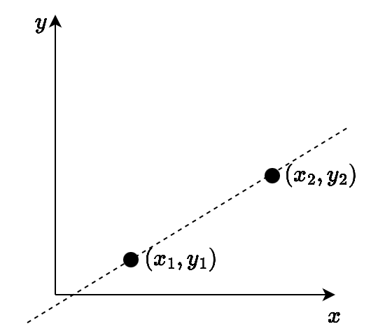
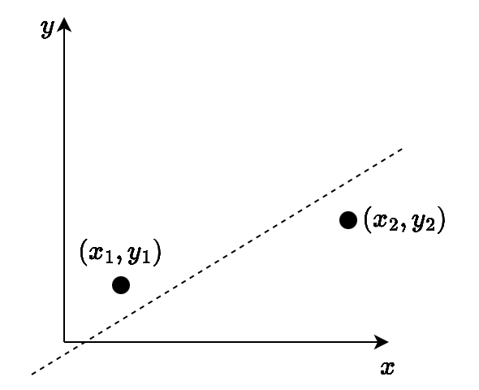
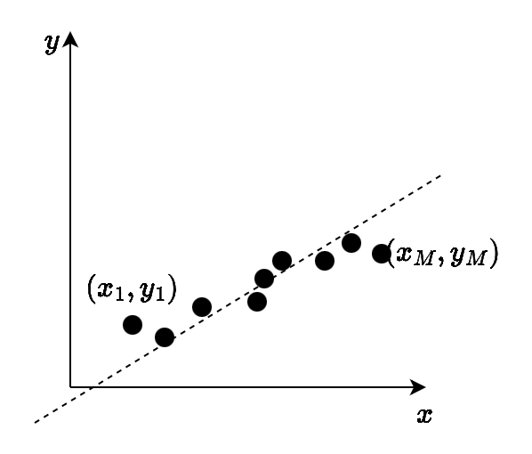
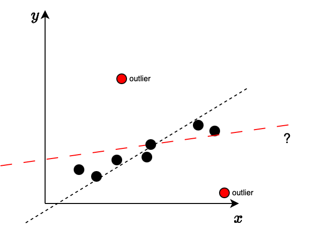

## Estimando um Modelo Matemático

- Considere o modelo matemático da **equação da reta**
  - Como é o modelo matemático? Quais são os seus parâmetros?
  - Quantos pontos são precisos para estimar este modelo?

## Estimando um Modelo Matemático {.nostretch}

{width=45% fig-align="center"}

## Estimando um Modelo Matemático

- Considere o modelo matemático da **equação da reta**
  - Como é o modelo matemático? Quais são os seus parâmetros?

    [$y_i = ax_i + b$]{style="color: red;"}

  - Quantos pontos são precisos para estimar este modelo?

    [Pelo menos dois pontos são necessários]{style="color: red;"}

## Estimando um Modelo Matemático

- E no caso em que é adicionado ruído às coordenadas dos pontos da reta?
  - $\hat{x}_i = x_i + N(0, \sigma^2)$
  - $\hat{y}_i = a\hat{x}_i + b$
- Observe que neste caso, a reta verdadeira (computada com $x_i$, $y_i$) deve ser aproximada da reta computada com os dados com ruído $\hat{x}_i$, $\hat{y}_i$

  Como proceder?

## Estimando um Modelo Matemático {.nostretch}

{width=45% fig-align="center"}

## Estimando um Modelo Matemático

- E no caso em que é adicionado ruído às coordenadas dos pontos da reta?
  - $\hat{x}_i = x_i + N(0, \sigma^2)$
  - $\hat{y}_i = a\hat{x}_i + b$
- Observe que neste caso, a reta verdadeira (computada com $x_i$, $y_i$) deve ser aproximada da reta computada com os dados com ruído $\hat{x}_i$, $\hat{y}_i$

  Como proceder?

  [Método dos Mínimos Quadrados: computa os parâmetros do modelo de forma a minimizar a soma dos erros quadráticos]{style="color: red;"}

## Estimando um Modelo Matemático

O Método dos Mínimos Quadrados se beneficia de uma maior quantidade de pontos:

- Com $M$ pontos, resolve um sistema de equações sobredeterminado ($M$ equações, 2 incógnitas)

## Estimando um Modelo Matemático {.nostretch}

{width=45% fig-align="center"}

## Estimando um Modelo Matemático

Para que o método dos Mínimos Quadrados estime o modelo correto na presença de dados corrompidos por ruído, uma premissa deve ser respeitada:

O ruído que afeta os dados $\hat{x}_i$, $\hat{y}_i$ é assumido com distribuição normal

- Pontos que seguem esta premissa são chamados de ***inliers***
- Pontos que não seguem são chamados de ***outliers***

## Estimando um Modelo Matemático {.nostretch}

{width=50% fig-align="center"}

## Estimando um Modelo Matemático

- Como lidar com outliers? Isto é possível?
- Um método para lidar com este tipo de problema se chama RANSAC

## RANSAC

RANSAC: RANdom SAmple Consensus (consenso da amostra aleatória):

- Método proposto em 1981
- Impulsionou fortemente Visão Computacional
- Até hoje, é considerado um trabalho importante
- Possui um número considerável de variações na literatura

## RANSAC

Permite que um modelo matemático seja estimado de forma robusta:

- **Estimação robusta**: o método é robusto a dados corrompidos por ruído
- Funciona mesmo em situações em que a proporção de outliers é considerável ($\sim 50\%$)

## RANSAC

Ideia do algoritmo:

- Utilizar um conjunto mínimo de dados selecionado aleatoriamente para estimar um modelo
- Com o modelo estimado, verificar com o restante dos dados quem "concorda" com o modelo
- O algoritmo se encerra quando um número considerável dos dados chega a um consenso

## RANSAC

Ao final:

- Modelo estimado na presença de outliers
- Classificação dos dados como inlier/outlier

## RANSAC: Algoritmo

- Selecione aleatoriamente uma amostra mínima $s$ do conjunto de pontos $S$
- Calcule o modelo $m$ de acordo com $s$
- Determine o conjunto consenso $S'$: pontos de $S$ que possuem erro no modelo $m$ menor do que $t$
  - Se o tamanho de $S'$ for maior que um limiar $T$, calcule um novo modelo $m$ de acordo com $S'$ e termine o algoritmo
  - Se não, repita o algoritmo
- Depois de $N$ tentativas, o conjunto consenso $S'$ é escolhido e um novo modelo $m$ é calculado de acordo com ele

## RANSAC: Algoritmo [para Reta]{style="color: red;"}

- Selecione aleatoriamente [dois pontos]{style="color: red;"} do conjunto de pontos $S$
- Calcule o modelo [da equação da reta]{style="color: red;"} de acordo com [os dois pontos]{style="color: red;"}
- Determine o conjunto consenso $S'$: pontos de $S$ com [$|y_i - (ax_i + b)| < t$]{style="color: red;"}
  - Se o tamanho de $S'$ for maior que um limiar $T$, calcule [uma nova equação da reta]{style="color: red;"} de acordo com $S'$ e termine o algoritmo
  - Se não, repita o algoritmo
- Depois de $N$ tentativas, o conjunto consenso $S'$ é escolhido [e uma nova equação da reta é calculada]{style="color: red;"} de acordo com ele

## RANSAC: Algoritmo [para Homografia]{style="color: red;"}

- Selecione aleatoriamente [quatro correspondências]{style="color: red;"} do conjunto de pontos $S$
- Calcule o modelo [da homografia]{style="color: red;"} de acordo com [os quatro pontos]{style="color: red;"}
- Determine o conjunto consenso $S'$: pontos de $S$ com [$d_{homog} < t$]{style="color: red;"}
  - Se o tamanho de $S'$ for maior que um limiar $T$, calcule [uma nova homografia]{style="color: red;"} de acordo com $S'$ e termine o algoritmo
  - Se não, repita o algoritmo
- Depois de $N$ tentativas, o conjunto consenso $S'$ é escolhido [e uma nova homografia é calculada]{style="color: red;"} de acordo com ele

## RANSAC: Medida de Distância

Dada uma correspondência entre pontos $\mathbf{x} \leftrightarrow \mathbf{x}'$, uma medida de distância entre os pontos e a homografia $H$ pode ser computada da seguinte forma:

$$
d_{homog}(\mathbf{x}, \mathbf{x}') = d(\mathbf{x}, H^{-1}\mathbf{x}')^2 + d(H\mathbf{x}, \mathbf{x}')^2,
$$

onde $d(.,.)$ é a distância Euclidiana entre pontos.

## RANSAC: Parametrização

O algoritmo RANSAC depende de 3 parâmetros:

1. $t$: limiar do erro
2. $N$: número máximo de tentativas
3. $T$: Tamanho do conjunto consenso

## RANSAC: Limiar do Erro

O limiar do erro $t$ no RANSAC:

- É escolhido de forma que, com uma probabilidade $\alpha$, uma amostra $s$ sem outliers será selecionada
- Não é tão simples de ser estimado

Para a homografia:

- Considerando $\alpha = 95\%$ (95% de chances do ponto ser um inlier), $t$ deve assumir valores entre 2 e 4 pixels
- Isto assume que a distribuição do erro é normal com média 0 e variância unitária

## RANSAC: Número de Amostras I

Observe que, com um conjunto contendo $M$ correspondências e um modelo que precisa de $K$ delas para ser estimado:

- Existem $\binom{M}{K}$ possíveis combinações
- Caso o algoritmo seja exaustivo (teste todas as possibilidades), ele não será computacionalmente eficiente
- Um número máximo $N$ de amostras a serem testadas deve ser especificado

## RANSAC: Número de Amostras II

O número de amostras $N$ pode ser estimado para garantir com uma probabilidade $p = 99\%$ que pelo menos uma amostra $s$ estará livre de outliers:

- Suponha $w$ como a probabilidade de um ponto ser um inlier
- Então, $\epsilon = 1 - w$ é a probabilidade de um ponto ser um outlier
- Assim, pelo menos $N$ amostras de tamanho $s$ são necessárias com

$$
N = \frac{\log(1 - p)}{\log(1 - (1 - \epsilon)^s)}
$$

## RANSAC: Número de Amostras III

| Tamanho da amostra $s$ | 5% | 10% | 20% | 25% | 30% | 40% | 50% |
|:---------------:|---:|----:|----:|----:|----:|----:|----:|
| 2 | 2 | 3 | 5 | 6 | 7 | 11 | 17 |
| 3 | 3 | 4 | 7 | 9 | 11 | 19 | 35 |
| 4 | 3 | 5 | 9 | 13 | 17 | 34 | 72 |
| 5 | 4 | 6 | 12 | 17 | 26 | 57 | 146 |
| 6 | 4 | 7 | 16 | 24 | 37 | 97 | 293 |
| 7 | 4 | 8 | 20 | 33 | 54 | 163 | 588 |
| 8 | 5 | 9 | 26 | 44 | 78 | 272 | 1177 |

: Proporção de inliers $\epsilon$

## RANSAC: Tamanho do Conjunto Consenso I

Para o tamanho $T$ do conjunto consenso:

- Utilizar a proporção dos dados que se acredita ser de inliers:
  - $T = (1 - \epsilon)M$
  - Por exemplo, se a proporção de inliers é de 50% e existem 1000 correspondências, então é preciso um conjunto consenso de tamanho $T = 500$ para terminar o algoritmo

## RANSAC: Tamanho do Conjunto Consenso II

Na prática, utiliza-se um valor de $T$ adaptativo:

- Inicialmente, acredita-se que a proporção de inliers é de $w = 50\%$
- Digamos que com o primeiro modelo $m$, a proporção de inliers é de $w = 80\%$
- Então, a proporção de inliers é melhor do que a inicial e portanto, pode ser utilizada para atualizar $T$

## RANSAC: Animação para Equação da Reta

<video autoplay loop muted playsinline style="display: block; margin: 0 auto; width: 80%; height: 80%; object-fit: contain;">
  <source src="img/ransac_reta.mp4" type="video/mp4">
</video>

## RANSAC: Estimação de Homografia

O RANSAC pode ser utilizado para estimar uma homografia que relaciona as duas imagens:

- Entrada: correspondências entre pontos das duas imagens
- Saída 1: homografia computada de acordo com os inliers (correspondências que concordam com o modelo)
- Saída 2: classificação de cada correspondência como inlier/outlier
  - Verificação geométrica: correspondências classificadas como outliers podem ser descartadas (são falsas de acordo com o modelo)

## Guia de leitura

- *Multiple View Geometry in Computer Vision* [@hartley2004]
- *Random sample consensus: a paradigm for model fitting with applications to image analysis and automated cartography* [@fischler1981]
- *Computer Vision: Algorithms and Applications* [@szeliski2022]
- *Learning OpenCV* [@kaehler2016]

## Sumário

Nesta aula – RANSAC:

- Intuição e funcionamento do algoritmo
- Parametrização

## Referências {.smaller .scrollable}

::: {#refs}
:::
