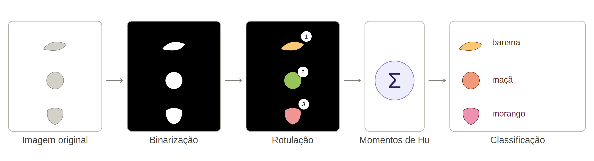
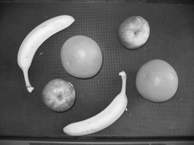
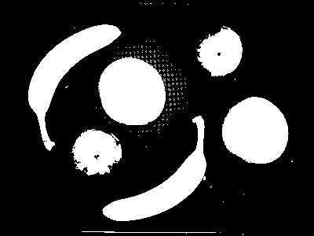
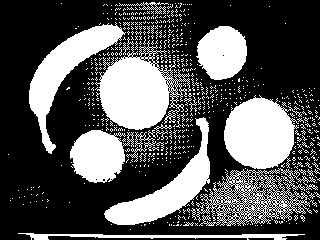
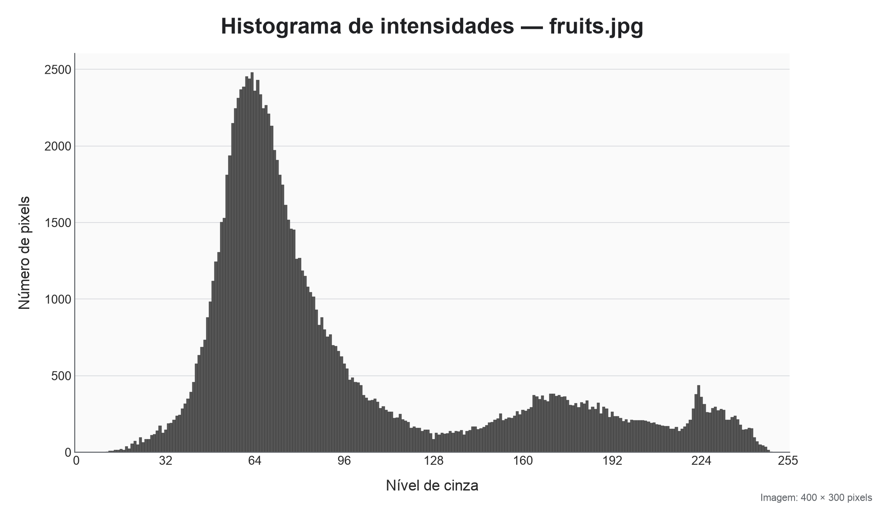
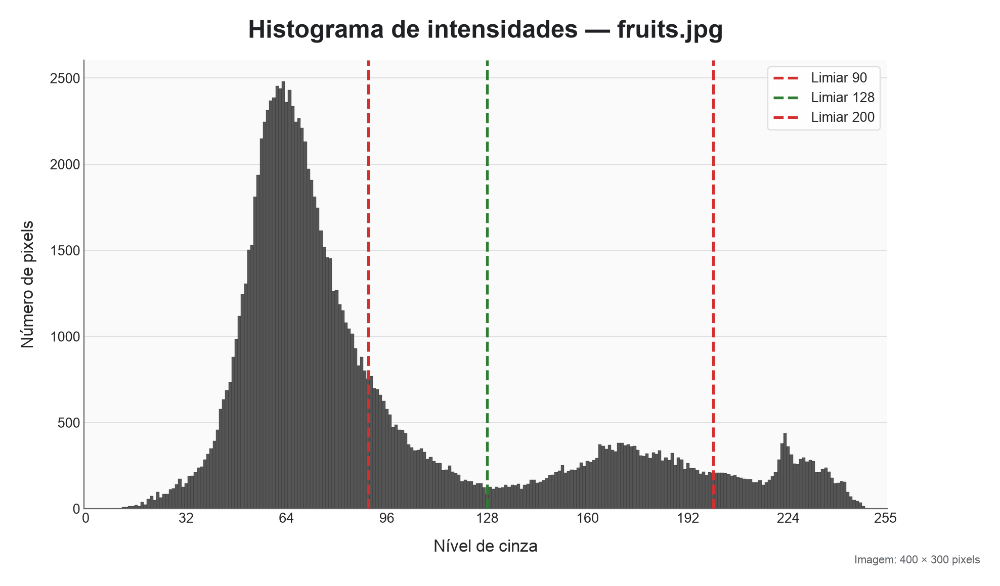
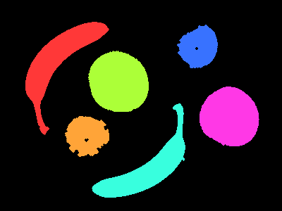
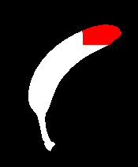

## Motivação

Imagine a situação em que imagens de vários objetos de interesse são
capturadas. O algoritmo deve classificar cada objeto:

- Localizar um objeto na imagem
- Informar a classe daquele objeto

---

## Motivação

Premissas:

1. Os objetos se distinguem facilmente do fundo da imagem
2. Os objetos possuem aparência uniforme
3. Os objetos se distinguem entre si por meio da sua forma

---

## Motivação

- Esta tarefa é conhecida como **classificação de objetos**
- Classificação de objetos: realizada em sistemas de *Machine Vision* há décadas

---

## Motivação

Aplicações que realizam este processamento:

- Imagens capturadas de objetos passando em uma esteira:
  - Classificação de frutas
  - Classificação de peças
- Classificação de células em imagens microscópicas
- Etc.

---

## Objetivos da aula

- Entender o que é segmentação e a sua necessidade
- Entender e aplicar um *pipeline* de reconhecimento de objetos
  baseado em segmentação
- Utilizar as ferramentas presentes em bibliotecas para segmentação

::: {.notes}
A estrutura da aula se dá sobre três pilares: conceito
("o que é separar uma imagem do fundo?"), algoritmo ("como fazer isto?")
e ferramenta ("que biblioteca faz isto"?)
:::

---

## Reconhecimento de Objetos por Segmentação: Pipeline

{width=100% fig-align="center"}

# Limiarização {transition="fade"}

## Limiarização

Dada uma imagem em níveis de cinza,
desejamos separar os objetos (*foreground*)
do fundo da imagem (*background*).

Partindo das premissas estabelecidas, podemos
fazer isto por *limiarização* (**thresholding**)

---

## Limiarização

Dada a imagem original $I$, uma imagem binária
$B$ de mesma dimensão é gerada após limiarização por:

$$
B(x,y)=
\begin{cases}
1, & I(x,y)>T \\
0, & I(x,y)\le T
\end{cases}
$$

Ou seja, pixels acima de um limiar $T$ recebem valor 1,
e recebem 0 caso contrário.

---

## Limiarização
### Exemplo

{width=48% fig-align="center"}
{width=48% fig-align="center"}

::: {.source}
Imagem exemplo retirada de
[https://sbirchfield.github.io/cvintro/](https://sbirchfield.github.io/cvintro/)
:::

---

## Limiarização
### Exemplo

Para este exemplo:

- Foi utilizado o valor de $T=128$
- Algumas partes do fundo da imagem estão com valor 1
- E se escolhermos outro valor?

---

## Limiarização
### Exemplo

::: {layout-ncol=2 style="text-align: center;"}

{width=100%}

{width=100%}

:::

---

## Limiarização

Como determinar um valor para $T$?

---

## Limiarização
### Utilização de Histograma

O histograma de uma imagem fornece a quantidade de vezes
que uma intensidade de pixel está nela presente:

{width=100% fig-align="center"}

---

## Limiarização
### Utilização de Histograma

$T$ pode ser determinado pelo valor que
divide os picos do histograma que pertencem aos objetos e que pertencem ao fundo:

{width=100% fig-align="center"}

---

## Limiarização
### Escolha automática do limiar

O algoritmo de Otsu pode ser utilizado para determinar o valor $T^*$
que melhor separa o histograma em duas classes $C_0$ e $C_1$.

---

## Limiarização
### Escolha automática do limiar

Para um dado valor $T$, o algoritmo calcula:

- A proporção de pixels $\omega_0(T) <= T$
- A proporção de pixels $\omega_1(T) > T$
- As intensidades médias de cada classe $\mu_0(T)$ e $\mu_1(T)$


---

## Limiarização
### Escolha automática do limiar

Então, a variância entre classes 

$$
\sigma_B^2(T)=\omega_0(T)\,\omega_1(T)\,[\mu_0(T) - \mu_1(T)]^2
$$

é calculada e em seguida o valor $T^*$ é determinado por

$$
T^*=\arg\max_T \; \sigma_B^2(T)
$$

---

## Limiarização
### Pós-processamento

Após a limiarização, é desejável remover o ruído ainda existente:

- Fundo não completamente removido dos objetos
- Sombras e reflexos dos objetos causam efeitos indesejáveis
  - Objetos com bordas finas
  - Objetos com buracos

---

## Limiarização
### Pós-processamento

Em imagens binárias, o pós-processamento envolve a combinação
de filtros morfológicos.

## Limiarização
### Pós-processamento

**Erosão**:

- Mantém o pixel igual a 1 se todos os vizinhos forem iguais a 1
- Tende a reduzir os pixels dos objetos

---

## Limiarização
### Pós-processamento

**Dilatação**:

- Atribui 1 ao pixel se pelo menos um vizinho dele for igual a 1
- Tende a aumentar os pixels dos objetos

---

## Limiarização
### Pós-processamento

Existem ainda duas operações compostas:

- **Abertura**: erosão seguida de dilatação
- **Fechamento**: dilatação seguida de erosão

Confira a bibliografia para mais informações em relação
aos filtros morfológicos

---

## Limiarização
### Pós-processamento

::: {layout-ncol=2 style="text-align: center;"}

{width=100%}

{width=100%}

:::

# Segmentação e Componentes Conexos {transition="fade"}

## Segmentação e Componentes Conexos

O próximo passo do pipeline é considerar pixels
de cor branca que são adjacentes como sendo um único grupo.

O algoritmo que realiza este processo é conhecido como **segmentação**.

Os grupos de pixels resultantes são denominados
**componentes conexos**.

---

## Segmentação e Componentes Conexos

A partir da imagem binarizada $B$, a segmentação produz regiões
$R_1,\ldots,R_n$ tais que:

$$
\bigcup_{i=1}^{n} R_i = B,
\qquad
R_i \cap R_j = \varnothing \quad (i\neq j)
$$

---

## Segmentação e Componentes Conexos

Segmentação de forma geral:

- Os pixels de uma região $R_i$ devem satisfazer algum critério de homogeneidade,
isto é, eles devem ser similares entre si
- Cada região $R_i$ é por definição um componente conexo

---

## Segmentação e Componentes Conexos

Observe que:

- Nada garante que cada região corresponda a um objeto físico, OU SEJA,
- Uma segmentação particiona a imagem de acordo com o seu padrão
  de intensidade

---

## Segmentação e Componentes Conexos

Entretanto, no nosso caso:

- Cada região $R_i$ não se mistura com o fundo (premissa 1)
- Os pixels de um mesmo objeto são similares (premissa 2)

---

## Segmentação e Componentes Conexos

Sendo assim, precisamos de um algoritmo que transforme
a imagem binarizada $B$ em uma imagem $L$ contendo os componentes
conexos.

---

## Segmentação e Componentes Conexos

::: {.columns}
::: {.column width="50%"}
**Imagem binária**

$$B(x,y)\in\{0,1\}$$

Indica "objeto" ou "fundo" por pixel

:::
::: {.column width="50%"}

{width=70%}

:::
:::

---

## Segmentação e Componentes Conexos

::: {.columns}
::: {.column width="50%"}

**Imagem de rótulos**

$$L(x,y)\in\{0,1,\ldots,K\}$$

Indica a qual região o pixel pertence

:::
::: {.column width="50%"}

{width=70%}

:::
:::

---

## Segmentação e Componentes Conexos

O algoritmo em questão:

- É de fácil compreensão e implementação
- Serve para o nosso caso e está de acordo com nossas premissas
- Possui versões alternativas com melhor tempo de execução e
  que cobre casos problemáticos específicos

---

## Segmentação e Componentes Conexos
### Algoritmo

```
para cada pixel p da imagem binarizada:

    se p é de objeto e ainda não foi marcado:

        adicione um novo rótulo a p
        flood_fill(p)
```

---

## Segmentação e Componentes Conexos
### `flood_fill`

O algoritmo `flood_fill` por sua vez funciona
de forma recursiva como:

```
para cada vizinho q de p:

    se q é pixel de objeto e ainda não foi marcado:

        adicione o rótulo atual a q
        flood_fill(q) 
```

---

## Segmentação e Componentes Conexos
### Vizinhança de 4 e 8

Para um pixel $p=(x,y)$:

$$
\begin{aligned}
N_4(p) &= \{(x-1,y),(x+1,y),(x,y-1),(x,y+1)\}\\
N_8(p) &= N_4(p)\cup\{(x\pm1,y\pm1)\}
\end{aligned}
$$

---

## Segmentação e Componentes Conexos

Algoritmo `flood_fill` no componente 0, com vizinhança $N_8$

{width=100% fig-align="center"}

# Momentos de Componentes Conexos {transition="fade"}

## Momentos de Componentes Conexos

Uma vez que a imagem $L$ com os rótulos foi produzida,
podemos utilizá-la para reconhecer classes de objetos:

- O componente conexo do rótulo 5 é uma maçã
- O componente conexo do rótulo 8 é um morango
- etc.

---

## Momentos de Componentes Conexos

Para isto, podemos calcular **estatísticas**
sobre os componentes

- Área
- Posição do centroide
- Orientação
- etc.

...

---

## Momentos de Componentes Conexos

... e então, dizer que objeto é cada componente conexo.
Isto funciona, tendo como princípio a premissa 3.

Este princípio é muito utilizado em Visão Computacional:
extração de características (*features*)

No tópico em questão, as features servem como descritores
de forma (*shape descriptors*)

---

## Momentos de Componentes Conexos

Para uma imagem em tons de cinza $I(x,y)$, o momento de ordem $(p+q)$ é:


$$
m_{pq}=\sum_x\sum_y x^p y^q I(x,y)
$$

---

## Momentos de Componentes Conexos

- Em imagem binária, $I(x,y)=1$ dentro do objeto e $0$ fora dele
- As potências de $x$ e $y$ ponderam a distribuição espacial dos pixels
- Os momentos servem para calcular as estatísticas dos componentes

---

## Momentos de Componentes Conexos
### $m_{00}$: área da região

Para $p=q=0$:

$$
m_{00}=\sum_x\sum_y I(x,y)
$$

Em uma imagem binária, cada pixel do objeto soma uma unidade.
Ou seja, $m_{00}$ é a área do componente conexo.

---

## Momentos de Componentes Conexos
### Momentos de Primeira Ordem e Centróide

Podemos calcular o centróide do componente
a partir dos seus momentos de 1a. ordem:

$$
m_{10}=\sum_x\sum_y xI(x,y),
\qquad
m_{01}=\sum_x\sum_y yI(x,y)
$$

$$
\bar{x}=\frac{m_{10}}{m_{00}},
\qquad
\bar{y}=\frac{m_{01}}{m_{00}}
$$

---

## Momentos de Componentes Conexos
### Momentos Centrais

Os momentos centrais usam coordenadas relativas ao centróide e
portanto, são invariantes à translação:

$$
\mu_{pq}=\sum_x\sum_y (x-\bar{x})^p(y-\bar{y})^q I(x,y)
$$

---

## Momentos de Componentes Conexos
### Momentos de Segunda Ordem

Os momentos $\mu_{20}$, $\mu_{02}$ e $\mu_{11}$
descrevem a dispersão da região em torno do centróide e
possuem matriz de covariância dada por:

$$
C=\frac{1}{\mu_{00}}
\begin{bmatrix}
\mu_{20} & \mu_{11}\\
\mu_{11} & \mu_{02}
\end{bmatrix}
$$

Seus autovetores indicam eixos principais. Seus autovalores têm relação
com os tamanhos dos eixos.

---

## Momentos de Componentes Conexos
### Exemplo 1

::: {layout-ncol=2 style="text-align: center;"}

{width=100%}

{width=100%}

:::

---

## Momentos de Componentes Conexos
### Exemplo 1

| Estatística | Figura A      | Figura B      |
|---|---:|---:|
| Área        | 5.209         | 5.209         |
| $\bar{x}$   | 81,48         | 431,48        |
| $\bar{y}$   | 86,13         | 86,13         |
| $\mu_{20}$  | 4.765.848,54  | 4.765.848,54  |
| $\mu_{02}$  | 7.263.543,59  | 7.263.543,59  |
| $\mu_{11}$  | −4.584.337,40 | −4.584.337,40 |

---

## Momentos de Componentes Conexos
### Momentos Centrais Normalizados

Para $p+q\ge 2$:

$$
\eta_{pq}=\frac{\mu_{pq}}{\mu_{00}^{\,\gamma}},
\qquad
\gamma=1+\frac{p+q}{2}
$$

Esta medida é invariante à escala uniforme:
a normalização compensa o crescimento dos momentos
quando o objeto aumenta ou diminui de modo uniforme

---

## Momentos de Componentes Conexos
### Exemplo 2

::: {layout-ncol=2 style="text-align: center;"}

{width=100%}

{width=100%}

:::

---

## Momentos de Componentes Conexos
### Exemplo 2

::: {style="font-size: 0.7em;"}

| Estatística | Tamanho T1            | Tamanho T2            |
|---|---:|---:|
| Área        | 5.209                 | 1.300                 |
| $\bar{x}$   | 81,48                 | 40,77                 |
| $\bar{y}$   | 86,13                 | 43,01                 |
| $\mu_{20}$  | 4.765.848,54          | 298.054,77            |
| $\mu_{02}$  | 7.263.543,59          | 450.518,94            |
| $\mu_{11}$  | −4.584.337,40         | −286.063,92           |
| $\eta_{20}$ | 0,18                  | 0,18                  |
| $\eta_{02}$ | 0,27                  | 0,27                  |
| $\eta_{11}$ | −0,17                 | −0,17                 |

:::

---

## Momentos de Componentes Conexos
### Momentos Invariantes de Hu

Para obter uma medida robusta a ruídos e invariância à rotações,
Hu propôs sete valores:

::: {style="font-size: 0.7em;"}
$$
\begin{aligned}
\phi_1 &=\eta_{20}+\eta_{02} \\
\phi_2 &=(\eta_{20}-\eta_{02})^2+4\eta_{11}^2\\
\phi_3 &=(\eta_{30}-3\eta_{12})^2+(3\eta_{21}-\eta_{03})^2\\
\phi_4 &=(\eta_{30}+\eta_{12})^2+(\eta_{21}+\eta_{03})^2\\
\end{aligned}
$$
:::

... (consulte a bibliografia para os outros 3 valores)

---

## Momentos de Componentes Conexos
### Invariâncias

| Momento           | Invariância                           |
|---                |---                                    |
| $m_{pq}$          | nenhuma em geral                      |
| $\mu_{pq}$        | translação                            |
| $\eta_{pq}$       | translação e escala uniforme          |
| Momentos de Hu    | translação, escala uniforme e rotação |

# Classificação de Objetos por Momentos {transition="fade"}

## Classificação de Objetos por Momentos
### Vetor de Características

Representando cada objeto por:

$$
\mathbf{h}=[\phi_1,\phi_2,\ldots,\phi_7]^T
$$

Podemos utilizar medidas de distância para comparar objetos:

$$
d(\mathbf{h}^{(a)},\mathbf{h}^{(b)})=
\left\|\mathbf{h}^{(a)}-\mathbf{h}^{(b)}\right\|_2
$$

---

## Classificação de Objetos por Momentos
### Vetor de Características

Então, podemos calcular o vetor $\mathbf{h_c}$ para imagens base
de cada classe $\mathbf{c}$ e então achar o vetor da classe
mais próximo a um vetor $\mathbf{h_k}$ de um componente conexo qualquer.

---

## Funções da OpenCV

Funções da OpenCV relacionadas ao tópico da aula:

::: {.columns}
::: {.column width="50%"}
- `cv2.threshold`
- `cv2.adaptiveThreshold`
- `cv2.findContours`
- `cv2.connectedComponents`
:::
::: {.column width="50%"}
- `cv2.erode`
- `cv2.dilate`
- `cv2.moments`
- `cv2.HuMoments`
:::
:::

---

## Guia de Leitura {.smaller}

- Segmentação e regiões: @haralick1992.
- Morfologia e momentos: @gonzalez2018.
- Descrição e comparação de formas: @nixon2019.
- Formulação dos invariantes: @hu1962.

---

## Sumário

Nesta aula:

- Pipeline a partir de premissas
- Limiarização e pós-processamento
- Segmentação por rotulação de componentes conexos
- Momentos de componentes conexos e classificação de objetos

---

## Referências {.smaller}

::: {#refs}
:::