## Visão Estéreo I

Nós humanos utilizamos os dois olhos para enxergar.

Por qual motivo?

Seres humanos e vários outros animais utilizam dois olhos para a obtenção da profundidade de objetos

## Visão Estéreo II

Em Visão Computacional:

- Visão Estéreo: utiliza dois sensores
- Mecanismo bioinspirado e matematicamente bem estabelecido
- Permite que seja a obtida a profundidade de pontos capturados pelas duas câmeras
- A mesma geometria de duas imagens vista anteriormente continua válida...

## Visão Estéreo III {.nostretch}

<video autoplay loop muted playsinline style="display: block; margin: 0 auto; width: 80%; height: 80%; object-fit: contain;">
  <source src="img/geometria_epipolar_para_estereo.mp4" type="video/mp4">
</video>

## Visão Estéreo IV {.nostretch}

::: {.columns}
::: {.column width="45%"}

... entretanto, com a pose relativa entre as câmeras sendo fixa:

- A pose relativa entre as câmeras é obtida por calibração
- A profundidade dos pontos e coordenadas 3D são obtidas com escala conhecida

:::
::: {.column width="55%"}

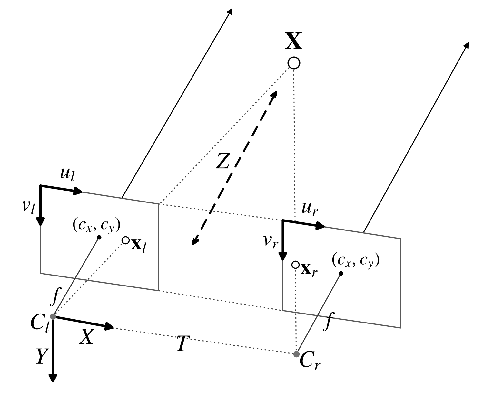{width=100% fig-align="center"}

:::
:::

## Visão Estéreo V

Ideia do processo:

- Achar um mesmo ponto nas duas imagens
- Utilizar modelo matemático para retroprojetar (*backproject*)
  para 3D os pontos 2D

## Visão Estéreo VI

Computacionalmente:

1. Calibração: obtenção dos parâmetros intrínsecos das duas câmeras e dos extrínsecos que relaciona as duas câmeras. Feito *offline*
2. Retificação: remoção de distorção e alinhamento virtual das câmeras
3. Correspondência: obtenção de um mesmo ponto nas duas imagens
4. Triangulação: calcular a profundidade a partir do modelo matemático

## Visão Estéreo VII {.nostretch}

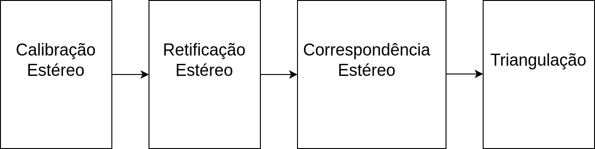{width=100% fig-align="center"}

## Visão Estéreo VIII {.nostretch}

::: {.columns}
::: {.column width="45%"}

- Acima: antes da retificação
- Abaixo: após a retificação. As linhas epipolares interceptam
  os mesmos pontos nas duas imagens

:::
::: {.column width="55%"}

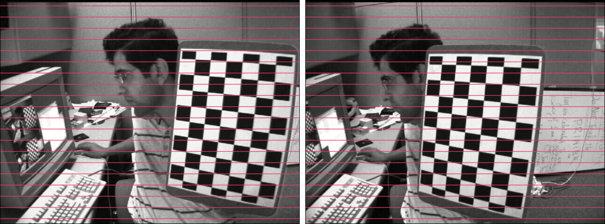{width=100% fig-align="center"}
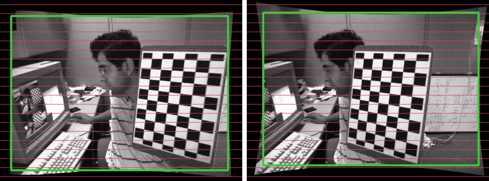{width=100% fig-align="center"}

:::
:::

## Visão Estéreo IX {.nostretch}

::: {.columns}
::: {.column width="45%"}

- Acima: imagem de disparidade
- Abaixo: imagem de profundidade, com escala em metros.
  A escala real é obtida a partir da calibração estéreo.

:::
::: {.column width="55%"}

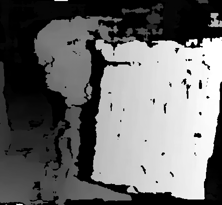{width=50% fig-align="center"}
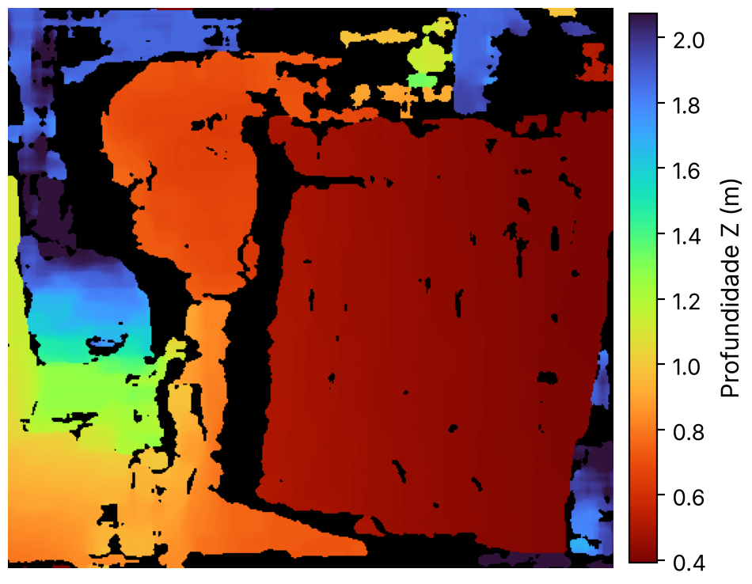{width=62% fig-align="center"}

:::
:::

# Etapa 1: Calibração estéreo

## Calibração Estéreo I

- Assume conhecidos os parâmetros intrínsecos das duas câmeras
- Calcula os parâmetros extrínsecos entre as duas câmeras
  - Rotação e translação que relaciona os dois sistemas de coordenadas
- Observe que também é possível trabalhar com estéreo não-calibrado (computando a Matriz Fundamental)

Para aplicações de robótica, o estéreo calibrado é mais confiável e possui melhor desempenho computacional.

## Calibração Estéreo II

Ideia do algoritmo – mesmos princípios da calibração monocular:

- Utilizar um padrão conhecido (ex.: padrão de xadrez)
- Apresentar várias imagens do padrão às duas câmeras
- Matematicamente, os parâmetros são encontrados por mínimos quadrados

## Calibração Estéreo – OpenCV I

A OpenCV possui uma função bem flexível para calibração.

Ela permite computar os parâmetros:

- Extrínsecos, dados os intrínsecos
- Extrínsecos, dados os intrínsecos como solução inicial,
  aplicando uma otimização para refinar estes últimos
- Extrínsecos e também os intrínsecos

Para a 3ª. opção, a quantidade de imagens com o padrão é maior, já que a quantidade de parâmetros a serem estimados também é.

## Calibração Estéreo – OpenCV II

`stereoCalibrate`: calibra um sistema de visão estéreo.

Parâmetros:

- Pontos no objeto (arrays de array numpy)
- Pontos na imagem esq. (arrays de array numpy)
- Pontos na imagem dir. (arrays de array numpy)
  - Estes três arrays devem conter um mesmo ponto no mesmo índice

## Calibração Estéreo – OpenCV III

`stereoCalibrate`: calibra um sistema de visão estéreo.

Parâmetros:

- Matriz com parâmetros intrínsecos da câmera esquerda
- Vetor com parâmetros de distorção da câmera esquerda
- Matriz com parâmetros intrínsecos da câmera direita
- Vetor com parâmetros de distorção da câmera direita
- Tamanho da imagem (largura x altura)

## Calibração Estéreo – OpenCV IV

`stereoCalibrate`: calibra um sistema de visão estéreo.

Parâmetros:

- Saída: matriz de rotação que relaciona a câmera esquerda com a direita
- Saída: vetor de translação que relaciona a câmera esquerda com a direita
- Saída: Matriz Essencial
- Saída: Matriz Fundamental

## Calibração Estéreo – OpenCV V

`stereoCalibrate`: calibra um sistema de visão estéreo.

Parâmetros:

- Saída: rotações do plano de calibração (por imagem)
- Saída: translações do plano de calibração (por imagem)
- Flag que informa como a função deve operar

# Etapa 2: Retificação estéreo

## Retificação Estéreo I

Processo responsável por alinhar virtualmente as duas câmeras:

- Devem ficar com planos de imagens coplanares
  - Eixos ópticos ficam paralelos
- Devem ficar com linhas epipolares correspondentes
  - Uma linha na imagem esquerda continua na mesma linha da imagem direita

Isto permite que a correspondência estéreo
seja realizada com menos custo computacional.

## Retificação Estéreo II {.nostretch}

<video autoplay loop muted playsinline style="display: block; margin: 0 auto; width: 45%; object-fit: contain;">
  <source src="img/retificacao_planos.mp4" type="video/mp4">
</video>

## Retificação Estéreo III {.nostretch}

::: {.columns}
::: {.column width="45%"}

Configuração estéreo ideal:

a retificação é responsável pelo alinhamento virtual das câmeras.

$l$ = *left* (câmera esquerda)

$r$ = *right* (câmera direita)

:::
::: {.column width="55%"}

{width=100% fig-align="center"}

:::
:::

## Retificação Estéreo IV {.nostretch}

::: {.columns}
::: {.column width="45%"}

Retificação:

- Remoção de distorção
- *Warp*
- Corte (crop) nas imagens: remove as partes sem informação de pixels

:::
::: {.column width="55%"}

{width=100% fig-align="center"}
{width=100% fig-align="center"}

:::
:::

## Retificação Estéreo V

Ideia do algoritmo:

Computar a transformação de *warping* a ser aplicada a cada imagem para as linhas epipolares ficarem coplanares e coincidirem.

Isto deve ser feito de forma a distribuir a deformação entre as duas imagens e maximizar a área comum.

## Retificação Estéreo VI

Ideia do algoritmo:

1. Dividir a rotação $R$ entre as câmeras: cada uma rotaciona metade, em sentidos opostos
2. Aplicar às duas uma mesma rotação que alinha o eixo $x$ com a linha de base: os epipolos vão para o infinito e as linhas epipolares ficam horizontais
3. Definir uma nova matriz de projeção comum (mesmas dist. focais e mesmo centro) e reprojetar as imagens

## Retificação Estéreo VII {.nostretch}

<video autoplay loop muted playsinline style="display: block; margin: 0 auto; width: 45%; object-fit: contain;">
  <source src="img/retificacao_bouguet.mp4" type="video/mp4">
</video>

## Retificação Estéreo – OpenCV I

`stereoRectify`: calcula novas matrizes de rotação $R_l$ e $R_r$ a serem aplicadas às poses da câmera esquerda e direita para retificação.

- Entradas: parâmetros intrínsecos e de distorção das duas câmeras, parâmetros extrínsecos e tamanho das imagens
- Saídas: matrizes $R_1$ e $R_2$, além das novas matrizes de projeção $P_1$ e $P_2$

A função aceita diversas configurações, como o controle sobre o tamanho da imagem de saída.

## Retificação Estéreo – OpenCV II

Com a saída de `stereoRectify`, o seguinte processo é realizado:

- Cada pixel na imagem retificada é retroprojetado para o plano
  $Z=1$
- A rotação de retificação é desfeita, voltando ao sistema original
- Aplica os parâmetros de distorção de câmera
- Projeta o resultado com a matriz de calibração $K$ original, obtendo
  as coordenadas de origem que devem ser retificadas

## Retificação Estéreo – OpenCV III

Na OpenCV, este processo é computado com duas funções:

- `initUndistortRectifyMap`: executada apenas uma vez porcâmera,
  após a calibração estéreo. Retorna as coordenadas de pixels
  que devem ser usadas para construir a imagem retificada
- `remap`: executada para cada par estéreo, para interpolar o resultado da 
  função anterior gerando a imagem retificada

## Retificação Estéreo - OpenCV IV {.nostretch}

<video autoplay loop muted playsinline style="display: block; margin: 0 auto; width: 45%; object-fit: contain;">
  <source src="img/remap_retificacao.mp4" type="video/mp4">
</video>

# Etapa 3: Correspondência estéreo

## Correspondência Estéreo I

Processo responsável por:

- Obter as coordenadas 2D $\mathbf{x}^l$ e $\mathbf{x}^r$ nas imagens esquerda e direita de um mesmo ponto 3D $\mathbf{X}$
- Com imagens previamente retificadas, a busca por correspondências é acelerada: ao invés da correspondência ser buscada em toda a imagem, ela é buscada em uma única linha

## Correspondência Estéreo II

O resultado da correspondência estéreo é chamado de
cálculo de **disparidade**:

- Diferença em pixels $x_l-x_r$ entre as coordenadas x de um mesmo ponto
- Forma uma tripla $[x_l, y, x_r]^t$ ou $[x_l, y_l, d]^t$
  - Lembre-se que em imagens retificadas, $y_l = y_r = y$
    e $x_r = x_l + d$
- Quanto maior esta diferença, mais próximo o ponto está da câmera

## Correspondência Estéreo III {.nostretch .smaller}

::: {.columns}
::: {.column width="45%"}

A profundidade $Z$ de um ponto é inversamente proporcional à sua disparidade:

- A relação é não-linear
- Pontos longe da câmera: pequenas diferenças na disparidade $\rightarrow$ grandes diferenças na profundidade
- A resolução do sistema é maior para pontos próximos

:::
::: {.column width="55%"}

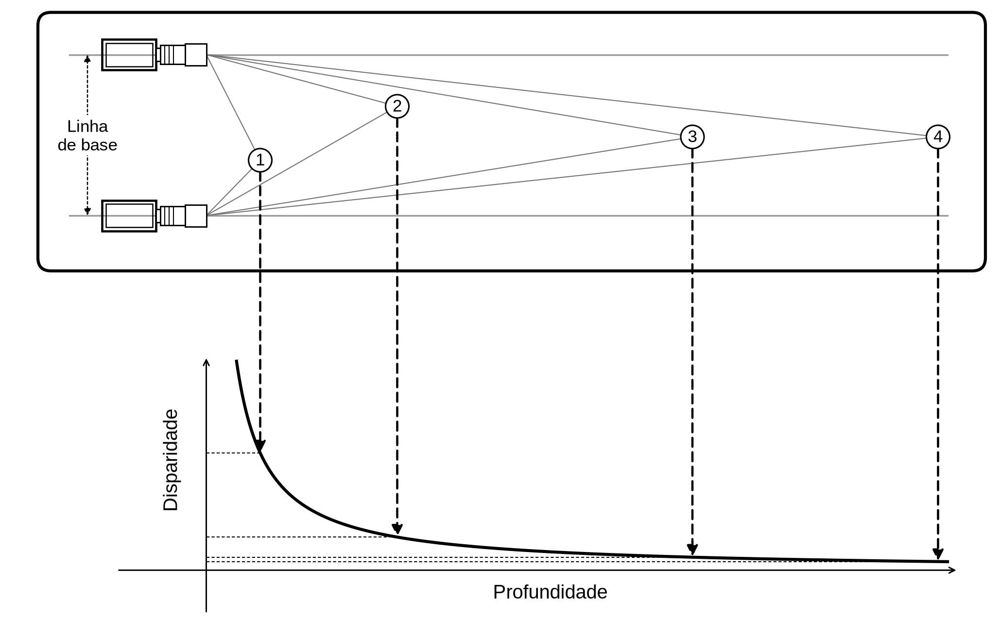{width=100% fig-align="center"}

:::
:::

## Correspondência Estéreo IV

Dois possíveis algoritmos:

- Algoritmo esparso: para cada feature da imagem esquerda, acha a correspondência na imagem direita
  - Usa features e descritores
  - Resulta na disparidade calculada para cada ponto
- **Algoritmo denso**: para cada ponto da imagem esquerda, obtém a correspondência na imagem direita
  - Usa *template matching*
  - Resulta em uma imagem chamada **mapa de disparidade**

## Correspondência Estéreo V

Para o algoritmo denso, a ideia é explorar imagens retificadas:

- A busca começa em uma posição inicial parametrizada e segue no
  sentido negativo do eixo x
  - Ou seja, a linha epipolar é percorrida a partir do ponto, para
    a esquerda
- Um intervalo de disparidades é utilizado para limitar as buscas
- Muito mais rápido do que buscar a correspondência na imagem toda

## Correspondência Estéreo VI

Cada disparidade corresponde a um plano de profundidade constante:
quanto mais próximo da câmera, menor é a diferença de profundidade
entre as disparidades.

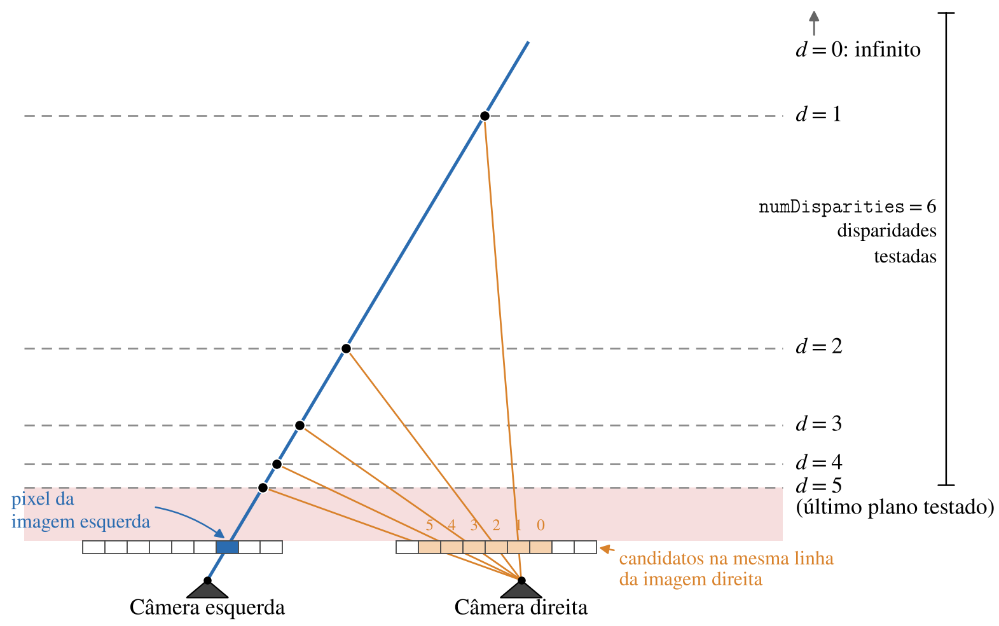{width=100% fig-align="center"}

## Correspondência Estéreo VII

Parâmetros do algoritmo denso:

- Tamanho de janela pequeno: mais detalhe, mais ruído
- Tamanho de janela grande: menos detalhe, menor acurácia

## Correspondência Estéreo VIII

Parâmetros do algoritmo denso:

- `minDisparity`: disparidade mínima (padrão é 0). Informa a
  disparidade mínima na busca, ou seja, o início da busca pela
  correspondência
- `numDisparities`: quantidade de disparidades. Junto com
  o parâmetro anterior, informa a quantidade de disparidades que um
  ponto pode ter como sendo `minDisparity + numDisparities - 1`

## Correspondência Estéreo IX

Observações importantes:

- Pontos mais próximos do que a faixa informada recebem disparidade
  inválida
- Aumentar `numDisparities` não melhora a resolução; ao invés disto,
  amplia o alcance em direção à câmera, a um custo maior de processamento e com uma faixa inválida maior na borda esquerda do mapa

## Correspondência Estéreo X {.nostretch}

::: {.columns}
::: {.column width="50%"}

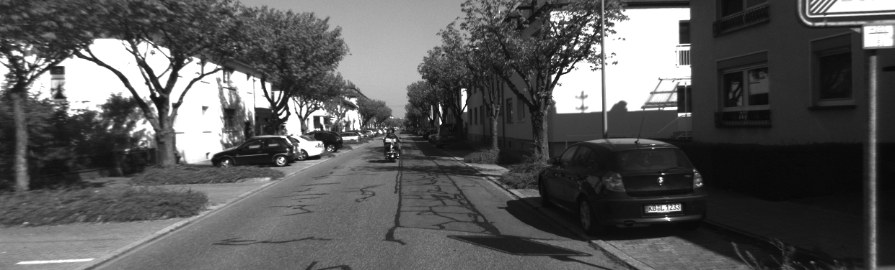{width=100% fig-align="center"}

:::
::: {.column width="50%"}

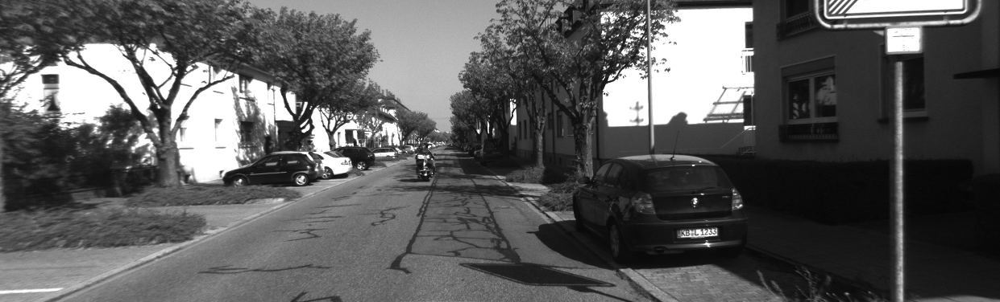{width=100% fig-align="center"}

:::
:::

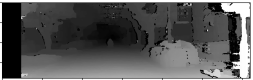{width=55% fig-align="center"}

Quanto mais próximo da cor branca, mais próximo o objeto está da câmera.

## Correspondência Estéreo – OpenCV I

Na OpenCV, estão presentes pelo menos 2 algoritmos para correspondência estéreo:

1. `StereoBM`: *block matching* simples $\rightarrow$ baixo custo computacional mas com mapa resultante de precisão limitada
2. `StereoSGBM`: *semi global block matching* $\rightarrow$ mapas de qualidade superior a um maior custo computacional

## Correspondência Estéreo – OpenCV II

`StereoBM.create`: cria um objeto do tipo *block matching*

Parâmetros:

- `minDisparity`: disparidade mínima esperada
- `numDisparities`: número de disparidades esperado (resolução do mapa). Precisa ser múltiplo de 16
- `blockSize`: tamanho do bloco. Precisa ser ímpar e maior do que 5

## Correspondência Estéreo – OpenCV III

`StereoSGBM.create`: cria um objeto do tipo *semi global block matching*

Novos parâmetros em relação ao `StereoBM`:

- `P1`: penalidade da disparidade por mudança de mais ou menos 1 entre pixels vizinhos. Quanto maior, mais suave será a disparidade
- `P2`: penalidade da disparidade por mudança maior que 1 entre pixels vizinhos. Quanto maior, mais suave será a disparidade
- `mode`: utilizar `cv2.STEREO_SGBM_MODE_SGBM_3WAY`

## Correspondência Estéreo – OpenCV IV

Em comum a ambos os algoritmos:

- `compute`: computa o mapa de disparidade para um par de imagens
- Parametrizá-los é uma tarefa necessária para cada aplicação específica
- O processo de parametrização é realizado empiricamente (tentativa e erro e uso de interface gráfica)

## Correspondência Estéreo - OpenCV V

O mapa de disparidade é geralmente armazenado
com o tipo `CV_16S`:

- Tipo inteiro com 16 bits, mas usado para armazenar nrs. reais
  com ponto fixo
- Convenção: 1 bit pro sinal, 11 bits pra parte inteira e os 4
  bit restantes para a parte decimal

## Correspondência Estéreo - OpenCV VI

O mapa de disparidade é geralmente armazenado
com o tipo `CV_16S`:

- A resolução do mapa é de $1/16 = 0,0625$ pixel. Ela é imposta
  quando os valores $d-1, d, d+1$ são interpolados para obter disparidade
  a nível de subpixel
- Assim, em cada posição do mapa, o valor armazenado é na verdade
  $16.d$: a disparidade real é obtida portanto por $d/16$
- Pixels sem correspondência recebem o valor
  `(minDisparity - 1) x 16`

# Etapa 4: Reconstrução estéreo

## Reconstrução Estéreo I

Processo responsável por:

- Calcular a profundidade (em unidades de medida) a partir do mapa de disparidade
- Realizado por aplicação de um modelo geométrico que relaciona o par de câmeras
- O resultado do processo é chamado de ***mapa de profundidade***

## Reconstrução Estéreo II

Premissas:

- Eixos ópticos das duas câmeras paralelos
- Planos de imagem das duas câmeras coplanares
- As duas câmeras possuem a mesma distância focal: $f = f^l = f^r$
- As duas câmeras estão separadas por uma distância $B$ (linha de base)

## Reconstrução Estéreo III

Premissas:

- As coordenadas horizontais dos centros de projeção das duas câmeras são iguais: $c_x^l = c_x^r$
- As duas imagens estão alinhadas por linha
- Um ponto 3D $\mathbf{X}$ no mundo pode ser achado sem ambiguidades nas câmeras esquerda $\mathbf{x}^l$ e direita $\mathbf{x}^r$
- A origem do sistema de coordenadas do sistema estéreo (*stereo rig*) está na câmera esquerda

## Reconstrução Estéreo IV {.nostretch}

::: {.columns}
::: {.column width="50%"}

Modelo geométrico - triangulação:

Obtenção da profundidade de um ponto (coordenada $Z$) através da imagem de um ponto em duas câmeras.

:::
::: {.column width="50%"}

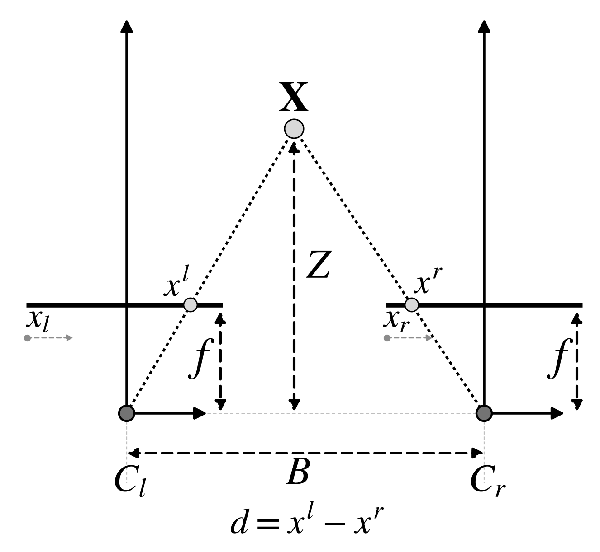{width=90% fig-align="center"}

:::
:::

## Reconstrução Estéreo V

Por semelhança de triângulos:

$$
\frac{B}{Z} = \frac{B - (x^r - x^l)}{Z - f}
$$

$$
Z = \frac{fB}{x^l - x^r}
$$

$$
Z = \frac{fB}{d}
$$

## Reconstrução Estéreo VI

Observe a importância dos parâmetros da correspondência estéreo
`minDisparity` e `numDisparities`:

Considere que o par estéreo possui $B = 0,1m$ e $f = 440$ px.
Para `minDisparity = 0` e `numDisparities = 160`, a profundidade
mínima do sistema será:

$$
Z_{min} = \frac{fB}{d} = \frac{440 \times 0,1}{160} = 27,5cm
$$

## Reconstrução Estéreo VII

Ainda com os mesmos parâmetros, observe a diferença das profundidades
$Z_1$ e $Z_2$, correspondentes aos planos inteiros obtidos com disparidades
$d=1$ e $d=2$ respectivamente:

$$
Z_{1} = \frac{fB}{d} = \frac{440 \times 0,1}{1} = 44m
$$

$$
Z_{2} = \frac{fB}{d} = \frac{440 \times 0,1}{2} = 22m
$$

Ou seja, 1 pixel de disparidade equivale a 22m de mudança de profundidade
para as maiores profundidades mensuráveis.

## Reconstrução Estéreo – Nuvem de Pontos 3D

Após a coordenada $Z_i$ de cada ponto  $i$ ser obtida, é possível obter uma nuvem de pontos 3D referenciado no sistema de coordenadas da câmera esquerda.

Para isto, aplica-se retroprojeção com o $Z_i$ conhecido:

$$
x_i = \frac{f_x X_i}{Z_i} + c_x \rightarrow X_i = \frac{Z_i(x_i - c_x)}{f_x}
$$

$$
y_i = \frac{f_y Y_i}{Z_i} + c_y \rightarrow Y_i = \frac{Z_i(y_i - c_y)}{f_y}
$$

## Reconstrução Estéreo – OpenCV I

`reprojectImageTo3D`: recebe a matriz `Q` e mapa de disparidade
computados pela `stereoRectify` e devolve a nuvem de pontos 3D
da cena. A matriz `Q` realiza a retroprojeção dos pontos.

## Reconstrução 3D Estéreo Interativa {.nostretch}

<iframe data-src="../../demos/visao_estereo.html"
        width="100%" height="580" style="border: none;"></iframe>

## Guia de leitura

- *Computer Vision: Algorithms and Applications* [@szeliski2022]
- *Introductory Techniques for 3-D Computer Vision* [@trucco1998]
- *Learning OpenCV* [@kaehler2016]
- *OpenCV Documentation: Camera Calibration and 3D Reconstruction* [@opencv_calib3d]

## Sumário

Nesta aula – Visão Estéreo:

- Calibração
- Retificação
- Correspondência
- Reconstrução
- Algoritmos da OpenCV

## Referências {.smaller .scrollable}

::: {#refs}
:::
